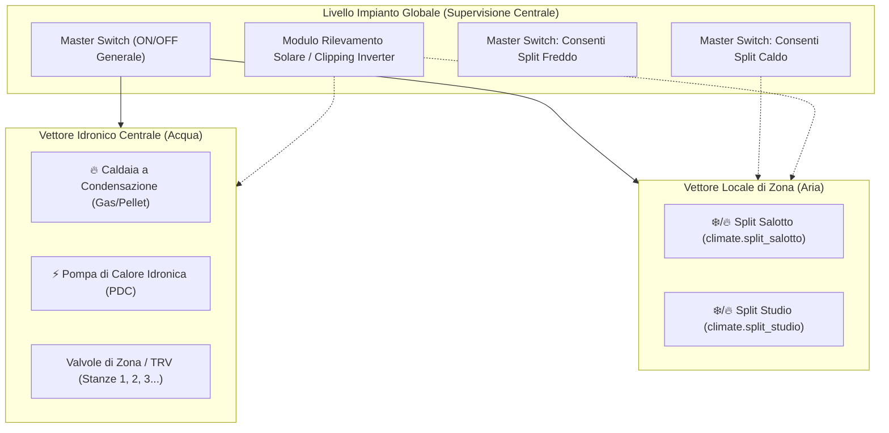

# 📋 Fase 11 — Specifiche Tecniche di Implementazione
## Gestione Ibrida Multi-Generatore, Integrazione Split di Zona, Autoconsumo Solare e Fondamenta Cooling

**Stato**: Prossima Fase di Sviluppo  
**Target Version**: v6.1.0 / v7.0.0  
**Data Definizione**: Novembre 2026  

---

## 1. 🌟 Visione Generale & Obiettivi

La **Fase 11** estende le capacità di Multizone Thermostat trasformandolo da regolatore mono-vettore ad **orchestratore energetico ibrido universale**. 

L'obiettivo è duplice:
1. **Separazione Architetturale dei Vettori Termici**:
   * **Livello Centrale Idronico (Acqua)**: Caldaia a gas/condensazione e Pompa di Calore (PDC) idronica in parallelo sullo stesso anello di distribuzione.
   * **Livello Locale di Zona (Espansione Diretta / Aria)**: Climatizzatori / Split (entità `climate.*`) associati alla singola stanza.
2. **Ottimizzazione Economica & Autoconsumo Fotovoltaico**:
   * Sfruttamento dell'eccesso solare o del clipping dell'inverter per accumulare calore gratuito nelle stanze dotate di split, azzerando l'uso del gas.
   * Completa flessibilità manuale per gli impianti privi di fotovoltaico.
   * Predisposizione strutturale per la **Modalità Estiva (Cooling)**.

---

## 2. 🏗️ Architettura a Due Livelli

---

## 3. ❄️ Integrazione Split di Zona (Attuatore Secondario / Ausiliario)

### 3.1. Configurazione nel Wizard di Zona (Zone Config Flow)
Nel flusso di configurazione della singola stanza, una nuova sezione pieghevole permetterà di abbinare un condizionatore:
* **Entità Climatizzatore**: selezione entità del dominio `climate.*` (Daikin, Mitsubishi, Sensibo, Tado, Tuya, ESPHome IR, ecc.).
* **Modalità Operativa Permessa**:
  * `Solo Raffrescamento`: lo split viene completamente ignorato durante la stagione invernale e lavorerà solo in estate.
  * `Solo Riscaldamento`: usato solo per il riscaldamento/boost invernale.
  * `Entrambi (Caldo & Freddo)`: abilitato in tutte le stagioni.

### 3.2. Le 3 Funzionalità di Zona (Toggle Indipendenti a Checkbox)
Ogni zona con split espone 3 comportamenti attivabili a piacimento:
1. [x] **🟢 Priorità Solare / Autoconsumo**: Quando il sistema globale rileva eccesso fotovoltaico, la stanza scalda prioritariamente via split a costo zero, bypassando la valvola del termosifone.
2. [x] **⚡ Shock Termico / Quick Heat Boost**: Se $\Delta T = (T_{\text{target}} - T_{\text{attuale}}) > \text{Soglia}$ (es. dislivello $> 1.5^\circ\text{C}$) o durante un evento di *Smart Return*, lo split si accende in supporto al termosifone per erogare calore immediato, spegnendosi non appena la stanza è vicina a target.
3. [x] **🎯 Pilotaggio Sonda Reale**: Multizone ignora la sonda a soffitto dello split e inietta setpoint dinamici basati sulla sonda a parete della stanza, eliminando i falsi spegnimenti anticipati.

### 3.3. Controlli Runtime su Dashboard (Senza Riconfigurazioni)
Per evitare che l'utente debba modificare impostazioni quando cambiano le stagioni o le preferenze:
* **Due Master Switch Globali**:
  * `switch.multizone_master_allow_split_heating` (Consenti Split in Caldo)
  * `switch.multizone_master_allow_split_cooling` (Consenti Split in Freddo)
* **Switch di Singola Zona (Opzionale)**:
  * `switch.multizone_{zona}_use_split` (Toggle rapido per escludere lo split in una specifica stanza).

---

## 4. ☀️ Gestione Autoconsumo Solare & Clipping Inverter

### 4.1. Opzionalità Totale (Zero Clutter per Impianti No-Solar)
* Se l'utente non possiede fotovoltaico, la scheda del solare viene **completamente bypassata**.
* In assenza di solare, la ripartizione tra Caldaia e Split/PDC è governata da un selettore manuale in dashboard (`select.multizone_heat_source_priority`):
  * `🔥 Priorità Caldaia (Gas)`
  * `⚡ Priorità Elettrico (Split / PDC)`
  * `🛑 Solo Caldaia a Gas` (Split inibiti)
  * `🚫 Solo Elettrico (Zero Gas)` (Caldaia inibita)

### 4.2. Opzioni di Rilevamento Eccesso Solare
Per gli utenti con fotovoltaico, il sistema supporta 4 metodi di rilevamento:

#### Metodo 1 — Sensore/Template Clipping Esistente (Plug & Play)
* Selezione dell'entità già configurata in Home Assistant (es. `sensor.inverter_stato` o `binary_sensor.*`).
* Valore di trigger (es. `Limitazione`, `clipping`, `on`).

#### Metodo 2 — Formula Nativa Off-Grid / Zero-Immissione (Built-in Logic)
Implementazione nativa nel core del template di riferimento:
$$\begin{aligned}
& \text{SOC Batteria} \ge 98\% \\
& \text{Stato Batteria} == \text{'idle'} \\
& |P_{\text{PV}} - P_{\text{Load}}| < 80\text{ W} \quad (\text{taglio produzione attivo}) \\
& P_{\text{PV}} > 300\text{ W} \quad (\text{luce diurna verificata})
\end{aligned}$$
* Parametri configurabili: soglia SOC (default 98%), delta tolleranza (default 80 W), soglia minima PV (default 300 W).

#### Metodo 3 — Impianti Grid-Tied con Immissione in Rete
* Sensore potenza immessa in rete (`sensor.grid_export_power`).
* Soglia attivazione in Watt (es. $> 1.500\text{ W}$ per almeno $N$ minuti).

#### Metodo 4 — Sistemi di Previsione Intelligente (EMHASS / Predbat)
* Entità segnale da EMHASS o Predbat per pre-riscaldamento solare programmato.

### 4.3. Le Due Modalità Operative Solari
Quando è attivo un surplus solare, l'utente può selezionare:
1. **Modalità 1 — Riscaldamento Globale Ibrido**:
   * Tutta la casa segue la programmazione.
   * Stanze SENZA split $\rightarrow$ si scaldano con la **caldaia a gas**.
   * Stanze CON split $\rightarrow$ **chiudono le valvole dei termosifoni** e usano gli **split a costo zero**.
2. **Modalità 2 — Solo Autoconsumo / Thermal Dumping (Zero Gas)**:
   * La **caldaia a gas rimane RIGOROSAMENTE SPENTA**.
   * Lavorano **esclusivamente gli split** per immagazzinare calore gratuito nelle stanze predisposte.

### 4.4. Salvaguardia Batteria (Battery Guard & Anti-Chatter)
* **Tempo Minimo di Accensione**: Gli split devono completare un ciclo minimo di lavoro (default 10–15 min) per preservare i compressori dai passaggi nuvolosi.
* **Stop Scarica Batteria**: Se il sole cala e la batteria entra in stato `discharging` per oltre $X$ minuti (o il SOC scende sotto una soglia di sicurezza, es. 92%), gli split vengono spenti e la batteria salvaguardata per la notte.

---

## 5. ❄️ Predisposizione per la Modalità Estiva (Cooling)

Questa architettura getta le fondamenta dirette per il raffrescamento:
* Introduzione del Master Switch Stagionale (`HVACMode.HEAT` / `HVACMode.COOL`).
* In estate, le zone con split operano come termostati di raffrescamento completi con profili orari e preset (`Comfort`, `Eco`, `Away`).
* Per le pompe di calore idroniche centrali (pavimento radiante estivo / fan-coil), apertura coordinata delle valvole e calcolo del punto di rugiada per protezione anti-condensa.

---

## 6. 📁 Piano di Modifica dei Componenti Software

1. `custom_components/multizone_thermostat/const.py`: Costanti, domini, tipi di attuatore ausiliario, modalità solari e chiavi di configurazione.
2. `custom_components/multizone_thermostat/config_flow.py`:
   * Nuova sezione ausiliaria nello Zone Options Flow (Split, ruoli, toggle).
   * Step condizionale Fotovoltaico/Autoconsumo (mostrato solo se presenti carichi elettrici).
3. `custom_components/multizone_thermostat/solar_manager.py`: Nuovo modulo per la gestione del clipping, immissione e logiche salvabatteria.
4. `custom_components/multizone_thermostat/zone_controller.py`: Gestione cooperativa tra valvola idronica e `climate` ausiliario con disaccoppiamento della domanda caldaia.
5. `custom_components/multizone_thermostat/switch.py` & `select.py`: Nuove entità runtime per Master Split Caldo/Freddo e selettore priorità sorgente.
6. `tests/test_phase11_hybrid_solar.py`: Suite di test completa (100% copertura bivalenza, clipping e commutazione).
