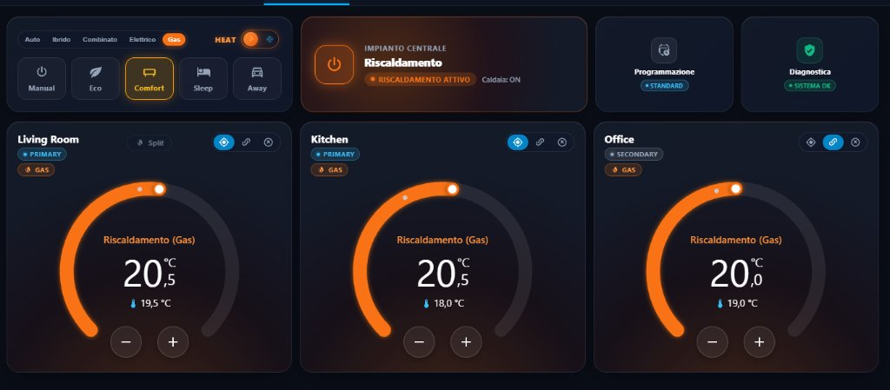
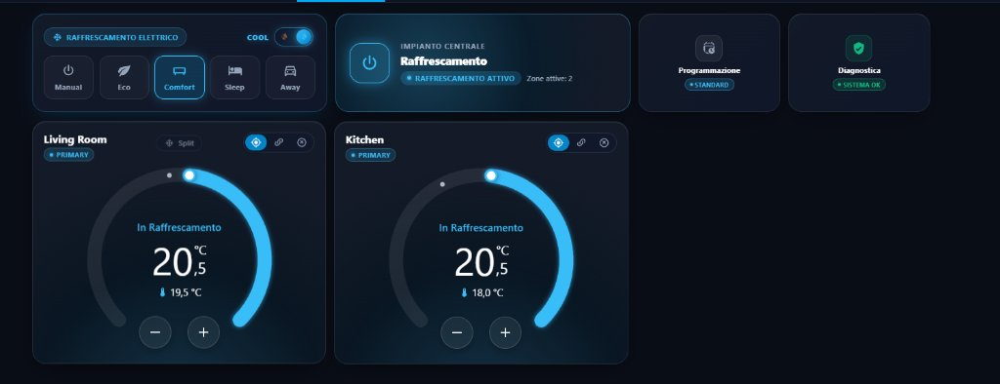

# Multizone Thermostat — Home Assistant Custom Integration

A comprehensive, 100% UI-configured custom integration for Home Assistant providing **multi-zone climate control**, **central plant supervision**, **adaptive PID autotuning**, and **building energy diagnostics** — with zero YAML automations required.

<table>
  <tr>
    <td align="center" width="50%">
      <b>🔥 Winter Heating (Gas Boiler &amp; Split Heat)</b>  
      
    </td>
    <td align="center" width="50%">
      <b>❄️ Summer Cooling (Electric Split &amp; Dual-Track)</b>  
      
    </td>
  </tr>
</table>

---

## ✨ Key Features

### Core Climate & Zone Management
- 🖥️ **100% UI Config & Options Flow**: Guided setup wizard with collapsible sections — no YAML editing required.
- 🔥 **Dual Boiler Drive**: Supports **ON/OFF Relay (PWM)**, **Modulating OpenTherm** (0–100% demand mapped to flow temperature), and **Centralized Condo / District Heating** (no boiler switch).
- 🧠 **Adaptive Autotuning (Hysteresis → Silent PID)**: Starts safely in Hysteresis, passively learns room thermal response, and transitions to continuous PID with weekly smoothed EMA and per-zone manual tuning controls.
- 🏠 **Hierarchical Zone Modes**: Per-zone `Primary`, `Secondary` (passive heat sharing), and `Bypass` selector directly on Lovelace cards.
- 🎛️ **Broad Actuator Support**: Smart TRVs (`climate.*`, multi-TRV aggregation, physical dial sync, `external_temperature_input` feed & `select.*` sensor-source switching, **Demand-Driven** bounded overdrive), **0–100% / 0–10V proportional valves**, and **PWM relay actuators**.
- 📅 **Weekly Scheduling, Geofencing & Smart Return**: Visual 24h schedule matrix, Local Calendar integration, presence-based presets, and predictive pre-heating based on room inertia.

### Hybrid Plant, Cooling & Solar *(v6.1.0-beta)*
- 🔄 **Bivalent Central Plant**: Arbitrates between Gas Boiler and Central Hydronic Heat Pump (`auto`, `hybrid`, `combined`, `electric_only`, `gas_only`).
- ❄️ **Room Split AC Integration**: Per-zone split units with ceiling sensor bypass (target injection), Quick Heat Boost, and automatic hydronic decoupling.
- ☀️ **Off-Grid & Solar Self-Consumption**: Inverter anti-clipping, battery discharge safeguard, night SoC reserve, and EMHASS / Predbat bridge.
- 🌡️ **Four-Season Dual-Track Engine**: Independent winter/summer preset memories, dual-track PID loops, indoor dew-point anti-condensation, and automatic summer card filtering.

### Safety, Diagnostics & Lovelace UI
- 🛡️ **Plant & Pipe Safeguards**: Anti-short-cycle timers (boiler & heat pump), motorized valve opening delay & **TRV hydraulic valve-readiness guard (`HOLD_TRV_CLOSED`)**, summer anti-seize exercise, persistent anti-frost protection, and window-open cutouts.
- 🚨 **Hydraulic & Energy Diagnostics**: Stuck-valve, TRV non-opening (`trv_not_opening`), and ghost-heating detection, wireless sensor watchdog with TRV fallback, OpenTherm telemetry & DHW priority, European Energy Class (`A4`–`G`), and thermal retention metrics.
- 🎨 **Visual Twin Lovelace Cards & Auto-Dashboards**: Custom cards matching Home Assistant native styling and auto-generated dashboard strategies in **6 languages** (`EN`, `IT`, `ES`, `FR`, `DE`, `RU`).

---

## 📚 Official Documentation Wiki & Live Simulator

All detailed guides, configuration references, services, YAML examples, and troubleshooting live in our **Official Bilingual Wiki**:

- 📖 **Official Wiki (English)**: [https://alex-military.github.io/multizone-thermostat/](https://alex-military.github.io/multizone-thermostat/)
- 📖 **Wiki Ufficiale (Italiano)**: [https://alex-military.github.io/multizone-thermostat/wiki/index.html#/it/home](https://alex-military.github.io/multizone-thermostat/wiki/index.html#/it/home)
- 🎮 **Interactive Live Simulator**: [https://alex-military.github.io/multizone-thermostat/wiki/simulator.html](https://alex-military.github.io/multizone-thermostat/wiki/simulator.html) (6 languages)
- 🚀 **[Project Roadmap](ROADMAP.md)** &nbsp;|&nbsp; 📋 **[Changelog](CHANGELOG.md)**

---

## 📥 Installation

### Via HACS (Recommended)

1. Open **HACS** → **Custom repositories** → add `https://github.com/alex-military/multizone-thermostat` as **Integration**.
2. Search for **"Multizone Thermostat"**, click **Download**, and restart Home Assistant.

### Manual Installation
1. Copy `custom_components/multizone_thermostat` into your Home Assistant `custom_components/` directory.
2. Restart Home Assistant.

---

## Acknowledgments

A special thanks to the creators of [SmartThermostat](https://github.com/ScratMan/HASmartThermostat) and [vindaalex/multizone-thermostat](https://github.com/vindaalex/multizone-thermostat) for inspiring the core PID and autotuning logic.

## Support & Donations

If you find this integration helpful and would like to support its ongoing development, consider buying a coffee!

  
  &nbsp;&nbsp;
  

---

## License

This project is licensed under the MIT License.
