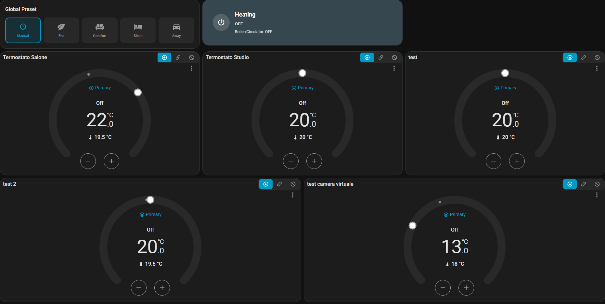
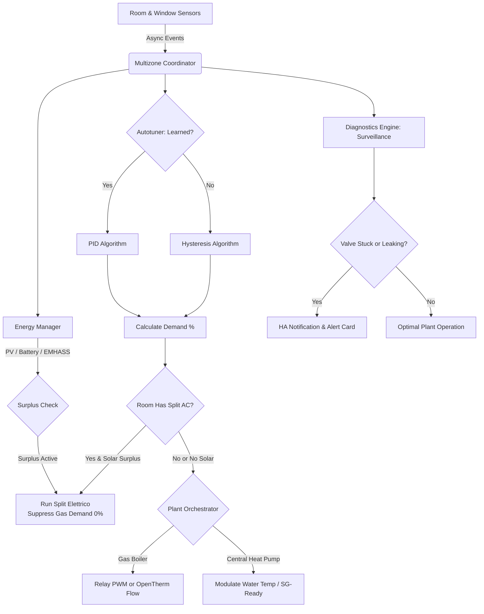

# Multizone Thermostat — Home Assistant Custom Integration

> [!IMPORTANT]
> **🚀 Beta Testing Release: v6.1.0-beta.1 (Phase 11: Hybrid Plant, Room Split AC & Solar Energy Management)**
> You are viewing the **`beta` branch**. This version introduces bivalent heating orchestration (Gas Boiler + Central Hydronic Heat Pump), per-room Split AC air conditioners with ceiling sensor bypass, off-grid & solar self-consumption optimization (with EMHASS/Predbat bridge and battery safeguards), dual-track seasonal regulation (Heat & Cool), and 1-to-1 visual twin Lovelace cards.

A comprehensive custom integration for Home Assistant that provides **multi-zone heating & cooling management**, **bivalent boiler & heat pump supervision**, **room split AC integration**, **solar self-consumption & battery protection**, **dual-drive OpenTherm/Relay modulation**, and **building energy diagnostics**. No YAML automations or scripts required — everything is configured seamlessly through the Home Assistant UI.

---

## 🌟 What Makes This Unique?

1. **Bivalent Hybrid Plant (Boiler + Central Hydronic Heat Pump) (v6.1.0-beta)**: Staged, intelligent arbitration between gas boilers (Relay PWM or OpenTherm) and central heat pumps (`climate`, `switch`, or `number`). Supports reversible summer hydronic cooling (fancoils/radiant floor) with strict gas boiler lockout.
2. **Per-Zone Split AC Integration with Ceiling Sensor Bypass (v6.1.0-beta)**: Assigns room air conditioners (`climate.*`) to work alongside radiators. Features dynamic mathematical injection from the real eye-level room sensor to overcome ceiling hot-air pooling, Quick Heat Boost thermal shock acceleration, and automated hydronic decoupling to save fuel.
3. **Off-Grid Solar Self-Consumption & Battery Safeguard (v6.1.0-beta)**: Automatically detects inverter clipping and solar surplus even without grid export. Features active battery discharge timeout protection (reverts to gas if household battery is drained for >5 min), minimum SoC night reserve, and direct bridge for EMHASS and Predbat optimizers.
4. **Dual-Track Seasonal Engine (Heat & Cool) (v6.1.0-beta)**: Independent PID controllers and passive Ziegler-Nichols autotuning for winter heating and summer cooling. Presets (*Comfort, Eco, Sleep, Away, Manual*) remember separate target temperatures for summer and winter.
5. **Dual Boiler Drive (Relay PWM & OpenTherm Modulating)**: Seamlessly operates with traditional ON/OFF relay boilers via Time-Proportional Integral (PWM) cycles, or with modern OpenTherm modulating gateways by mapping real-time house Heat Demand % (0-100%) to boiler water flow temperature ($35^\circ\text{C} - 75^\circ\text{C}$).
6. **Dynamic Autotuning (Hysteresis → Silent PID)**: Starts in Hysteresis mode, studies each room's thermal dispersion over time, and smoothly transitions to a self-tuned PID controller without user intervention to eliminate temperature swings.
7. **Hierarchical Zones (Primary vs Secondary vs Bypass)**: Primary zones can trigger boiler ignition. Secondary zones only open valves passively to "steal" heat when the boiler is already active, conserving fuel. Bypassed zones exclude rooms completely.
8. **Physical TRV Override & Offset Injection**: The Multizone Coordinator intercepts TRVs attached to hot radiators and injects mathematical offsets or dynamic setpoints to force the valve to obey a clean, external room temperature sensor.
9. **Hydraulic Anomaly Surveillance Engine**: Continuously monitors each heating circuit for mechanical faults, detecting stuck closed valves, ghost heating leakage, and sensor lag, issuing native Home Assistant persistent notifications.
10. **Building Energy & Thermal Retention Metrics**: Automatically estimates each room's theoretical European energy class (A4 through G), thermal retention time (hours required to drop 1°C), and radiator power sizing.
11. **Visual Twin Lovelace Cards & Dashboard Strategies**: Glassmorphic custom cards matching native HA styling 1-to-1, direct arc click temperature control, active source badges (`🔥 GAS`, `⚡ ELETTRICO`, `🔥⚡ GAS + ELETTRICO`), and full multilingual localization (**English**, **Italian**, **Spanish**, **French**, **German**, **Russian**).

---

## ⚡ Complete Feature Matrix

### Bivalent Plant & Hybrid Climate (v6.1.0-beta)
- 🔄 **Multi-Generator Staging (`PlantOrchestrator`)**: Arbitrates between Gas Boiler and Central Heat Pump based on 5 configurable priority modes: `auto`, `hybrid`, `combined`, `electric_only`, and `gas_only`.
- ❄️ **Reversible Hydronic Cooling (`heat_pump_cooling`)**: Supports radiant floor or fancoil cooling in summer, strictly locking gas combustion to 0%.
- ⚡ **Full Electric Mode**: Fully functional with central heat pumps or room splits alone without any gas boiler configured.

### Room Split AC Integration (v6.1.0-beta)
- 🎯 **Per-Zone Split Unit Association**: Connects room air conditioners (`climate.*`) as secondary/auxiliary climate actuators with configurable roles (`heat_cool`, `heating_only`, `cooling_only`).
- 🌡️ **Ceiling Sensor Bypass (Target Injection)**: Compensates for ceiling heat accumulation by continuously injecting corrected targets based on real room sensor measurements.
- 🚀 **Quick Heat Boost (Thermal Shock)**: Engages the split alongside radiators when cold ($\Delta T \ge 1.5^\circ\text{C}$), automatically disengaging once comfort is reached ($\Delta T \le 0.3^\circ\text{C}$).
- 🛑 **Automatic Hydronic Decoupling**: Suppresses gas demand to `0.0%` for rooms currently heating with the electric split.
- 🔘 **Independent Room Split Manual Button**: Header button on the Dial card allowing single-room electric split run when Master heating is OFF, with automated safety lockout when Master is active.

### Solar Self-Consumption & Energy Management (v6.1.0-beta)
- ☀️ **Off-Grid & Inverter Clipping Detection**: Triggers electric surplus heating based on Battery SoC ($\ge 95\%$) and PV generation ($\ge 300\text{ W}$) before zero-export inverters throttle panel production.
- 🛡️ **Battery Anti-Discharge Safeguard**: Automatically cancels electric surplus and restores gas baseline if the battery discharges ($> 150\text{ W}$) continuously for more than 5 minutes.
- 🔋 **Night Battery Reserve SoC**: Ensures battery does not drop below a user-defined threshold (e.g. 50-85%) for heating.
- 🤖 **EMHASS & Predbat Integration**: Native support for boolean signals and numerical deferred load sensors (`p_deferrable0 > 0 W`).
- 🏠 **Solar Thermal Overheating Offset**: Configurable boost ($0.0^\circ\text{C} \dots +3.0^\circ\text{C}$) to store free solar thermal energy into walls and floors during sunny hours.
- ⏱️ **Compressor Anti-Chatter Protection**: 10-minute minimum cycle run time protects inverter compressors from cloud transients.

### Core Climate & Zone Management
- 🖥️ **100% UI Config Flow & Collapsible Sections (v5.0.1)**: Clean, accordion-style configuration wizard organized into collapsible sections (*TRVs*, *Proportional & 0-10V Valves*, *Relay Actuators*, *Room Split AC*, *Protections & Advanced Settings*) without YAML.
- 🎛️ **Proportional & 0-10V Valve Control (v5.0.1)**: Direct, continuous opening control for motorized actuators, underfloor manifolds, and direct-pin TRVs. Supports both percentage (`0-100%`) and analog voltage (`0.0-10.0 V`) via `valve` or `number` entities with integrated bus anti-chatter deadband.
- 🔘 **Master Switch & Seasonal Commutation**: One central switch to enable or disable the entire system, with seamless seasonal toggle between Heating 🔥 and Cooling ❄️.
- 🏠 **Hierarchical Zone Modes**: Per-zone selector (`Primary`, `Secondary`, `Bypass`) accessible directly from Lovelace cards.
- 📍 **Geofencing & Dynamic Presence**: Automatically switches to Away or Sleep presets based on home occupancy sensors.
- 🪟 **Window Sensor Detection**: Automatically bypasses a zone when a window is opened, and restores it when closed.
- 🌡️ **Virtual Thermostats**: Combine any simple heater switch (relay, underfloor actuator) and temperature sensor into a fully featured PID climate entity.
- 🧠 **Multi-TRV Aggregation**: Group multiple TRVs in the same room; the system automatically calculates their average temperature and syncs their targets.
- 🔄 **Dual-Track Presets & Dynamic Memory**: Manual, Eco, Comfort, Sleep, Away. Presets store independent temperatures for winter heating and summer cooling.
- 📅 **Global Calendar Integration & Predictive Smart Start**: Schedules presets via Home Assistant's native Local Calendar and preheats rooms ahead of time based on learned thermal retention models.
- 🌤️ **Adaptive Weather Compensation**: Dynamic Feed-Forward heating adjustment based on an outdoor temperature sensor. The system automatically learns each room's thermal dispersion to adapt the compensation curve.

### Hardware Protection & Safety
- 🛡️ **Anti-Short-Cycle Engine**: Configurable minimum ON and minimum OFF times to prevent rapid boiler cycling and extend burner relay lifespan.
- ⏱️ **Valve Opening Delay**: Configurable delay to ensure thermoelectric actuators have fully opened before igniting the boiler.
- 🐕 **Watchdog Sensor Timeout & TRV Fallback (v4.7)**: Configurable per zone (`sensor_timeout_min`). If an external wireless sensor drops offline or its battery runs out, the zone automatically falls back to the TRV's internal temperature probe to maintain heating, automatically restoring once the external sensor recovers.
- ❄️ **Anti-Frost Protection Override (v4.3)**: Global safety override with dedicated switch (`switch.multizone_thermostat_anti_frost_protection`) and threshold control (`number.frost_protection_temp`). Forces emergency heating at 100% demand when room temperature drops below frost threshold, ignoring open window and master off blocks to prevent frozen pipes.
- ☀️ **Summer Anti-Seize Protection**: Cyclical exercise of boiler pumps and zone valves during idle summer months to prevent mechanical seizure.
- 🔄 **Bidirectional Physical Climate Sync (v4.3)**: Dynamic toggle switches allowing physical hardware buttons on TRVs to propagate setpoint adjustments to the virtual zone without fighting, with parental lock capability.

### Plant Diagnostics & Building Efficiency (v4.5 - v4.7)
- 🔍 **Central Plant Health Monitoring**: Real-time tracking of boiler ignition frequency (cycles/hour), cumulative 24h runtime, and real-time state reasons.
- 🔥 **OpenTherm Telemetry & Error Bus (v4.7)**: Automatic discovery of water pressure (Bar), return temperature (°C), flame active state, burner modulation %, and OEM fault codes. Includes DHW (Domestic Hot Water) priority detection to freeze zone PID loops during hot water draw-off.
- 🔋 **Universal Battery Surveillance (v4.7)**: Automatically resolves battery charge levels across Zigbee2MQTT, ZHA, and Tuya/Avatto devices, displaying battery percentages in thermostat attributes and diagnostic cards.
- 🚨 **Mechanical Anomaly Detection**: Automatic detection of stuck valves (heat demanded for >45m but room temperature drops) and ghost heating leakage (room temperature rises while valve is closed).
- ♨️ **Apporto Termico Passivo (Passive Heat Intake)**: Switchable per zone (`allow_passive_heat`), tailored for open lofts, mezzanines, or fan coils without cutoff valves to prevent false ghost-heating alerts.
- 📊 **European Building Energy Classes (A4 → G)**: Theoretical energy grade calculated from thermal dispersion and outdoor weather $\Delta T$.
- ⏱️ **Thermal Retention Time**: Displays estimated hours needed for each room to lose $1.0^\circ\text{C}$.
- 📐 **Radiator Sizing Evaluation**: Identifies whether the heating emitter is optimal, undersized, or oversized for the space.
- 🩺 **HA Native Diagnostics & Trace Engine (v4.4)**: Downloadable JSON diagnostics directly from Home Assistant's device settings.

---

## 🎨 Custom Lovelace Cards & Strategies

Multizone Thermostat includes custom Lovelace cards and auto-dashboard strategies, automatically registered in Home Assistant:

| Card / Strategy | Lovelace Type | Zero-Config? | Description |
| :--- | :--- | :---: | :--- |
| **Central Plant Health Card** | `custom:multizone-thermostat-plant-card` | ✅ Yes | Real-time burner/PDC telemetry, short-cycle ignition frequency, and active hydraulic anomalies list. |
| **Zone Energy Efficiency Card** | `custom:multizone-thermostat-zone-energy-card` | Configurable | Theoretical European Energy Class (A4-G), thermal retention time (-1°C), radiator sizing, and valve surveillance. |
| **Central Heating Status Card** | `custom:multizone-thermostat-status-card` | ✅ Yes | Master card showing generator states (`Caldaia: ON`, `Caldaia: ON + Split`, `Split Elettrico: ON`), cyan cooling aura, and one-click toggle. |
| **Dial Thermostat Card** | `custom:multizone-thermostat-dial-card` | Configurable | 1-to-1 visual twin of native HA thermostat: 14px dial stroke, direct arc click/touch target setting, [-]/[+] step buttons, active source badges (`🔥 GAS`, `⚡ ELETTRICO`), and local split manual button. |
| **Button Thermostat Card** | `custom:multizone-thermostat-button-card` | Configurable | Compact card with `+` / `-` controls, HVAC modes, zone mode selector, and active source badge. |
| **Global Preset Card** | `custom:multizone-thermostat-preset-card` | ✅ Yes | Multi-preset bar with constant height, priority segmented pill selector (`Auto`, `Ibrido`, `Combinato`, `Elettrico`, `Gas`), and Caldo 🔥 / Freddo ❄️ master slider. |
| **Weekly Scheduler Card** | `custom:multizone-thermostat-scheduler-card` | ✅ Yes | Interactive 24h timeline matrix view, multi-profile management, and predictive Smart Return arrival planner. |
| **Auto Thermostats View Strategy** | `custom:multizone-thermostat-dashboard` | Strategy | Auto-generates a complete responsive climate dashboard with presets, master switch, and zone cards. |
| **Auto Diagnostics View Strategy** | `custom:multizone-thermostat-diagnostics` | Strategy | Auto-generates a full diagnostic view with plant health supervisor and energy efficiency cards for all zones. |

> [!NOTE]
> All Lovelace cards automatically adapt to the user's Home Assistant language setting (**English**, **Italian**, **Spanish**, **French**, **German**, and **Russian** supported natively).

---

## 🔥 OpenTherm & Bivalent Hybrid Support

Multizone Thermostat features a **multi-drive architecture** allowing seamless operation with traditional relay boilers, modulating OpenTherm gateways, and central heat pumps:

- **Relay Mode (ON/OFF PWM)**: Uses Time-Proportional Integral (PWM) duty cycles to switch the boiler relay based on the calculated Heat Demand %, strictly respecting anti-short-cycle rules.
- **OpenTherm Mode (Modulating)**: Directly modulates the boiler water flow temperature according to real-time house demand.
- **Central Heat Pump Drive**: Regulates water flow setpoint and mode (`heat`/`cool`) for bivalent or full-electric heat pump installations.

### Heat Demand Mapping (0-100% to Water Temperature)

In OpenTherm or Heat Pump modulating mode, the coordinator translates the house's total calculated **Heat Demand %** ($0\%$ to $100\%$) into a precise target setpoint for water flow temperature, mapped linearly between configured Minimum Water Temperature ($T_{\text{min}}$) and Maximum Water Temperature ($T_{\text{max}}$):

$$\text{Water Temperature} = T_{\text{min}} + \left( \frac{\text{Demand \%}}{100} \times (T_{\text{max}} - T_{\text{min}}) \right)$$

---

## 🏗️ System Architecture

---

## 🎮 Interactive Live Simulator & Diagnostics Showcase

Experience the diagnostic supervision and building energy calculation features directly inside your browser. Multizone Thermostat provides a standalone web simulator running the exact same frontend algorithms as the Home Assistant Lovelace cards:

- **Live Web App**: [https://alex-military.github.io/multizone-thermostat/](https://alex-military.github.io/multizone-thermostat/)
- **Offline / Local**: Open [`docs/index.html`](docs/index.html) directly in any browser.

---

## Installation

### Via HACS (Recommended)

1. Open HACS in your Home Assistant instance.
2. Click the three dots in the top right corner and select **Custom repositories**.
3. Add `https://github.com/alex-military/multizone-thermostat` as an **Integration**.
4. In HACS, enable **"Show beta versions"** to receive this v6.1.0-beta release.
5. Search for **"Multizone Thermostat"** in HACS and click **Download**.
6. Restart Home Assistant.

### Manual Installation
1. Copy the `custom_components/multizone_thermostat` folder to your Home Assistant `custom_components` directory.
2. Restart Home Assistant.

---

## Documentation Hub

Explore our dedicated documentation pages for deep dives:

- 🌿 **[Hybrid Plant, Room Split AC & Energy Management Guide](hybrid_and_energy.md)**: Bivalent arbitration, split AC roles, real sensor injection, solar clipping & battery protection, dual-track seasonal cooling.
- ⚙️ **[Configuration & Setup Guide](configuration.md)**: Hardware aggregation, setup wizard, virtual thermostats, geofencing, calendar scheduling, anti-frost, and summer protection.
- 🎨 **[Lovelace Custom Cards & Dashboard](cards.md)**: Detailed configuration, YAML examples, visual twin styling, and strategies for all custom cards.
- 🚀 **[Project Roadmap](ROADMAP.md)**: Development phases, completed milestones, and future features.

---

## Acknowledgments

A special thanks to the creators of [SmartThermostat](https://github.com/ScratMan/HASmartThermostat) and [vindaalex/multizone-thermostat](https://github.com/vindaalex/multizone-thermostat). The core mathematical logic for the PID controller and the Autotuning algorithm in this project were deeply inspired by and adapted from their fantastic open-source work.

## License

This project is licensed under the MIT License.
