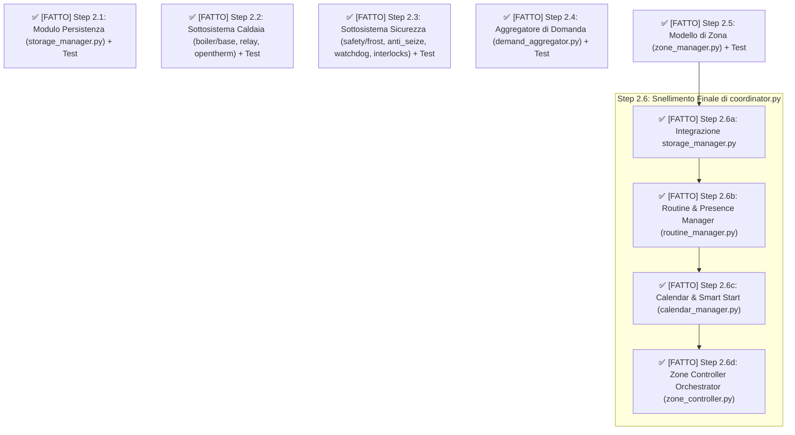
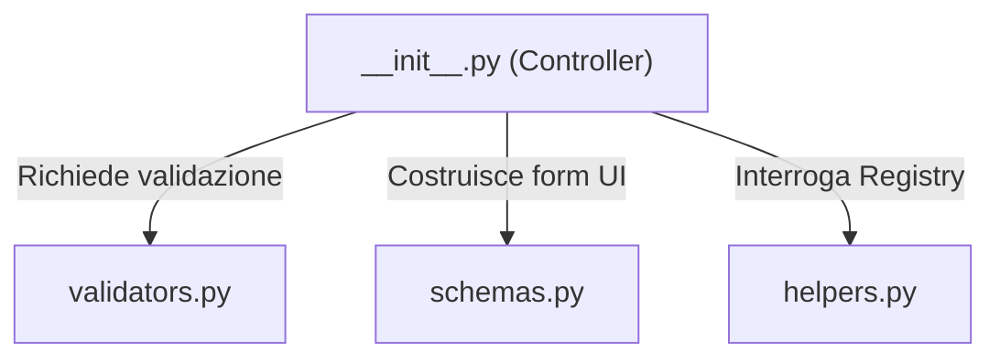

# 🗺️ Roadmap di Progetto — Hardening, Refactoring Modulare e Fasi Evolutive

Questo documento definisce in modo rigoroso:
1. L'elenco dei **bug e difetti tecnici da correggere** (Fase 1).
2. L'**obiettivo e la strategia del refactoring modulare** (Fase 2).
3. La pianificazione delle **fasi successive** (Documentazione, Migliorie Funzionali, Nuove Feature dal PDF).

---

## 🎯 Obiettivo del Refactoring Modulare
> **Dichiarazione di Scopo:**
> Decomporre il monolite `coordinator.py` (oltre 1.460 righe) e i file sovradimensionati (`config_flow.py`, `plant_diagnostics.py`) in moduli autonomi con **singola responsabilità (SRP)** e interfacce pulite (*Strategy Pattern*), procedendo **un file alla volta** e validando ogni singola estrazione con uno **script di test/simulazione dedicato** per garantire zero regressioni e massima affidabilità.

---

## 🛠️ FASE 1: Risoluzione Bug e Hardening ✅ [VALIDATO]

Tutte le anomalie e i difetti logici individuati dall'analisi tecnica sono stati risolti e validati con test:

| Priorità | Componente | Descrizione del Problema | Soluzione Tecnica | Stato |
| :---: | :--- | :--- | :--- | :---: |
| 🔴 **P0** | **DHW & Plant Demand** | Durante l'acqua calda sanitaria, il callback fa solo `return`: la vecchia domanda resta attiva nel coordinator e `_async_pwm_tick` continua a scaldare. | Forzare esplicitamente `plant_demand = 0` durante DHW; sopprimere l'output di riscaldamento. | ✅ **Validato** |
| 🔴 **P0** | **DHW PID Integral Windup** | Durante una pausa ACS lunga (es. 20 min di doccia), al ritorno il $\Delta t$ del PID include tutta la durata della pausa, causando un accumulo integrale anomalo al primo ciclo. | Congelare formalmente il timestamp del PID durante il DHW e resettare/riancorare il tempo alla ripresa (*bumpless resume*). | ✅ **Validato** |
| 🔴 **P0** | **Fallback Sensore a Runtime** | Se la sonda esterna diventa `unavailable` o `unknown`, `_on_temp_changed` esce subito, ritardando il passaggio al fallback sui TRV. | Intercettare immediatamente lo stato `unavailable`/`unknown` e forzare la transizione istantanea al fallback TRV. | ✅ **Validato** |
| 🔴 **P0** | **Re-check Task Ritardo Valvole** | In `_schedule_boiler_check`, dopo il delay di apertura valvole (es. 120s), il task accende direttamente la caldaia senza ricontrollare se le condizioni sono cambiate. | Subito prima di accendere la caldaia, ricontrollare: `master == ON`, `demand > 0`, `is_dhw_active == False`, `min_cycle_off` rispettato. | ✅ **Validato** |
| 🔴 **P0** | **OpenTherm su entità `number`** | Con domanda 0% viene inviato solo $T_{\min}$, senza un comando esplicito di OFF o spegnimento riscaldamento se l'entità è un semplice slider numerico. | Separare l'abilitazione riscaldamento (switch/enable) dal setpoint di mandata. | ✅ **Validato** |
| 🟠 **P1** | **Presenza Geofencing Robusta** | Attualmente il sistema considera "Away" qualsiasi stato diverso da `"home"`: se il sensore va temporaneamente in `unknown` o `unavailable`, la casa viene svuotata per errore. | Introdurre una whitelist: commutare in Away solo su stati certi (`"not_home"`, `"away"`). | ✅ **Validato** |
| 🟠 **P1** | **Uniformazione su `time.monotonic()`** | L'uso di `time.time()` per $\Delta t$ e intervalli (PID, PWM, inerzia) può produrre salti negativi se l'orologio di sistema si sincronizza con NTP. | Sostituire con `time.monotonic()` per tutti i calcoli di durata e delta temporali. | ✅ **Validato** |
| 🟠 **P1** | **Sanity Check Sensore (< 4°C)** | Considerare temperature < 4°C come sensore guasto crea un falso positivo su seconde case fredde ed entra in conflitto con l'antigelo. | Ampliare il range plausibile e usare la derivata di variazione per rilevare sonde rotte. | ✅ **Validato** |

---

## 🧱 FASE 2: Refactoring Modulare Incrementale

Ogni step prevede la creazione del nuovo modulo, il refactoring del chiamante e la validazione tramite **script di simulazione autonomo**:

### Dettaglio dei Moduli da Estrarre (Step 2.6 - coordinator.py):
1. **✅ [FATTO] `storage_manager.py` (Integrazione)**: Il modulo è stato creato allo step 2.1, integrato nel coordinator.
2. **✅ [FATTO] `routine_manager.py`**: Spostata la logica del Geofencing (sensore presenza) e della schedulazione Auto Night/Morning.
3. **✅ [FATTO] `calendar_manager.py`**: Spostato il polling delle API Calendar, il parsing degli eventi e l'override delle temperature temporanee (Smart Start).
4. **✅ [FATTO] `zone_controller.py`**: Spostato il megablocco di calcolo del PID. Il modulo fa da Facade per orchestrare `pid.py`, `autotune.py` e `thermal_model.py` per singola zona, incapsulando Weather Compensation e Smart Stop.
5. **✅ [FATTO] `demand_aggregator.py`**: Instradamento delle richieste termiche e calcolo della demand.

---

### 📦 FASE 2-BIS: Refactoring degli altri file "Massivi"

Dopo aver snellito il `coordinator.py`, rimangono da scomporre altri file sovradimensionati che violano il principio di singola responsabilità.
Procederemo con la seguente roadmap di estrazione, validando ogni step:

#### ✅ [FATTO] Step 2.7: Scomposizione di `config_flow.py` (~1200 righe) - *Completato in v. Platinum*
Il file di configurazione UI è diventato troppo grande e complesso. Lo divideremo in un package `config_flow/` per rispettare il Single Responsibility Principle:

*   `__init__.py`: Entry point (classi `ConfigFlow` e `OptionsFlow`). Diventa un puro controller/orchestratore privo di logica di business.
*   `schemas.py`: Fabbriche per la definizione dinamica degli schemi `voluptuous` (es. `get_user_schema()`, `get_add_zone_schema()`).
*   `validators.py`: Isola la logica di validazione degli input dell'utente e la generazione degli errori UI (es. controlli di coerenza T min/max, validazione nome zona).
*   `helpers.py`: Funzioni per estrarre entità e stati da Home Assistant (es. `_get_climate_entities`, `_get_switch_entities`, `_remove_entity_from_registry`).

#### ✅ [FATTO] Step 2.8: Scomposizione di `plant_diagnostics.py` (~800 righe)
Il motore di diagnostica contiene logiche eterogenee mescolate. Lo struttureremo in un package `diagnostics/`:
*   `engine.py`: La Facade `PlantDiagnosticsEngine` che orchestra i controlli.
*   `anomalies.py`: Regole di rilevamento specifiche (Valve Stuck, Ghost Heating, Air in Radiator, Timeout Sensori).
*   `efficiency.py`: Metriche energetiche (calcolo inerzia, stime di efficienza).
*   `const.py`: Etichette human-readable e chiavi delle anomalie.

#### ✅ [FATTO] Step 2.9: Scomposizione di `climate.py` (~800 righe)
Il Termostato Virtuale HA (`MultizoneVirtualThermostat`) è stato scisso in:
*   `climate.py` (entry point): Setup platform e definizione dell'entità `ClimateEntity`.
*   `sync_manager.py`: Motore di sincronizzazione di stato verso i TRV e Switch fisici (sub-climates e sub-switches).
*   `state_restorer.py`: Logica di persistenza e `RestoreEntity` del termostato dopo i riavvii.

---

## 🧪 FASE 3: Test Massivi e Validazione Architetturale ✅ [VALIDATO]

Il sistema rifattorizzato ha superato con successo l'intero ciclo di test di regressione e validazione architetturale:
1.  **✅ Test di Regressione Unitari (60/60 PASSED)**: Esecuzione automatizzata completa con framework `pytest` e mock integrato `dummy_ha` per simulare l'ambiente Home Assistant.
2.  **✅ Test di Integrazione e Flusso**: Verifica dei flussi di orchestrazione tra `ZoneController`, `DemandAggregator`, `ZoneManager`, `CalendarManager`, `RoutineManager`, `BoilerBackend` e `PlantDiagnosticsEngine`.
3.  **✅ Test di Fallback e Resilienza**: Validazione dei fallback su sensori TRV, anti-frost emergency e interlock DHW/ACS.

---

## 🏆 RILASCIO FASE 5.0.0 — Nuova Architettura Modulare Rifattorizzata ✅ [VALIDATO]
- Disaccoppiamento completo del monolite `coordinator.py` in sottosistemi indipendenti (`boiler/`, `safety/`, `plant_diagnostics/`, `storage/`, `config_flow/`, `zone_controller.py`, `demand_aggregator.py`, `zone_manager.py`, `calendar_manager.py`, `routine_manager.py`, `sync_manager.py`, `state_restorer.py`).
- Implementazione e validazione al 100% dell'ambiente di test con dummy Home Assistant (`dummy_ha`).
- Pulizia del codebase, rimozione di file temporanei e consolidamento del repository.

---

## 📖 FASE SUCCESSIVA PRIORITARIA: Allineamento e Pulizia Documentazione
> ⚠️ **NOTA DI PIANIFICAZIONE**: La revisione completa della documentazione viene eseguita **SUBITO DOPO IL RILASCIO DELLA FASE 5.0.0 (ossia quella rifattorizzata)**, come step prioritario prima di introdurre nuove feature evolutive.

Attività pianificate per la documentazione:
* **Allineamento Architetturale**: Aggiornare `README.md` per descrivere la nuova struttura modulare e chiarire che il componente è *"Event-driven con leggeri supervisory timers periodici"* (PWM ogni 10s, schedule ogni 1 min, calendario ogni 5 min).
* **Guida Tecnica ai Moduli**: Dettagliare il funzionamento di `DemandAggregator`, `ZoneController`, `SafetySubsystem`, `BoilerBackend` (Relay vs OpenTherm) e `PlantDiagnostics`.
* **Telemetria OpenTherm**: Chiarire la natura di discovery semantico tramite entità gateway Home Assistant.
* **Aggiornamento Manuali d'Uso e Esempi**: Aggiornare `cards.md` e `configuration.md` con i riferimenti alle nuove entità e opzioni.

---

## 🚀 FASE 5: Migliorie ed Evoluzioni Funzionali

Applicazione delle ottimizzazioni ingegneristiche suggerite dalla review tecnica:
1. **Demand Aggregator Configurabile**: Possibilità di selezionare la strategia di calcolo della domanda d'impianto:
   * `MAX` (comportamento attuale standard)
   * `WEIGHTED_AVERAGE` (media pesata sulla metratura o potenza radiante della zona)
   * `SUM_CAPPED` (somma delle domande limitata a 100%)
2. **PID Bumpless Transfer**: Ripartenza morbida dell'integrale e del setpoint dopo commutazioni di modalità o ripresa dalla modalità ACS.
3. **Termostato Fisico Autoritativo per Zona**: Opzione configurabile che permette a un cronotermostato a parete (es. Vimar, Bticino) di comandare la modalità ON/OFF della zona senza conflitti.
4. **Curva Climatica Dinamica ($T_{\text{ext}} \rightarrow T_{\text{flow}}$)**: Ottimizzazione della temperatura di mandata caldaia basata sulla reale risposta termica dell'edificio anziché su un semplice guadagno statico.
5. **Attivazione Anomalia `ANOMALY_AIR_IN_RADIATOR`**: Completamento della formula matematica diagnostica per rilevare presenza di aria nel circuito idraulico.

---

## 🌟 FASE 6: Nuove Funzionalità Avanzate dal Documento PDF
*(Riferimento: `C:\Users\alessandro\Desktop\Miglior Termostato Multiambiente Home Assistant.pdf`)*

Integrazione delle funzionalità di nuova generazione:
* **Cluster di Zone Idrauliche**: Raggruppamento delle zone per collettore o piano per evitare sovrapressioni della pompa di circolazione.
* **Controllo Multi-Generatore**: Gestione ibrida intelligente (es. Pompa di calore primaria + Caldaia a condensazione di supporto).
* **Energy Cost Optimization**: Integrazione con tariffe elettriche dinamiche (es. Nord Pool / PUN orario) e produzione fotovoltaica per il pre-riscaldamento ad alta efficienza.
