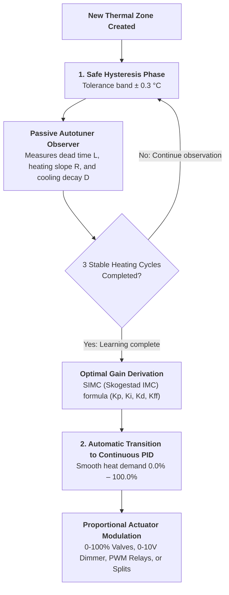
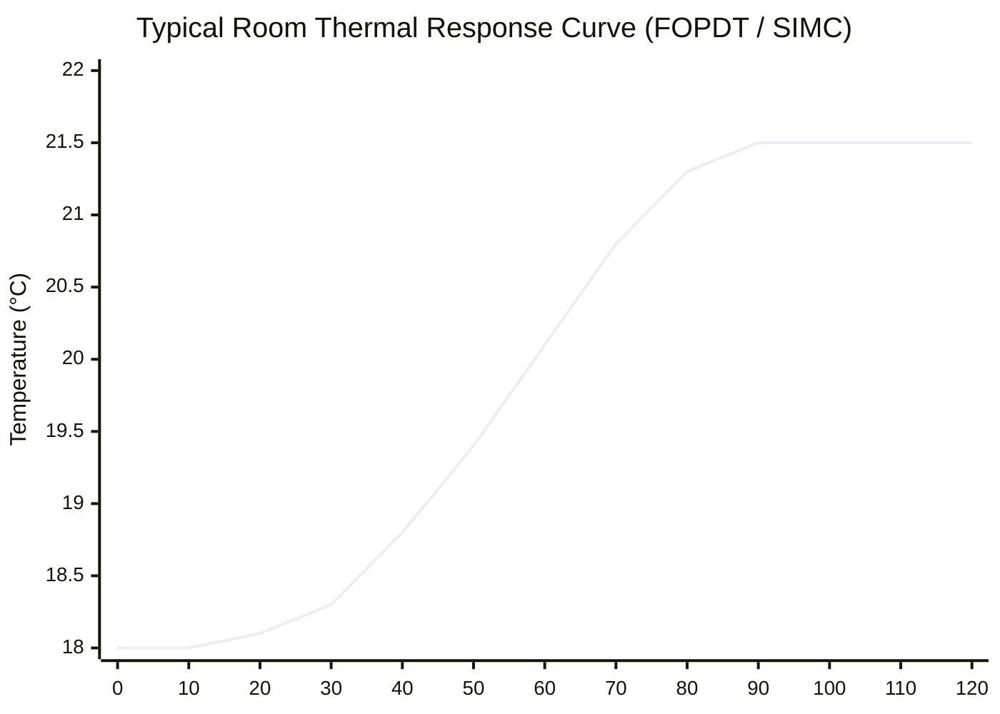

# Temperature Control Algorithms & Autotuning

STABLE

The core of **Multizone Thermostat** is a two-stage mathematical engine designed to eliminate manual PID tuning, guaranteeing stability without temperature oscillations while optimizing fuel and electricity consumption.

---

## 1. Two-Stage Architecture: From Hysteresis to Silent PID

When a new zone is created, the system has no prior knowledge of the room's physical dynamics (air volume, wall thermal capacity, external heat loss, and emitter power).

To prevent runaway oscillations during initial operation, the integration employs a self-learning transition:

### Stage 1: Adaptive Hysteresis (Learning Phase)
* **Tolerance Band**: ± 0.3 °C relative to target setpoint.
* **Behavior**: Actuators open when temperature falls below $(T_{\text{target}} - 0.3\ ^\circ\text{C})$ and close at $(T_{\text{target}} + 0.3\ ^\circ\text{C})$.
* **Objective**: Maintain room comfort while the passive observer records natural thermal step responses.

### Stage 2: Continuous PID Regulation & Dynamic Smart Stop
* Upon completing learning, the zone transitions seamlessly to proportional-integral-derivative regulation.
* Room heat demand is expressed on a continuous scale **from 0.0% to 100.0%**, recalculated with every sensor reading.
* **Dynamic Smart Stop**: In Smart PID mode, Smart Stop offsets are scaled dynamically by real-time heating slope (`last_slope`): active braking engages during warm-up ramps while dropping cleanly to **0.0 °C offset at steady-state or cooling**, allowing zones to hold exact setpoints instead of lingering slightly below target (Hysteresis mode preserves full static Smart Stop).

---

## 2. Passive Autotuning (SIMC / Skogestad IMC)

The autotuner is **completely passive**: it never forces artificial heating cycles that wear out boilers or disturb occupants.

The observer monitors real-world room responses:

### Measured Physical Parameters
1. **Dead Time $L$ (Hydronic Delay & Inertia)**:
   Elapsed minutes between valve opening/burner ignition and the moment room temperature begins rising by at least 0.1 °C.
2. **Maximum Warm-Up Slope $R$ (°C/hour — OLS Regression)**:
   Extracted via **Ordinary Least Squares (OLS) linear regression** over sliding windows ($\ge 180\text{ s}$ and $\ge 3$ samples) to reject quantization noise, with clean fallback on sparse updates.
3. **Natural Heat Loss Decay $D$ & Newton $k_{\text{loss}}$**:
   Quiet passive cooling rate (°C/hour) and weather-invariant exponential cooling coefficient $k_{\text{loss}}$ (`1/h`).

### Derivation of Controller Gains (SIMC — Skogestad IMC)
From dead time $L$ (in seconds) and duty-normalized warm-up slope $R_{\text{eff}} = R_{\text{max}} / \max(0.7, \min(1.0, u_{\text{avg}}))$ (in °C/s), the autotuner derives smooth, residential-comfort **SIMC (Skogestad IMC)** gains with time constant $\tau_c = \max(2.0 \cdot L,\ 600.0\text{ s})$:

* **Proportional Gain**: $K_p = \text{clamp}\!\left(\frac{100.0}{R_{\text{eff}} \cdot (\tau_c + L)},\ 10.0,\ 500.0\right)$
* **Integral Time**: $T_i = \max(900.0,\ 4.0 \cdot (\tau_c + L)) \quad \implies \quad K_i = \min\!\left(0.15,\ \frac{K_p}{T_i}\right)$
* **Derivative Time**: $T_d = \min(60.0,\ 0.25 \cdot L) \quad \implies \quad K_d = \min\!\left(500.0,\ K_p \cdot T_d\right)$

* **Coherent Median `(L, slope)` Aggregation**: Across the initial learning cycles, `_compute_final_pid()` computes the coherent median of `(median(L), median(slope))` and derives `(Kp, Ki, Kd)` together from that pair, preventing fast/warm-start outlier cycles from inflating $K_i$ or creating aggressive gains.
* **Trapezoidal Integral, Deadband & Anti-Windup**: Uses **trapezoidal integration** (`0.5 * (last_error + error) * dt`) with a **`0.03 °C` error deadband** (`INTEGRAL_DEADBAND`) to prevent low-level quantization drift, combined with conditional integration, back-calculation anti-windup clamping (`max_dt = 600 s`), physical bounds (`Ti >= 900 s`, `Ki <= 0.15`), and smart setpoint-drop reset (`>= 1.5 °C`).
* **15-Minute Least-Squares Derivative & Anti-Flicker Guard**: Instead of noisy sample-to-sample differences, $D$ is computed via linear least-squares regression over a `900 s` (15 min) window (`>= 3` samples spanning at least 5 minutes, clamped to `±15.0%`), protected by a `0.105 °C` minimum temperature span guard (`MIN_DERIVATIVE_TEMP_SPAN`) to eliminate jitter on `0.1 °C`-quantized wireless sensors.
* **Extended Dead Time & Intermediate Learning**: Supports slow radiant slabs with dead times up to 4 hours (`L <= 14400 s`). Open-window periods immediately pause autotuner ramps. Weekly candidate ramps require `>= 85%` demand (`>= 300 s`, `>= 0.4 °C` rise, normalized for `>= 70%` duty) and enforce a `1800 s` idle gap guard (`_was_idle_before_ramp`).

### Weekly Smoothed EMA, Overshoot Guardrail & Dual-Season Manual PID
* **Weekly Median-Filtered EMA & Overshoot Guardrail**: After initial learning, the observer refines gains weekly (`alpha = 0.15`, `>= 3` candidates, clamped to `±10%/week` and `[0.5x, 2.0x]` baseline). Before applying a weekly drift update, it snapshots `pre_kp/ki/kd` and monitors the next **`2` post-shutdown overshoot peaks** (`GUARDRAIL_MIN_CYCLES = 2`): if post-update overshoot exceeds **`0.45 °C`** and degrades by **`> +0.25 °C`** vs baseline, the autotuner **automatically rolls back** to the pre-update gains (`weekly_guardrail_status = "reverted"` on `AutotuneSensor`; pending check expires after `7` days or cancels on manual override).
* **Per-Zone Manual Override & Safety Lock**: Each zone device (`Zone <Name>`) exposes **Configuration** entities for `PID Kp` (`0.1–500.0`), `PID Ki` (`0.0–10.0`), `PID Kd` (`0.0–50000.0`) (`number`), `PID Manual Unlock` (`switch`, defaults to locked), and `Reset Autotuner` (`button`).
* **Dual-Season Isolation**: Heating (`heat`) and cooling (`cool`) PID tracks are stored and tuned independently; manual edits or resets only affect the active season (or the `mode` specified in `multizone_thermostat.set_pid_parameters` / `multizone_thermostat.reset_autotune`). Manually overridden gains are preserved from automatic EMA updates.
* **Seed Autotuner, Pure PI Preservation & Pre-Reset Backup (`v6.1.0-beta`)**: You can seed `Kp/Ki/Kd` directly as the learned Auto EMA baseline (`seed_autotuner: true` or via the Zone Energy Card UI) so continuous weekly optimization continues from those values; seeding `Kd = 0.0` preserves pure-PI operation (`_seeded_pi_only`) across weekly EMA updates and restarts. Before any autotuner reset, a snapshot of the learned parameters and cycles is automatically backed up and can be restored anytime via `multizone_thermostat.restore_autotune` (or the Zone Energy Card UI).

---

## 2a. Sensorless Thermal Model (`ThermalObserver`) & Weather-Invariant Newton `k_loss`

To prevent open windows, short drafts, or sensor quantization jitter from distorting room heat-loss diagnostics (`cooling_rate`, Thermal Retention, and Energy Class):

* **Open-Window Exclusion**: Active open-window states (internal window manager or configured `window_sensor`) immediately suspend thermal rate updates and autotuner ramps.
* **Quiet Passive Cooling Windows**: Natural cooling samples require **at least `30 minutes` (`1800 s`)** and **`>= 0.25 °C`** temperature drop, strictly **outside post-shutdown thermal inertia tails**.
* **Sensorless Window / Draft Protections** *(works even without physical contact sensors)*:
  * **10-Minute Wall Rebound Confirmation**: When a rapid cooling drop ends, the observer checks for wall thermal rebound (`>= 0.1 °C` bounce over `600 s`) to distinguish genuine ventilation drafts from structural cooling.
  * **Fast-Draft Detector & 40-Minute Lockout**: Drops exceeding `2.0 °C/h` reject the window sample and trigger a **`40-minute` (`2400 s`) re-equilibration lockout** before resuming thermal learning.
* **OLS Linearity, Outlier Rejection & 35th-Percentile Estimator**: Windows with `>= 4` samples must satisfy Ordinary Least Squares linearity (`R² >= 0.65`). Accepted cooling samples enter a 10-sample rolling buffer protected by asymmetric outlier rejection (`> 2.5×` median rejected) and a **35th-percentile robust estimator**, plus startup **self-healing** that clears corrupted/out-of-range persisted rates automatically.
* **Weather-Invariant Newton `k_loss`**: Alongside `°C/h`, `ThermalObserver` learns the indoor-outdoor $\Delta T$-normalized exponential cooling coefficient $k_{\text{loss}}$ (`1/h`, plausible `0.001–0.25`), which `get_zone_energy_class()` uses as its primary metric so Energy Class remains stable between mild afternoons and freezing nights.

---

## 3. Hydronic Actuator Control (Valves & Relays)

| Actuator Type | Control Method | Description |
|---|---|---|
| **Proportional Valves (0–100%)** | Direct `valve.*` entity | Adjusts physical valve opening proportionally to calculated PID demand. Supports `invert_valve` for Normally Open / reverse-acting actuators. |
| **0–10V Analog Modules** | Scaled `number.*` entity | Linearly converts PID percentage to voltage: $V_{\text{out}} = (\% / 100) \cdot 10.0\text{ V}$ (or inverted with `invert_valve`). Ideal for underfloor manifolds and fancoils. |
| **Electrothermal Relays (PWM)** | Timed `switch.*` entity | Applies anti-chattering time-proportional modulation (`PWMEngine`) with **strict single-pulse-per-cycle OFF latch**, trickle-demand zeroing, **`95%` continuous-ON threshold**, and **adaptive phase-locked boiler period** `max(900 s, 2 × (min_on + min_off))` (`20 min` default with `5 + 5 min` protection = max 3 cycles/h). Supports `invert_switch` for Normally Open (NO) valves. |
| **Direct-Pin TRVs** | Internal `valve.*` entity | For TRVs exposing direct pin control, bypasses internal manufacturer algorithms to prevent dual-PID fighting. |
| **Standard TRVs (`climate.*`)** | Calibration / Demand-Driven | Supports offset injection (with `0.25 °C` deadband, `180 s` cooldown, `300 s` anti-ratchet settle), `external_temperature_input` push, `disabled` (for native Matter/Zigbee binding), and Bounded Overdrive (`demand_driven`). |

---

## 4. Outdoor Weather Compensation Curve (Feed-Forward)

Heating demand can be combined with outdoor weather compensation by connecting an external temperature sensor (`CONF_WEATHER_SENSOR`):

$$T_{\text{flow}} = T_{\text{base}} + K_{\text{curve}} \cdot (20^\circ\text{C} - T_{\text{outdoor}})$$

* **Advantage**: When outdoor temperatures plummet, the system proactively boosts heat output before indoor rooms cool down.
* **Tunable Multiplier**: Via `number.master_control_weather_curve` (`default: 1.0`; set `0.0` to disable completely with zero feed-forward contribution; `0.5–1.5` recommended for radiators, `0.2–0.6` for underfloor radiant). On **OpenTherm** plants, zone-level weather feed-forward is skipped automatically to avoid double compensation alongside `opentherm_backend` flow-temperature compensation.

---

## 5. Central Plant Demand Aggregation Strategies

Configured via `select.master_control_demand_strategy`:

1. **`max` (Maximum Zone Demand)**:
   Boiler demand matches the highest single active zone. Ideal for high-temperature radiator systems.
2. **`weighted_average` (Weighted Average)**:
   Zones contribute proportionally to their configured primary weight (`weight`, default 1.0) divided by total configured primary weights, guaranteeing strictly monotonic plant demand with a minimum 70% peak floor. Prevents full boiler ignition for small closets.
3. **`sum_capped` (Sum Capped at 100%)**:
   Demands across all zones sum together up to 100%. Ideal for multi-circuit underfloor manifolds.
