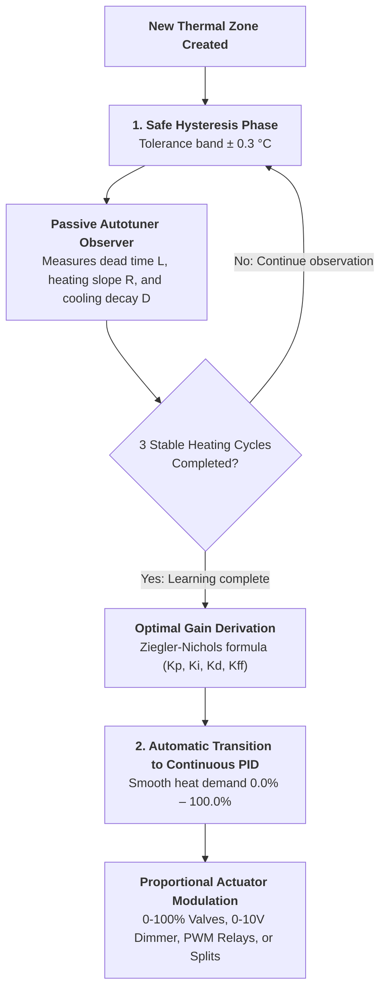
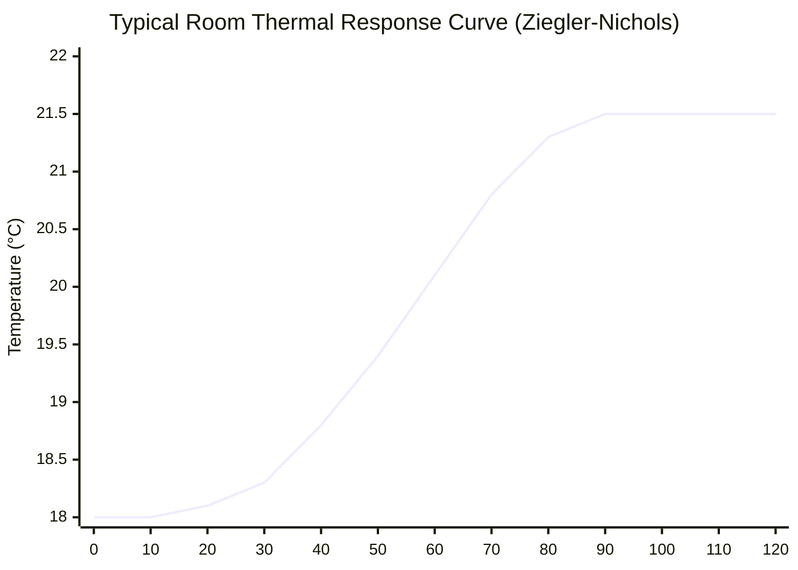

# Temperature Control Algorithms & Autotuning

STABLE

The core of **Multizone Thermostat** is a two-stage mathematical engine designed to eliminate manual PID tuning, guaranteeing stability without temperature oscillations while optimizing fuel and electricity consumption.

---

## 1. Two-Stage Architecture: From Hysteresis to Silent PID

When a new zone is created, the system has no prior knowledge of the room's physical dynamics (air volume, wall thermal capacity, external heat loss, and emitter power).

To prevent runaway oscillations during initial operation, the integration employs a self-learning transition:

### Stage 1: Adaptive Hysteresis (Learning Phase)
* **Tolerance Band**: ± 0.3 °C relative to target setpoint.
* **Behavior**: Actuators open when temperature falls below $(T_{\text{target}} - 0.3\ ^\circ\text{C})$ and close at $(T_{\text{target}} + 0.3\ ^\circ\text{C})$.
* **Objective**: Maintain room comfort while the passive observer records natural thermal step responses.

### Stage 2: Continuous PID Regulation
* Upon completing learning, the zone transitions seamlessly to proportional-integral-derivative regulation.
* Room heat demand is expressed on a continuous scale **from 0.0% to 100.0%**, recalculated with every sensor reading.

---

## 2. Passive Autotuning (Adaptive Ziegler-Nichols)

The autotuner is **completely passive**: it never forces artificial heating cycles that wear out boilers or disturb occupants.

The observer monitors real-world room responses:

### Measured Physical Parameters
1. **Dead Time $L$ (Hydronic Delay & Inertia)**:
   Elapsed minutes between valve opening/burner ignition and the moment room temperature begins rising by at least 0.1 °C.
2. **Maximum Warm-Up Slope $R$ (°C/hour)**:
   Rate of temperature rise during full heating output.
3. **Natural Heat Loss Decay $D$ (°C/hour)**:
   Rate of cooling when heating is idle.

### Derivation of Controller Gains
From $L$, $R$, and $D$, the autotuner derives the controller gains:

* **Proportional Gain**: $K_p = \frac{1.2}{R \cdot L}$
* **Integral Time**: $T_i = 2.0 \cdot L \quad \implies \quad K_i = \frac{K_p}{T_i}$
* **Derivative Time**: $T_d = 0.5 \cdot L \quad \implies \quad K_d = K_p \cdot T_d$

* **Integral Anti-Windup**: The $K_i$ term is mathematically clamped to prevent error accumulation when the boiler is off or during prolonged absences.
* **Low-Pass Derivative Filter**: The $K_d$ term is filtered to ignore high-frequency sensor noise from wireless Zigbee thermometers or transient drafts.

---

## 3. Hydronic Actuator Control (Valves & Relays)

| Actuator Type | Control Method | Description |
|---|---|---|
| **Proportional Valves (0–100%)** | Direct `valve.*` entity | Adjusts physical valve opening proportionally to calculated PID demand. |
| **0–10V Analog Modules** | Scaled `number.*` entity | Linearly converts PID percentage to voltage: $V_{\text{out}} = (\% / 100) \cdot 10.0\text{ V}$. Ideal for underfloor manifolds and fancoils. |
| **Electrothermal Relays (PWM)** | Timed `switch.*` entity | Applies time-proportional modulation over a standard cycle window (e.g. 15 min). A 40% demand produces 6 minutes ON and 9 minutes OFF. |
| **Direct-Pin TRVs** | Internal `valve.*` entity | For TRVs exposing direct pin control, bypasses internal manufacturer algorithms to prevent dual-PID fighting. |
| **Standard TRVs (`climate.*`)** | Calibrated offset injection | Injects dynamic setpoint offsets to force the TRV to respect an eye-level room thermometer. |

---

## 4. Outdoor Weather Compensation Curve (Feed-Forward)

Heating demand can be combined with outdoor weather compensation by connecting an external temperature sensor (`CONF_WEATHER_SENSOR`):

$$T_{\text{flow}} = T_{\text{base}} + K_{\text{curve}} \cdot (20^\circ\text{C} - T_{\text{outdoor}})$$

* **Advantage**: When outdoor temperatures plummet, the system proactively boosts heat output before indoor rooms cool down.
* **Tunable Multiplier**: Via `number.master_control_weather_curve` (default: 0.0 disabled, 0.5–1.5 recommended for radiators, 0.2–0.6 for underfloor radiant).

---

## 5. Central Plant Demand Aggregation Strategies

Configured via `select.master_control_demand_strategy`:

1. **`max` (Maximum Zone Demand)**:
   Boiler demand matches the highest single active zone. Ideal for high-temperature radiator systems.
2. **`weighted_average` (Weighted Average)**:
   Zones contribute proportionally to their volume weight (`weight`, default 1.0), preventing boiler ignition for small closets.
3. **`sum_capped` (Sum Capped at 100%)**:
   Demands across all zones sum together up to 100%. Ideal for multi-circuit underfloor manifolds.
