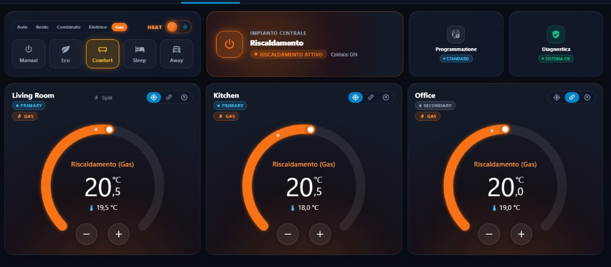
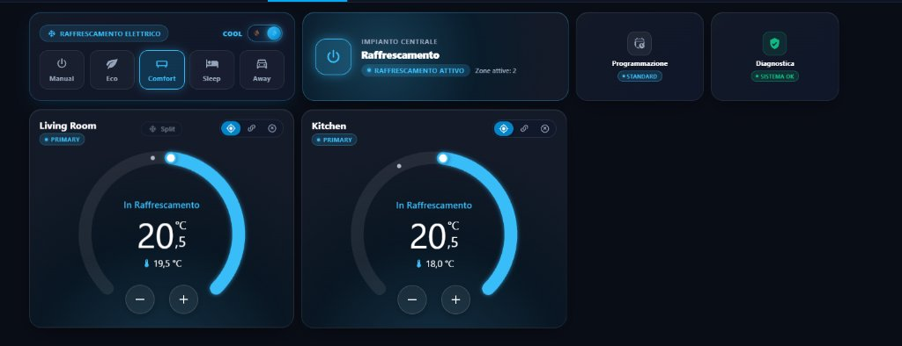

# Complete Lovelace Cards & Dashboard Strategy Guide

Multizone Thermostat includes a full suite of custom cards designed to integrate into Home Assistant's native design language. The cards support light and dark themes, dynamic animations, two visual styles (**Classic** native 1-to-1 styling and **Luxury** glowing aura), and automatic resource registration upon integration startup.

<div style="display: grid; grid-template-columns: repeat(auto-fit, minmax(350px, 1fr)); gap: 14px; margin: 20px 0;">
  <div style="background: rgba(15, 23, 42, 0.6); border: 1px solid rgba(249, 115, 22, 0.3); border-radius: 12px; padding: 10px; text-align: center;">
    <span style="font-weight: 700; color: #fb923c; font-size: 0.9rem; display: block; margin-bottom: 6px;">🔥 Winter Heating View (3 Rooms + Gas Staging)</span>
    
  </div>
  <div style="background: rgba(15, 23, 42, 0.6); border: 1px solid rgba(56, 189, 248, 0.3); border-radius: 12px; padding: 10px; text-align: center;">
    <span style="font-weight: 700; color: #38bdf8; font-size: 0.9rem; display: block; margin-bottom: 6px;">❄️ Summer Cooling View (Auto-Filtered Uncooled Rooms)</span>
    
  </div>
</div>

---

## 1. Dial Thermostat Card (`custom:multizone-thermostat-dial-card`)

A modern circular thermostat designed as a **1-to-1 Visual Twin** of Home Assistant's native thermostat card:

### Key Enhancements (v6.1.0-beta)
* **Direct Arc Touch / Click**: Tap or click anywhere along the circular arc to immediately set your target temperature without dragging the knob.
* **Symmetrical Circular Step Buttons `[-]` and `[+]`**: Ergonomic 42px circular buttons positioned in the bottom opening to adjust temperature in 0.5 °C steps.
* **Active Source Badge (Top Left)**:
  * `🔥 GAS` (Orange): Zone heated by the central gas boiler.
  * `⚡ ELECTRIC` (Cyan): Zone conditioned by the room split AC or heat pump.
  * `🔥⚡ GAS + ELECTRIC` (Amber): Simultaneous dual operation (Quick Heat Boost or combined priority).
* **Room Split AC Manual Run Button (Header Center)**:
  * Visible only in rooms configured with a split unit (`split_climate_entity`).
  * **Master OFF**: Allows running the split air conditioner independently for that room without turning on the gas boiler.
  * **Master ON (Safety Lockout)**: Automatically locks out manual clicks when whole-house heating is active to prevent conflicting operations.
* **Automatic Summer Filtering (`hide_if_cannot_cool: true`)**: Hides zones lacking cooling capabilities when the system switches to summer mode.
* **Zone Mode Selector**: Cycle between `Primary`, `Secondary`, and `Bypassed` with a single tap.

```yaml
type: custom:multizone-thermostat-dial-card
entity: climate.multizone_thermostat_living
title: Living Room
card_style: classic # 'classic' (native HA) or 'luxury' (glowing aura)
hide_if_cannot_cool: true # Auto-hide uncooled rooms in summer
border_radius: "20px" # Card corner curvature
```

---

## 2. Global Preset Card (`custom:multizone-thermostat-preset-card`)

A whole-house control bar combining seasonal switching, heat source priority, and comfort presets at a **guaranteed constant height**:

* **Segmented Heat Source Priority Selector**: Horizontal pill selector for 5 priorities (`Auto`, `Hybrid`, `Combined`, `Electric`, `Gas`).
* **Identical Summer Transition**: In summer cooling mode, the priority selector smoothly transforms into the aesthetic pill `❄️ Electric Cooling` with the **exact same height**, preserving layout geometry across seasons.
* **Master Seasonal Switch (Heat 🔥 / Cool ❄️)**: Instantly toggles the home between heating and cooling.
* **Dual-Track Preset Buttons**: Quick recall for `Manual`, `Eco`, `Comfort`, `Sleep`, `Away` with isolated memory tracks.

```yaml
type: custom:multizone-thermostat-preset-card
```

---

## 3. Central Status Card (`custom:multizone-thermostat-status-card`)

Full-width master button with high-visibility dynamic aura to power the whole-house system ON or OFF:

* **Dynamic State Aura**:
  * **Orange**: Winter heating active.
  * **Cyan**: Summer cooling active.
  * **Yellow**: Standby (all zones satisfied, circulators idle).
  * **Grey**: Master system disabled (OFF).
* **Telemetry Subtitle**:
  Displays real-time generator staging: `Boiler: ON`, `Boiler: ON + Split`, `Split Electric: ON`, `Active zones: 2/4`.

```yaml
type: custom:multizone-thermostat-status-card
```

---

## 4. Button Thermostat Card (`custom:multizone-thermostat-button-card`)

A compact button thermostat card designed for dense dashboard grids where circular dials take up too much vertical space:

* Rapid `+` and `-` temperature step controls.
* Clear temperature, target, and HVAC status displays.
* Includes active source badges (`🔥 GAS`, `⚡ ELECTRIC`, `🔥⚡ GAS + ELECTRIC`).
* Dynamic border glow synchronized with the room's duty cycle.

```yaml
type: custom:multizone-thermostat-button-card
entity: climate.multizone_thermostat_bedroom
title: Master Bedroom
```

---

## 5. Weekly Scheduler Card (`custom:multizone-thermostat-scheduler-card`)

Visual weekly matrix scheduling interface:

* **24-Hour Color Matrix**: Displays schedule blocks for all rooms across the day.
* **Interactive Editing**: Tap blocks to adjust start/end times and presets.
* **Smart Return Planner**: Schedule arrival times with automated preheating advance per room.

```yaml
type: custom:multizone-thermostat-scheduler-card
```

---

## 6. Central Plant Health Card (`custom:multizone-thermostat-plant-card`)

Technical boiler and heat pump telemetry:

* **Plant Health Score**: Overall hydraulic health percentage (0–100%).
* **Ignition Frequency (Short-Cycling)**: Monitors starts per hour with visual warnings for high wear (> 5 cycles/h).
* **OpenTherm Telemetry**: Water pressure (Bar), flow & return temperatures with $\Delta T$, modulation %, and boiler OEM fault codes.
* **Active Anomalies List**: Real-time list of detected hydraulic faults.

```yaml
type: custom:multizone-thermostat-plant-card
```

---

## 7. Zone Energy Efficiency Card (`custom:multizone-thermostat-zone-energy-card`)

Displays physical building performance metrics for each room:

* **European Energy Class (A4 → G)**: Calculated from natural heat loss decay and indoor/outdoor $\Delta T$.
* **Thermal Retention Time**: Hours required to drop by 1.0 °C.
* **Radiator Sizing**: Evaluates emitter sizing (Undersized, Optimal, Oversized).
* **Universal TRV Battery Gauge**: Battery monitoring for wireless Zigbee/Z-Wave valves.
* **Interactive Toggles**: Cycle zone mode or toggle passive heat directly from the card.

```yaml
type: custom:multizone-thermostat-zone-energy-card
entity: climate.multizone_thermostat_living
```

---

## 8. Auto-Generated Dashboard Strategies

Build complete views without writing YAML for individual entities:

### Climate View Strategy (`custom:multizone-thermostat-dashboard`)
```yaml
views:
  - title: Climate
    path: climate
    icon: mdi:thermostat
    strategy:
      type: custom:multizone-thermostat-dashboard
      columns: 3 # Responsive columns (1, 2, 3, or 4)
```

### Diagnostics View Strategy (`custom:multizone-thermostat-diagnostics`)
```yaml
views:
  - title: Diagnostics
    path: diagnostics
    icon: mdi:chart-box-outline
    strategy:
      type: custom:multizone-thermostat-diagnostics
      columns: 3
```

---

## 🎮 Test Cards in the Live Simulator

Test all cards, seasonal commutation, touch arcs, and step buttons:

👉 [**Open Official Live Simulator (3 Dashboards)**](simulator_view.md) or [**Open Full Screen in a New Tab ↗**](simulator.html)
