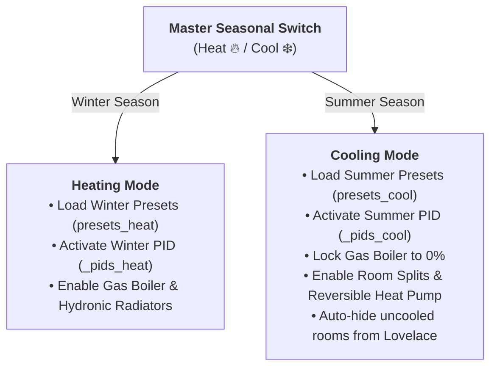

# Summer Cooling & Dual-Track Climate Engine

BETA

With Phase 11, Multizone Thermostat becomes a complete four-season climate solution, managing winter heating and summer cooling with equal precision (via direct-expansion split AC units or central reversible hydronic heat pumps).

---

## 1. Master Seasonal Switch (Heat 🔥 / Cool ❄️)

The master seasonal switch is located on the **Global Preset Card**:
* **Winter Mode (Heat 🔥)**: Activates heating logic (gas boiler, hydronic circulators, split heat pump mode).
* **Summer Mode (Cool ❄️)**: Activates cooling logic:
  * The gas boiler is strictly locked to **`0%` (shut off)**.
  * Cooling demand is dispatched to room split units or the central reversible heat pump.

---

## 2. Isolated Dual-Track Preset Memory

Comfort temperature expectations differ dramatically between seasons:
* **Winter**: Comfort at 20.5 °C, Eco at 18.0 °C, Sleep at 17.5 °C.
* **Summer**: Comfort at 24.5 °C, Eco at 27.0 °C, Sleep at 26.0 °C.

Conventional thermostats force users to reconfigure every room temperature twice a year.
Multizone Thermostat eliminates this with two physically separated storage tracks:
1. `presets_heat`: stores winter setpoints and zone modes.
2. `presets_cool`: stores summer setpoints and zone modes.

Flipping the seasonal switch immediately restores summer memories while preserving winter targets for autumn.

---

## 3. Dual-Track PID Regulators & Passive Cooling Autotuner

Hydronic cooling (radiant floors with dehumidification or fancoils) behaves asymmetrically compared to winter heating:
* Winter heating water ($55-65^\circ\text{C}$) has a temperature differential of $\approx 35-45^\circ\text{C}$ against room air ($20^\circ\text{C}$).
* Summer cooling water ($7-12^\circ\text{C}$ in fancoils or $16-18^\circ\text{C}$ in radiant floors) has a differential of only $8-15^\circ\text{C}$ against room air ($26^\circ\text{C}$).

Using the same PID parameters across seasons causes instability and sluggish response.

### The Dual-Track PID Engine
Each zone maintains two independent PID controllers in memory:
* `_pids_heat` and `_autotuners_heat` for heating.
* `_pids_cool` and `_autotuners_cool` for cooling.

### Passive Cooling Autotuner (`mode="cool"`)
The passive observer analyzes natural temperature drops during air conditioner or fancoil operation, computing delay $L$ and maximum drop rate $R$ to derive optimal Ziegler-Nichols gains ($Kp, Ki, Kd$) specifically for summer cooling.

---

## 4. Hydronic Cooling vs Room Split Units

| Cooling Architecture | Actuators Used | System Behavior |
|---|---|---|
| **Room Split AC Units** | Split entity `climate.*` | The split responds directly to room cooling demand. The hydronic radiator valve remains closed at 0%. |
| **Radiant Floor + Reversible Heat Pump** | Proportional valves / relays + central heat pump | The heat pump chills water (e.g. 18 °C); valves modulate flow using summer PID. Requires dehumidifiers to prevent condensation. |
| **Central Fancoils** | 0–10V valves + fan coils | Chilled water flow (7–12 °C) with continuous modulation of fans and valves. |

---

## 5. Automatic Dashboard Summer Filtering

In real homes, secondary spaces often lack cooling (pantries, hallways, closets, or secondary bathrooms have radiators only).

With `hide_if_cannot_cool: true`:
* In summer mode, cards for rooms that **cannot cool are automatically hidden from the Lovelace view**, decluttering your dashboard.
* Returning to winter mode (Heat 🔥) immediately restores all rooms in their grid slots.
