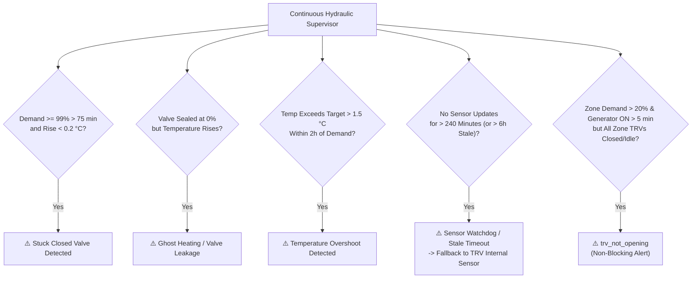

# Plant Safeguards & Hydraulic Diagnostics

STABLE

Multizone Thermostat acts as a supervisory controller for your hydronic plant, protecting boilers from short-cycling wear and catching mechanical faults before they cause damage or waste energy.

---

## 1. Mechanical Fault Surveillance

The diagnostic engine continuously inspects room temperature trajectories against historical learning:

### Active Plant & Zone Anomalies

| Anomaly | Trigger Criteria | Automated System Response |
|---|---|---|
| **Stuck Closed Valve (`stuck_closed`)** | Zone demand `>= 99%` for **`> 75 minutes`** with active heating, while room temperature rises by `< 0.2 °C`. | Red alert on Lovelace card, persistent notification in Home Assistant, and activation of zone anomaly binary sensor. |
| **TRV Valve Not Opening (`trv_not_opening`)** | Zone heating demand `> 20%` and central generator active (`boiler_on`) for `> 5 minutes` while all zone TRVs still report closed/`idle`. | **Non-blocking diagnostic alert**: flags the affected zone without halting the central plant so other zones continue to be served. |
| **Ghost Heating (`ghost_heating`)** | Room temperature rises significantly while the zone valve/relay is commanded to 0% (suppressed if `allow_passive_heat` is enabled). | Warns of damaged valve seats, incomplete closure, or faulty bypass valves. |
| **Temperature Overshoot (`overshoot`)** | Room temperature climbs `> 1.5 °C` above target setpoint within 2 hours of an active heating call. | Flags thermal over-delivery or oversized radiator/PID gains. |
| **Sensor Watchdog / Stale / Fault (`stale_sensor`, `sensor_fault`)** | Wireless sensor battery dies or loses updates (`> sensor_timeout_min` default `240 min`, stale `> 6h`, or implausible/spike readings). | **Instant graceful fallback (`safety_fallback_active`)**: regulates via TRV internal sensor, reverts `trv_sensor_selects` to local/internal, and reverts `demand_driven` TRVs to `standard` mode. |
| **Low Battery / Short Cycling / Boiler Pressure & Faults** | TRV/sensor battery `<= 10%` (`low_battery`), boiler `> 5` cycles/hour (`short_cycling`), OpenTherm pressure `< 0.8 bar` (`boiler_low_pressure`), or OEM fault code (`boiler_fault`). | Surfaces warning/critical status in Plant Health (`Optimal` / `Warning` / `Critical`) and diagnostics cards. |

---

## 2. Mechanical Plant Protections

### 1. Boiler & Heat Pump Anti-Short-Cycle Protection & Anti-Chattering PWM
Frequent starts reduce efficiency and wear out burners or compressors:
* **Gas Boiler**: `number.master_control_min_cycle_on` / `min_cycle_off` (default: **5 minutes**).
* **Anti-Chattering Relay PWM**: `PWMEngine` enforces a strict single-pulse-per-cycle OFF latch, zeros trickle demand, stays continuously ON above **`95%` demand**, and runs `RelayBoilerBackend` on an adaptive, phase-locked cycle period `max(900 s, 2 × (min_on + min_off))` (`20 min` default with `5 + 5 min` protection = max 3 cycles/h).
* **Central Heat Pump**: Dedicated `number.master_control_hp_min_cycle_on` / `hp_min_cycle_off` (independent from boiler cycles).
* **Plant Diagnostics**: Cycle frequency (`cycles/hour`) and 24h runtime tracking work for both gas boilers and heat-pump-only plants.

### 2. Motorized Valve Opening Delay & Hydraulic TRV Guard (`number.master_control_valve_delay`)
Wax thermal actuators require 90 to 180 seconds to stroke open.
Setting a delay (e.g. **120 seconds**) ensures the boiler/heat pump and circulator start only when valves are fully open, eliminating water hammer and pipe overpressure.
* **Unified TRV Valve-Readiness Guard (`HOLD_TRV_CLOSED`)**: `HOLD_TRV_CLOSED` automatically holds heat generator ignition up to **120 s max** while demanding zone TRVs still report closed—inspecting valve position attributes (`position`, `valve_position`, `pi_heating_demand`, `heating_demand` > 10%) as well as `hvac_action` fallback (`"heating"` vs `"idle"`/`"off"`), followed by the optional motorized `valve_delay` (`number.master_control_valve_delay`) if `> 0 s`. Applies to **Relay Boiler**, **OpenTherm cold-start only** (never kills an already-running burner), and **Central Heat Pump in HEAT mode**.

### 3. Summer Anti-Seize Exercise
During warm months, valves and circulators sit dormant, risking calcification and seizing:
* If idle for > 15 days (`number.master_control_anti_seize_idle_days`), the integration strokes all valves open for 2 minutes (`number.master_control_anti_seize_duration`), closing them immediately after. Protected by a concurrency guard and compatible with both boiler and heat pump backends (`anti_seize_boiler`).

### 4. Emergency Anti-Frost Protection & Persistent Recovery
If any room falls below `number.master_control_anti_frost_temperature` (range `5.0–16.0 °C`, default: **`12.0 °C`**):
* The system forces 100% emergency heating at a configurable `number.master_control_frost_protection_flow_temp` (default: `40.0 °C`), overriding window cutouts, master off states, or away presets to protect pipes from freezing.
* **Persistent Recovery**: Pre-frost targets (`pre_frost_targets`) are persisted across Home Assistant restarts.
* **L5 Frost Emergency Fallback**: If both room sensor and TRVs become unavailable while outdoor temperature (weather or numeric `sensor.*`) drops below **2.0 °C**, conservative frost protection engages automatically.

### 5. Underfloor 40.0 °C Ceiling, Dew-Point & Window Safety
* **Underfloor Hard Thermal Ceiling**: Enforces a strict **40.0 °C** max water temperature on unmixed underfloor radiant systems, even in mixed radiator/underfloor setups.
* **Indoor Dew-Point Anti-Condensation**: Keeps chilled cooling water at least **+2.0 °C** above the worst-case indoor dew point across zones actively demanding cooling.
* **Window Open Cutout**: Opening a window immediately clears zone demand and cancels any local split manual override.

### 6. TRV Demand-Driven Bounded Overdrive & Safety Reversion
* **Bounded Overdrive (`trv_control_mode: demand_driven`)**: Prevents smart TRVs from pinching/closing early via PID demand hysteresis (`>= 5.0%` opens, `<= 0.0%` closes), `60 s` anti-chatter debounce, `10 s` evaluation tick, and an idle no-chatter guard. Open target is strictly bounded to `min(trv_max, room_temp + trv_open_boost, zone_target + trv_open_boost)` (never blasts a fixed 30 °C), and close target to `max(trv_min, min(zone_target, room_temp - trv_close_offset))`.
* **Automatic Safety Reversion (`safety_fallback_active`)**: If the primary room sensor is lost or stale, `demand_driven` TRVs automatically revert to `standard` mode (direct zone setpoint) and `trv_sensor_selects` switches back to the TRV's internal/local sensor so each valve regulates autonomously.

---

## 3. Advanced OpenTherm Bus Telemetry

* **Water Pressure (Bar)**: Continuous pressure monitoring with low pressure warning under 0.8 Bar.
* **Flow & Return Temperatures (°C)**: Real-time $\Delta T = (T_{\text{flow}} - T_{\text{return}})$ to monitor condensing performance.
* **Flame Modulation (%)**: Real-time percentage burner firing rate.
* **Boiler OEM Fault Codes**: Direct capture and display of manufacturer trouble codes.
* **Domestic Hot Water Priority (DHW Freeze)**: When hot water taps open (including EMS-ESP multi-device charging detection and custom DHW entities), the system **freezes PID error integration**, preventing false error accumulation while the boiler diverts output to domestic water.

---

## 4. Home Assistant JSON Diagnostics (`pid_state`, `trv_health` & Actuators)

Under **Settings → Devices & Services → Multizone Thermostat → Download Diagnostics**, each zone includes deep real-time telemetry:

* **Live PID State (`pid_state` / `pid_state_cool`)**: Exposes `kp`, `ki`, `kd`, `p_contribution`, `i_contribution`, `d_contribution`, `integral_accumulator`, `pid_raw_output`, `pid_clamped_output`, `pid_error`, `pid_target`, and `dt_seconds` in Home Assistant JSON diagnostics.
* **Live `DemandSensor` Attributes (`sensor.<zone>_demand`)**: Exposes live `control_mode`, `p_term`, `i_term`, `d_term`, `integral_accumulator`, `error`, `set_point`, `raw_output`, `clamped_output`, `kp`, `ki`, `kd`, `weather_ff`, `smart_stop_offset`, `window_open`, and `active_track` directly in Home Assistant state attributes so tools like ApexCharts can plot exact P/I/D terms without reverse calculations.
* **Autotuner Guardrail & Thermal Model Diagnostics**: `AutotuneSensor` exposes `weekly_guardrail_status` (`idle`, `monitoring`, `confirmed`, `reverted`, `cancelled_manual`, `expired`) for automatic post-update overshoot rollbacks; Energy Class uses weather-invariant Newton `k_loss` with startup self-healing for corrupted stored rates; per-zone `target_temp_step` (`0.5` / `0.1`) is also reported in diagnostics.
* **TRV Offset & Feed Telemetry (`trv_health`)**: Reports active `ext_temp_feed_mode` (`"auto"`, `"offset"`, `"external_temperature"`, or `"disabled"`). Offset calibration enforces a `0.25 °C` error deadband, `180 s` write cooldown, `300 s` anti-ratchet settle window, and sets **`offset_stalled: true`** after 2 unresponsive calibration writes (e.g., TRV natively Matter-bound to another sensor), recovering automatically upon manual adjustment or expected TRV temperature response.
* **Actuator Inversion Flags**: Reports per-zone `invert_switch` and `invert_valve` booleans for Normally Open (NO) relays and reverse-acting proportional/0–10V valves.
