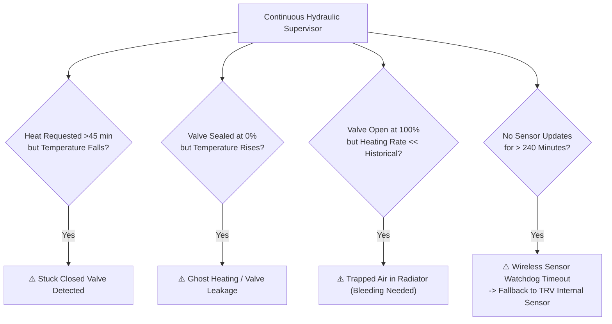

# Plant Safeguards & Hydraulic Diagnostics

STABLE

Multizone Thermostat acts as a supervisory controller for your hydronic plant, protecting boilers from short-cycling wear and catching mechanical faults before they cause damage or waste energy.

---

## 1. Mechanical Fault Surveillance

The diagnostic engine continuously inspects room temperature trajectories against historical learning:

### The 4 Core Mechanical Anomalies

| Anomaly | Trigger Criteria | Automated System Response |
|---|---|---|
| **Stuck Closed Valve** | Room demands heat for > 45 minutes with boiler running, but room temperature continues to drop. | Red alert on Lovelace card, persistent notification in Home Assistant, and activation of `binary_sensor.heating_zones_[room]_anomaly`. |
| **Ghost Heating (Leakage)** | Room temperature rises significantly while the room valve/relay is commanded to 0%. | Warns of damaged valve seats, poor actuator seating, or faulty bypass valves. |
| **Trapped Radiator Air** | Valve is open 100% but warm-up rate is less than 30% of historical rate $R$. | Flags radiator as needing manual air bleeding to restore heat transfer. |
| **Sensor Watchdog Timeout** | Wireless sensor battery dies or loses signal for > 240 minutes (`CONF_ZONE_SENSOR_TIMEOUT`). | **Instant graceful fallback**: automatically regulates using the TRV's internal temperature probe, preventing freezing. |

---

## 2. Mechanical Plant Protections

### 1. Boiler Anti-Short-Cycle Protection
Frequent burner starts reduce condensing efficiency and wear out ignition electrodes:
* `number.master_control_min_cycle_on`: Minimum continuous boiler run time (default: **5 minutes**).
* `number.master_control_min_cycle_off`: Minimum rest period before restart (default: **5 minutes**).

### 2. Motorized Valve Opening Delay (`number.master_control_valve_delay`)
Wax thermal actuators require 90 to 180 seconds to stroke open.
Setting a delay (e.g. **120 seconds**) ensures the boiler and circulator start only when valves are fully open, eliminating water hammer and pipe overpressure.

### 3. Summer Anti-Seize Exercise
During warm months, valves and circulators sit dormant, risking calcification and seizing:
* If idle for > 15 days (`number.master_control_anti_seize_idle_days`), the integration strokes all valves open for 2 minutes (`number.master_control_anti_seize_duration`), closing them immediately after.

### 4. Emergency Anti-Frost Protection
If any room falls below `number.master_control_anti_frost_temperature` (default: **7.0 °C**):
* The system forces 100% emergency heating, overriding window cutouts, master off states, or away presets to protect pipes from freezing.

---

## 3. Advanced OpenTherm Bus Telemetry

* **Water Pressure (Bar)**: Continuous pressure monitoring with low pressure warning under 0.8 Bar.
* **Flow & Return Temperatures (°C)**: Real-time $\Delta T = (T_{\text{flow}} - T_{\text{return}})$ to monitor condensing performance.
* **Flame Modulation (%)**: Real-time percentage burner firing rate.
* **Boiler OEM Fault Codes**: Direct capture and display of manufacturer trouble codes.
* **Domestic Hot Water Priority (DHW Freeze)**: When hot water taps open, the system **freezes PID error integration**, preventing false error accumulation while the boiler diverts output to domestic water.
