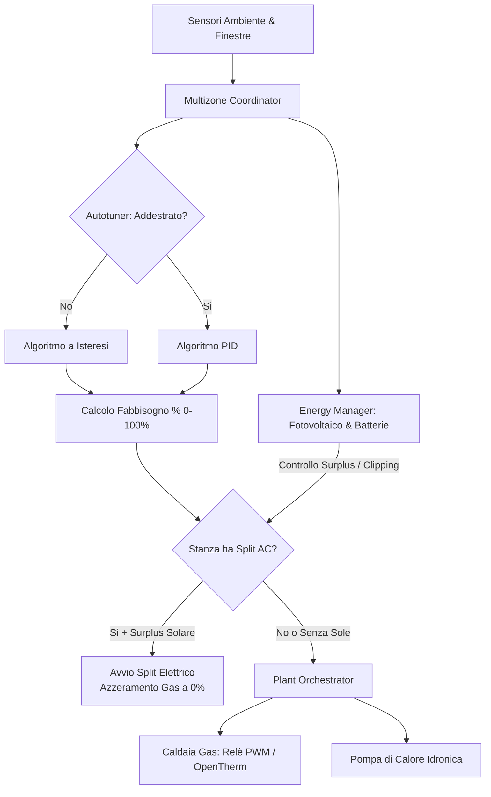

# Multizone Thermostat — Documentazione Ufficiale

Benvenuto nella Wiki e documentazione ufficiale di **Multizone Thermostat**, l'integrazione personalizzata completa per Home Assistant che trasforma la gestione termica della tua casa in un orchestratore autonomo e intelligente.

  <strong>Attenzione: Funzionalità Beta (Fase 11 / v6.1.0-beta)</strong> 
  Le sezioni contrassegnate con il badge BETA descrivono le nuove funzionalità bivalenti, split AC, gestione solare off-grid e commutazione estiva attualmente disponibili sul ramo <code>beta</code> in preparazione al rilascio stabile.

---

## 🌟 Caratteristiche Principali

| Funzionalità | Stato | Descrizione |
|---|:---:|---|
| **Centrale Bivalente (Caldaia + Pompa di Calore)** | BETA | Arbitraggio intelligente tra caldaia a gas e PDC idronica con 5 priorità operative. |
| **Climatizzatori Split AC d'Ambiente** | BETA | Associazione split per stanza, bypass sonda a soffitto e Quick Heat Boost termico. |
| **Surplus Solare & Protezione Batterie Off-Grid** | BETA | Algoritmo anti-clipping inverter, blocco anti-scarica batteria e bridge EMHASS/Predbat. |
| **Raffrescamento Estivo & Doppio Binario** | BETA | Regolazione caldo/freddo, memorie preset isolate e doppio PID con autotuner per il freddo. |
| **Autotuning Dinamico (Hysteresis → PID)** | STABILE | Apprendimento automatico della dispersione termica e transizione a PID senza oscillazioni. |
| **Valvole Proporzionali & 0-10V Analogiche** | STABILE | Apertura continua per riscaldamento a pavimento, fancoil e TRV direct-pin senza PWM. |
| **Doppio Comando Caldaia (Relè PWM / OpenTherm)** | STABILE | Calcolo temperatura di mandata scorrevole o cicli PWM con rispetto anti-short-cycle. |
| **Programmazione Settimanale & Smart Return** | STABILE | Timeline 24h a matrice, gestione multi-profilo e radar termico predittivo di rientro. |
| **Sorveglianza Anomalie Meccaniche** | STABILE | Rilevamento automatico valvole bloccate, trafilamenti di calore e aria nei radiatori. |
| **Schede Lovelace Visual Twin** | STABILE | Parità estetica 1-a-1 con il termostato nativo Home Assistant, touch arco e pulsanti step. |

---

## 🗺️ Architettura Generale

