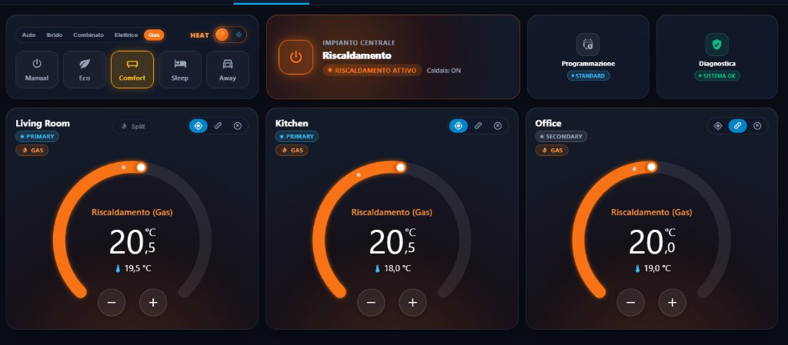
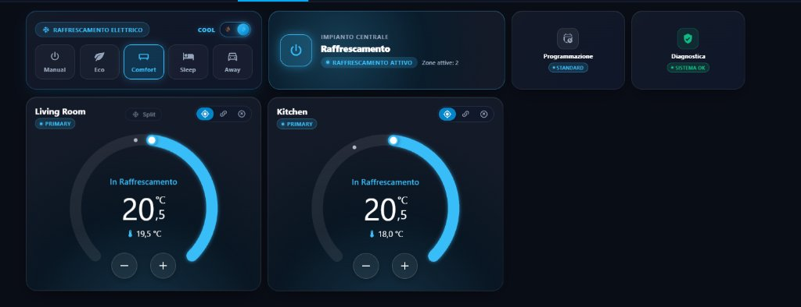
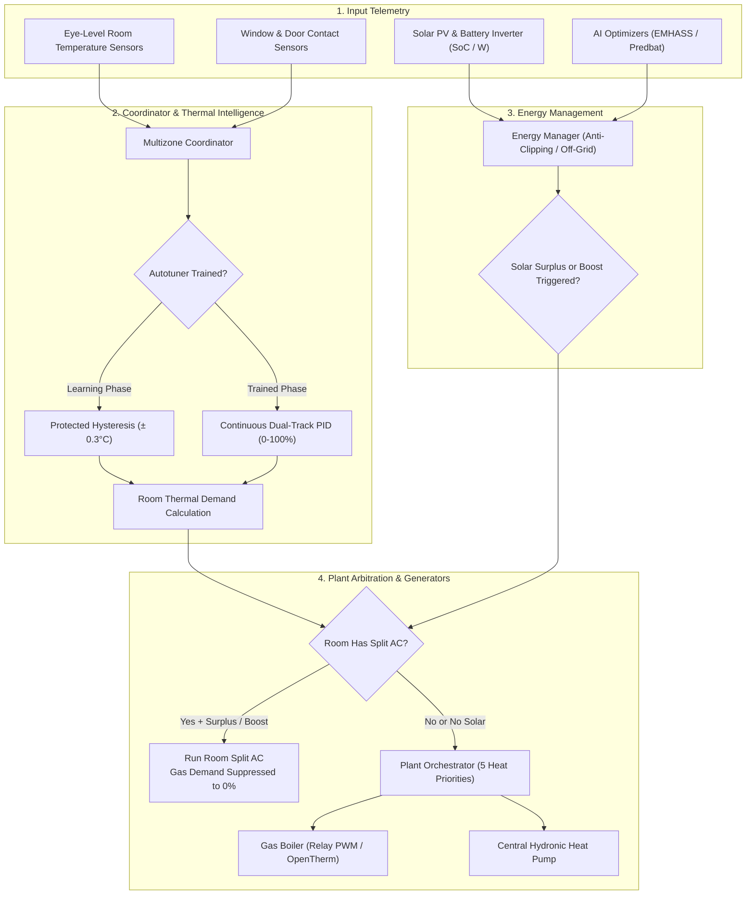

# Multizone Thermostat — The Unified Climate Hub for Home Assistant

Welcome to the official documentation and wiki for **Multizone Thermostat**, the most advanced, modular, and comprehensive custom climate integration designed for Home Assistant.

  <strong>What's New in Phase 11 (v6.1.0-beta.1 — Beta Branch)</strong> 
  Phase 11 introduces comprehensive support for <strong>bivalent central plants (Gas Boiler + Central Hydronic Heat Pump)</strong>, individual <strong>Room Split AC units</strong> with dynamic ceiling sensor bypass, <strong>off-grid & zero-export solar self-consumption</strong> with battery discharge protection, seasonal <strong>Heat 🔥 / Cool ❄️ dual-track preset memory</strong>, and <strong>1-to-1 visual twin Lovelace cards</strong> matching Home Assistant native styling.

---

## 🎯 The Vision: The Unified Home Climate Hub

> **The primary mission of Multizone Thermostat is to become the definitive, all-in-one central climate management hub for Home Assistant.**

In modern homes, HVAC systems are fragmented: condensing boilers controlled by wall thermostats, heat pumps with proprietary mobile apps, split air conditioners controlled via infrared remotes or disconnected integrations, smart TRVs with readings distorted by radiator heat proximity, and rooftop solar inverters feeding surplus electricity to the grid while the house burns fossil gas.

**Multizone Thermostat bridges and orchestrates all of these systems under an autonomous, intelligent brain:**
* **Any Heating / Cooling Generator**: Gas/pellet/oil boilers (Relay PWM or modulating OpenTherm), Central Hydronic Heat Pumps (air-to-water), Room Split Air Conditioners (air-to-air), and Electric Heating Elements.
* **Any Room Terminal**: Radiators with smart TRVs, Underfloor Radiant Heating, Fancoils with analog 0–10V or 0–100% motorized valves, and Direct-expansion Split AC units.
* **Four-Season Comfort**: High/low temperature winter heating and continuous summer chilled-water or split cooling with thermal inertia compensation.
* **Solar Self-Consumption & Energy Storage**: Intelligent activation of solar surplus even on **off-grid / zero-export systems**, active battery discharge safeguards, and direct bridge integration with AI economic optimizers (EMHASS, Predbat, Solcast).

No other integration or commercial thermostat combines this breadth: everything is configured seamlessly via the Home Assistant user interface (UI) without requiring hundreds of lines of complex YAML automations.

---

## 📸 Dashboard Showcase: Winter vs Summer

  

    🔥 Winter Season (Gas Boiler & Split Heat)
    
    
All 3 rooms active, vibrant orange heating aura, target temperature with comma formatting, and local Split boost button.

  

  

    ❄️ Summer Season (Electric Split Cooling)
    
    
Cyan cooling aura, constant-height preset header, and <b>automatic summer filtering</b>: the Office (uncooled radiator only) is hidden!

  

---

## 🌟 What Makes Multizone Thermostat Unique?

The 11 core architectural pillars that set this integration apart:

### 1. Bivalent Hybrid Central Plant (Gas Boiler + Hydronic Heat Pump)
The `PlantOrchestrator` stages and arbitrates between fuel boilers and central heat pumps using **5 selectable priority modes** (`auto`, `hybrid`, `combined`, `electric_only`, `gas_only`). Supports reversible heat pump cooling for radiant floors or fancoils while strictly locking the gas boiler to 0%.

### 2. Room Split AC Integration with Ceiling Sensor Bypass
Each thermal zone can bind an individual room air conditioner (`climate.*`) to work alongside radiators.
* **Real Sensor Injection**: Split units measure warm air pooled at the ceiling, throttling down prematurely; Multizone Thermostat calculates and injects a real-time compensated target based on the eye-level wall sensor.
* **Quick Heat Boost**: When a room starts cold (ΔT ≥ 1.5 °C), split and radiators fire together (**Dual Heat**) to bring the room up to temperature in a fraction of the time.
* **Hydronic Decoupling**: When the room split is active via solar surplus or electric boost, hydronic gas demand for that specific room is suppressed to 0%, closing valves and saving fuel.

### 3. Off-Grid Solar Self-Consumption & Battery Safeguards
Engineered for grid-tied, zero-export, or **completely off-grid standalone systems**:
* **Inverter Anti-Clipping**: Detects battery saturation (SoC ≥ 95%) and PV generation (≥ 300 W), triggering electric heating *before* the inverter throttles solar panel generation.
* **Continuous Discharge Safeguard**: If clouds or heavy household loads pull battery power (> 150 W) continuously for more than 5 minutes, the system **immediately suspends electric heating and restarts the gas boiler**, preserving night reserves.
* **EMHASS / Predbat Bridge**: Direct interface for local AI optimizers using boolean signals or numeric deferrable load sensors in Watts.

### 4. Dual-Track Seasonal Engine (Heat 🔥 / Cool ❄️)
* Master slider switches the entire house between winter heating and summer cooling.
* **Dual-Track Presets**: Presets (*Comfort, Eco, Sleep, Away, Manual*) preserve completely isolated target memories for heating (`presets_heat`) and cooling (`presets_cool`).
* **Dual-Track PID Controllers**: Separate winter and summer PID gains and autotuners to compensate for asymmetrical water temperature heat exchange.

### 5. Dual Boiler Drive (Relay PWM & Modulating OpenTherm)
* **ON/OFF Relay**: Time-Proportional Integral (PWM) cycles with configurable time windows and strict anti-short-cycle burner protection.
* **Modulating OpenTherm**: Direct translation of household Heat Demand (0–100%) into sliding boiler water flow temperatures (35 °C – 75 °C).

### 6. Dynamic Adaptive Autotuning (Hysteresis → Silent PID)
Zones begin in safe Hysteresis mode (± 0.3 °C). The passive observer monitors natural warm-up slope $R$ and delay $L$, calculating optimal Ziegler-Nichols PID gains ($Kp, Ki, Kd, Kff$) and transitioning silently to continuous PID regulation without user intervention or overshoot.

### 7. Hierarchical Thermal Zones (Primary, Secondary, Bypass)
* **Primary**: Can ignite the central boiler whenever heating is demanded.
* **Secondary**: Opens its valve only to "steal" free heat when the boiler is already active for a primary zone, saving fuel.
* **Bypass**: Completely isolates the room from central heating calls.

### 8. Physical TRV Override & Offset Injection
If an occupant turns the physical dial of a smart radiator valve, the coordinator detects the event, syncs setpoints across Home Assistant, and injects offset calibrations to ensure the TRV respects the room's true wall sensor.

### 9. Continuous Mechanical Fault Surveillance
A supervisory engine inspects thermal responses in real time, detecting:
* Stuck closed valves.
* Hydronic leakage (*Ghost Heating* when valves are sealed at 0%).
* Trapped air in radiators requiring bleeding.
* Wireless sensor watchdog timeouts (with instantaneous fallback to internal TRV sensors).

### 10. Building Thermal Retention & Energy Class Metrics
Physical thermal evaluation computed in real time:
* **Estimated European Energy Class (A4 through G)**.
* **Thermal Retention Time**: Hours required for the room to drop by 1.0 °C when heating is idle.
* **Radiator Sizing Evaluation**: Undersized, Optimal, or Oversized.

### 11. Visual Twin Lovelace Cards & Strategy Auto-Generation
Custom cards matching native Home Assistant styling 1-to-1:
* Direct arc touch / click target temperature setting.
* Symmetrical circular step buttons `[-]` and `[+]` (0.5 °C steps).
* Active source badge (`🔥 GAS`, `⚡ ELECTRIC`, `🔥⚡ GAS + ELECTRIC`).
* Dedicated room split button with master safety lockout.
* Automatic dashboard strategies to build complete multi-zone views in 5 lines of YAML.

---

## ⚡ Complete Feature Matrix

### Bivalent Plant & Hybrid Climate (v6.1.0-beta)
* 🔄 **Multi-Generator Staging (`PlantOrchestrator`)**: Arbitrates between Gas Boiler and Central Heat Pump based on 5 configurable priority modes: `auto`, `hybrid`, `combined`, `electric_only`, and `gas_only`.
* ❄️ **Reversible Hydronic Cooling (`heat_pump_cooling`)**: Supports radiant floor or fancoil cooling in summer, strictly locking gas combustion to 0%.
* ⚡ **Full Electric Mode**: Fully functional with central heat pumps or room splits alone without any gas boiler configured.

### Room Split AC Integration (v6.1.0-beta)
* 🎯 **Per-Zone Split Unit Association**: Connects room air conditioners (`climate.*`) as secondary/auxiliary climate actuators with configurable roles (`heat_cool`, `heating_only`, `cooling_only`).
* 🌡️ **Ceiling Sensor Bypass (Target Injection)**: Compensates for ceiling heat accumulation by continuously injecting corrected targets based on real room sensor measurements.
* 🚀 **Quick Heat Boost (Thermal Shock)**: Engages the split alongside radiators when cold ($\Delta T \ge 1.5^\circ\text{C}$), automatically disengaging once comfort is reached ($\Delta T \le 0.3^\circ\text{C}$).
* 🛑 **Automatic Hydronic Decoupling**: Suppresses gas demand to `0.0%` for rooms currently heating with the electric split.
* 🔘 **Independent Room Split Manual Button**: Header button on the Dial card allowing single-room electric split run when Master heating is OFF, with automated safety lockout when Master is active.

### Solar Self-Consumption & Energy Management (v6.1.0-beta)
* ☀️ **Off-Grid & Inverter Clipping Detection**: Triggers electric surplus heating based on Battery SoC ($\ge 95\%$) and PV generation ($\ge 300\text{ W}$) before zero-export inverters throttle panel production.
* 🛡️ **Battery Anti-Discharge Safeguard**: Automatically cancels electric surplus and restores gas baseline if the battery discharges ($> 150\text{ W}$) continuously for more than 5 minutes.
* 🔋 **Night Battery Reserve SoC**: Ensures battery does not drop below a user-defined threshold (e.g. 50-85%) for heating.
* 🤖 **EMHASS & Predbat Integration**: Native support for boolean signals and numerical deferred load sensors (`p_deferrable0 > 0 W`).
* 🏠 **Solar Thermal Overheating Offset**: Configurable boost ($0.0^\circ\text{C} \dots +3.0^\circ\text{C}$) to store free solar thermal energy into walls and floors during sunny hours.
* ⏱️ **Compressor Anti-Chatter Protection**: 10-minute minimum cycle run time protects inverter compressors from cloud transients.

### Core Climate & Zone Management
* 🖥️ **100% UI Config Flow & Collapsible Sections (v5.0.1)**: Clean accordion-style configuration wizard organized into collapsible sections (*TRVs*, *Proportional & 0-10V Valves*, *Relay Actuators*, *Room Split AC*, *Protections & Advanced Settings*) without YAML.
* 🎛️ **Proportional & 0-10V Valve Control (v5.0.1)**: Direct, continuous opening control for motorized actuators, underfloor manifolds, and direct-pin TRVs. Supports both percentage (`0-100%`) and analog voltage (`0.0-10.0 V`) via `valve` or `number` entities with integrated bus anti-chatter deadband.
* 🔘 **Master Switch & Seasonal Commutation**: One central switch to enable or disable the entire system, with seamless seasonal toggle between Heating 🔥 and Cooling ❄️.
* 🏠 **Hierarchical Zone Modes**: Per-zone selector (`Primary`, `Secondary`, `Bypass`) accessible directly from Lovelace cards.
* 📍 **Geofencing & Dynamic Presence**: Automatically switches to Away or Sleep presets based on home occupancy sensors.
* 🪟 **Window Sensor Detection**: Automatically bypasses a zone when a window is opened, and restores it when closed.
* 🌡️ **Virtual Thermostats**: Combine any simple heater switch (relay, underfloor actuator) and temperature sensor into a fully featured PID climate entity.
* 🧠 **Multi-TRV Aggregation**: Group multiple TRVs in the same room; the system automatically calculates their average temperature and syncs their targets.
* 🔄 **Dual-Track Presets & Dynamic Memory**: Manual, Eco, Comfort, Sleep, Away. Presets store independent temperatures for winter heating and summer cooling.
* 📅 **Global Calendar Integration & Predictive Smart Start**: Schedules presets via Home Assistant's native Local Calendar and preheats rooms ahead of time based on learned thermal retention models.
* 🌤️ **Adaptive Weather Compensation**: Dynamic Feed-Forward heating adjustment based on an outdoor temperature sensor. The system automatically learns each room's thermal dispersion to adapt the compensation curve.

### Hardware Protection & Safety
* 🛡️ **Anti-Short-Cycle Engine**: Configurable minimum ON and minimum OFF times to prevent rapid boiler cycling and extend burner relay lifespan.
* ⏱️ **Valve Opening Delay**: Configurable delay to ensure thermoelectric actuators have fully opened before igniting the boiler.
* 🐕 **Watchdog Sensor Timeout & TRV Fallback (v4.7)**: Configurable per zone (`sensor_timeout_min`). If an external wireless sensor drops offline or its battery runs out, the zone automatically falls back to the TRV's internal temperature probe to maintain heating, automatically restoring once the external sensor recovers.
* ❄️ **Anti-Frost Protection Override (v4.3)**: Global safety override with dedicated switch (`switch.multizone_thermostat_anti_frost_protection`) and threshold control (`number.frost_protection_temp`). Forces emergency heating at 100% demand when room temperature drops below frost threshold, ignoring open window and master off blocks to prevent frozen pipes.
* ☀️ **Summer Anti-Seize Protection**: Cyclical exercise of boiler pumps and zone valves during idle summer months to prevent mechanical seizure.
* 🔄 **Bidirectional Physical Climate Sync (v4.3)**: Dynamic toggle switches allowing physical hardware buttons on TRVs to propagate setpoint adjustments to the virtual zone without fighting, with parental lock capability.

### Plant Diagnostics & Building Efficiency (v4.5 - v4.7)
* 🔍 **Central Plant Health Monitoring**: Real-time tracking of boiler ignition frequency (cycles/hour), cumulative 24h runtime, and real-time state reasons.
* 🔥 **OpenTherm Telemetry & Error Bus (v4.7)**: Automatic discovery of water pressure (Bar), return temperature (°C), flame active state, burner modulation %, and OEM fault codes. Includes DHW (Domestic Hot Water) priority detection to freeze zone PID loops during hot water draw-off.
* 🔋 **Universal Battery Surveillance (v4.7)**: Automatically resolves battery charge levels across Zigbee2MQTT, ZHA, and Tuya/Avatto devices, displaying battery percentages in thermostat attributes and diagnostic cards.
* 🚨 **Mechanical Anomaly Detection**: Automatic detection of stuck valves (heat demanded for >45m but room temperature drops) and ghost heating leakage (room temperature rises while valve is closed).
* ♨️ **Apporto Termico Passivo (Passive Heat Intake)**: Switchable per zone (`allow_passive_heat`), tailored for open lofts, mezzanines, or fan coils without cutoff valves to prevent false ghost-heating alerts.
* 📊 **European Building Energy Classes (A4 → G)**: Theoretical energy grade calculated from thermal dispersion and outdoor weather $\Delta T$.
* ⏱️ **Thermal Retention Time**: Displays estimated hours needed for each room to lose $1.0^\circ\text{C}$.
* 📐 **Radiator Sizing Evaluation**: Identifies whether the heating emitter is optimal, undersized, or oversized for the space.
* 🩺 **HA Native Diagnostics & Trace Engine (v4.4)**: Downloadable JSON diagnostics directly from Home Assistant's device settings.

---

## 🏛️ System Architecture Flowchart

---

## 🚀 Documentation Index

* **Installation & Setup**:
  * [📥 Installation & Requirements](installation.md)
  * [⚙️ Setup Wizard (Config Flow & Options)](setup_wizard.md)
* **Phase 11 (Beta Features)**:
  * [🔥 Bivalent Central Plant & Energy Management](hybrid_energy.md)
  * [❄️ Room Split Air Conditioners](split_climate.md)
  * [🔄 Summer Cooling & Dual-Track Regulation](cooling_season.md)
* **Algorithms & Core Controls**:
  * [🧠 Autotuning, PID & 0-10V Analog Actuators](algorithms_tuning.md)
  * [📅 Weekly Scheduling & Smart Return](scheduling.md)
  * [🛡️ Plant Safeguards & Hydraulic Diagnostics](diagnostics_safety.md)
* **Reference & Guides**:
  * [📋 Entities Created & Exposed Services](entities_services.md)
  * [❓ Troubleshooting & FAQ](faq_troubleshooting.md)
* **User Interface**:
  * [🎨 Complete Lovelace Cards Guide](cards_guide.md)
  * [🎮 Interactive Live Simulator (3 Dashboards)](simulator_view.md)
