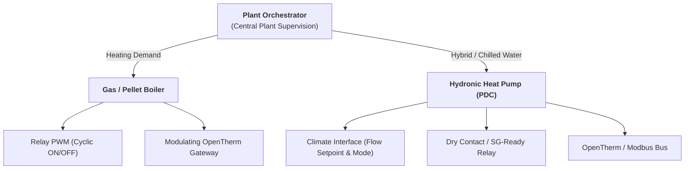
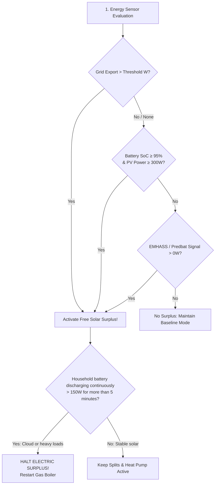

# Bivalent Central Plant & Energy Management

BETA

Phase 11 transforms Multizone Thermostat into an advanced thermal and energy orchestration platform (`PlantOrchestrator` & `EnergyManager`), coordinating combustion boilers and hydronic heat pumps while maximizing renewable solar self-consumption—even in completely **off-grid** or zero-export environments.

---

## 1. Bivalent Central Plant (Gas Boiler + Heat Pump)

The central plant engine arbitrates between two primary generator tiers:

### Supported System Architectures
1. **Standard Bivalent Hybrid System**: Gas boiler handles cold winter baselines; heat pump engages during mild shoulder seasons or summer cooling.
2. **Full-Electric Installation (Heat Pump Only)**: By disabling the boiler (`enable_gas_heater: False`), the heat pump manages 100% of the home's heating and cooling.
3. **Traditional Gas Boiler + Room Split AC Units**: Central boiler serves hydronic radiators while individual room splits leverage free rooftop solar power.

---

## 2. The 5 Heat Source Priorities

Configurable from the Lovelace Preset Card or via `select.master_control_heat_source_priority`:

| Priority | Gas Boiler Behavior | Electric Behavior (Splits & Heat Pump) | Recommended Scenario |
|---|---|---|---|
| **`auto`** | Covers household baseline heating. | Engages automatically during **Free Solar Surplus**, EMHASS dispatch, or cold **Quick Heat Boost** (ΔT ≥ 1.5 °C). | Set-and-forget everyday comfort. |
| **`hybrid`** | Heats conventional rooms via hydronics. | Rooms with split units use electric heating **only when solar surplus is available**; falls back to gas without sun to preserve batteries. | Homes with home batteries to preserve for the night. |
| **`combined`** | Maintains steady hydronic heating. | Operates in parallel with gas during solar surplus or large temperature drops to warm the house as quickly as possible. | Large houses or returning from prolonged absence. |
| **`electric_only`** | **Locked at 0%** (zero gas burned). | 100% of heat demand directed to central heat pump and room split units. | All-electric homes, gas supply outages, or peak sunny days. |
| **`gas_only`** | 100% of heat demand supplied by gas. | Splits and heat pumps disabled in heating mode. | Prolonged bad weather or AC maintenance. |

---

## 3. Solar Self-Consumption & Off-Grid Standalone Systems

Traditional solar diverters require a grid export sensor (`grid_export > 500 W`).
This fails on **off-grid standalone setups** or **zero-export inverters (curtailment)**, where export power is 0 W and the inverter curtails panel generation as soon as the battery is full.

Multizone Thermostat uses an intelligent anti-clipping algorithm:

### Essential Battery Safeguards

1. **Continuous Discharge Timeout (`battery_max_discharge_time`)**:
   If passing clouds or heavy household appliances (oven, induction hob) cause continuous battery discharge (> 150 W) for longer than the configured timeout (default: **5 minutes**), the system immediately suspends electric heating and **restarts the gas boiler**, safeguarding night reserves.
2. **Minimum Night Reserve SoC (`battery_min_reserve_soc`)**:
   Hard security floor (recommended 80–85%). Electric solar heating is strictly locked out if the battery falls below this level.
3. **Compressor Anti-Chatter Protection (`solar_min_run_time`)**:
   Enforces a minimum continuous run time (default: **10 minutes**) on inverter heat pump and split compressors to prevent wear from transient cloud shadows.
4. **Thermal Pre-Storage in Building Walls (`solar_overheat_offset`)**:
   During peak solar hours when batteries are saturated, the system can temporarily elevate the target temperature of conditioned rooms by **+0.5 °C** to **+3.0 °C**, storing free solar energy directly into the building's thermal mass.

---

## 4. AI Optimizer Bridge (EMHASS & Predbat)

Connect your local economic optimizer directly:
* **Boolean Signals**: Recognizes `on`, `true`, `active`, `boost`.
* **Numeric Power Sensors**: If EMHASS schedules a deferrable load (e.g. `sensor.p_deferrable0`), Multizone Thermostat monitors the numeric Watt value: as soon as it reads $> 0\text{ W}$, solar surplus engages automatically.

---

## 5. Configuration Parameters Reference

| Parameter | Configuration Key | Default | Description |
|---|---|---|---|
| Gas Boiler Enable | `enable_gas_heater` | `True` | If disabled, operates in pure Full-Electric mode. |
| Heat Pump Enable | `enable_heat_pump` | `False` | Enables central hydronic heat pump coordination. |
| Heat Pump Type | `heat_pump_type` | `climate` | Select from `climate`, `switch`, or `opentherm`. |
| Reversible Cooling | `heat_pump_cooling` | `True` | Enables chilled water cooling while locking gas combustion. |
| Energy Management | `energy_management_enabled` | `False` | Master switch for the Energy Manager. |
| Solar PV Sensor | `solar_power_sensor` | `None` | Real-time rooftop solar generation in Watts. |
| Grid Export Sensor | `grid_export_sensor` | `None` | Grid feed-in sensor in Watts (optional). |
| Export Threshold | `solar_export_threshold` | `500.0 W` | Minimum export power to trigger surplus mode. |
| Battery SoC Sensor | `battery_soc_sensor` | `None` | Battery state of charge percentage (0-100%). |
| Battery Power Sensor | `battery_power_sensor` | `None` | Battery charge/discharge power in Watts. |
| Night Reserve SoC | `battery_min_reserve_soc` | `20.0%` | Recommended 80–85% to preserve battery overnight. |
| Max Discharge Time | `battery_max_discharge_time` | `5 min` | Max consecutive discharge minutes before gas fallback. |
| Min Cycle Duration | `solar_min_run_time` | `10 min` | Inverter compressor anti-chatter protection. |
| Thermal Mass Offset | `solar_overheat_offset` | `0.0°C` | Target elevation during free solar surplus (up to +3.0°C). |
| External AI Override | `external_solar_override_entity` | `None` | EMHASS deferrable load sensor or Predbat signal. |
