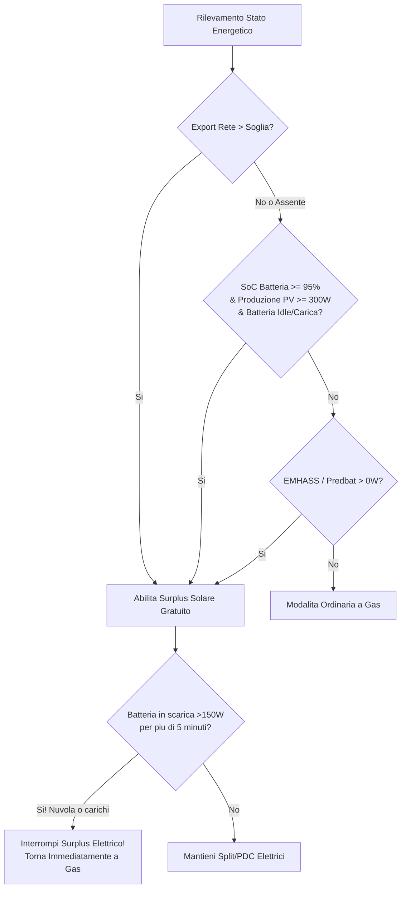

# Centrale Bivalente & Gestione Energetica

BETA

La **Fase 11** introduce un motore di orchestrazione termico ed energetico avanzato (`PlantOrchestrator` & `EnergyManager`), capace di gestire contemporaneamente caldaie a combustibile e pompe di calore idroniche, ottimizzando l'autoconsumo da fotovoltaico anche in contesti Off-Grid.

---

## 1. Centrale Termica Bivalente (Caldaia + Pompa di Calore)

L'impianto centrale può pilotare contemporaneamente o alternativamente:
1. **Caldaia a Gas / Combustibile**:
   * Relè ON/OFF con cicli PWM intelligenti.
   * Modulante OpenTherm con regolazione dinamica della temperatura dell'acqua in base al fabbisogno reale ($35^\circ\text{C} - 75^\circ\text{C}$).
2. **Pompa di Calore Idronica (PDC)**:
   * Termostato dedicato (`climate.*`), contatto pulito/SG-Ready (`switch.*`), oppure modulazione OpenTherm/Modbus.
   * Modalità estiva reversibile per impianti radianti o fancoil con blocco assoluto della caldaia a gas a 0%.

### Le 5 Priorità di Riscaldamento
Selezionabili direttamente dal selettore a pillola della card Lovelace o tramite `select.master_control_heat_source_priority`:

| Modalità | Comportamento Gas | Comportamento Elettrico (Split & PDC) |
|---|---|---|
| **`auto`** | Copre il fabbisogno di base dell'abitazione | Subentra con **Surplus Solare**, pianificazione EMHASS o avvio rapido **Quick Boost** |
| **`hybrid`** | Riscalda tutte le stanze convenzionali | Le stanze con split usano l'elettrico **solo se c'è sole**; senza sole tornano a gas per non consumare la batteria |
| **`combined`** | Lavora stabilmente a regime idronico | Interviene in parallelo al gas in caso di surplus solare o forte shock termico ($\Delta T \ge 1.5^\circ\text{C}$) |
| **`electric_only`** | **Forzato a 0%** (zero gas bruciato) | 100% della richiesta termica gestito da PDC centrale e split |
| **`gas_only`** | 100% della richiesta termica a gas | Split e PDC disattivati in riscaldamento |

---

## 2. Autoconsumo Fotovoltaico, Sistemi Off-Grid & Clipping

A differenza di molti algoritmi che richiedono obbligatoriamente un sensore di esportazione verso la rete pubblica, il motore energetico è pensato anche per **impianti a isola (Off-Grid)** o con inverter a immissione zero (*curtailment/zero-export*):

### Salvaguardie Fondamentali per la Batteria
* **Guardia Anti-Scarica Continua (`battery_max_discharge_time`)**:
  Se la casa comincia ad assorbire energia dalla batteria domestica (scarica continua $> 150\text{ W}$) per un periodo configurabile (default: **5 minuti consecutivi**), il sistema interrompe l'overheat elettrico e **riaccende la caldaia a gas**, preservando l'accumulo per la sera.
* **Riserva Minima Notturna (`battery_min_reserve_soc`)**:
  Soglia minima di sicurezza (es. 80% o 85%). Al di sotto di questa soglia l'impianto termico non può mai attingere alla batteria per riscaldare la casa.
* **Anti-Pendolamento Compressori (`solar_min_run_time`)**:
  Garantisce che una volta avviato un compressore elettrico, esso resti in marcia continuativa per almeno 10 minuti, proteggendo la meccanica dell'inverter da nuvole passeggere.
* **Accumulo Termico nei Muri (`solar_overheat_offset`)**:
  Possibilità di incrementare temporaneamente la temperatura ambiente delle stanze fino a **+3.0°C** durante il picco solare gratuito, trasformando l'edificio in una batteria termica.

---

## 3. Bridge Predittivo EMHASS & Predbat
Puoi collegare direttamente l'entità di output del tuo ottimizzatore economico:
* Riconosce segnali booleani (`on`, `true`, `boost`).
* Riconosce **sensori numerici in Watt** (es. `sensor.p_deferrable0 > 0 W`).
