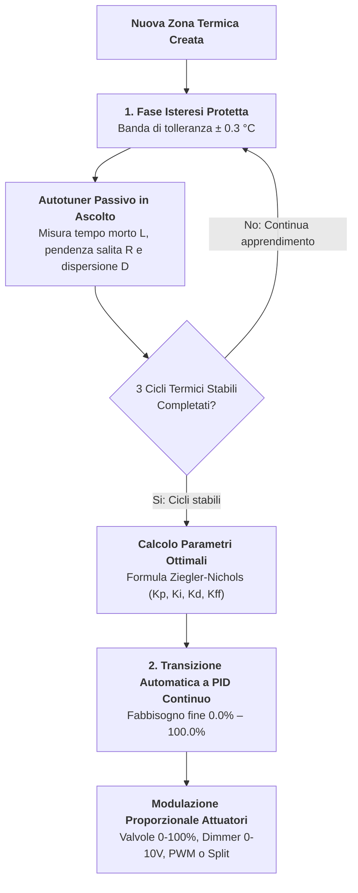
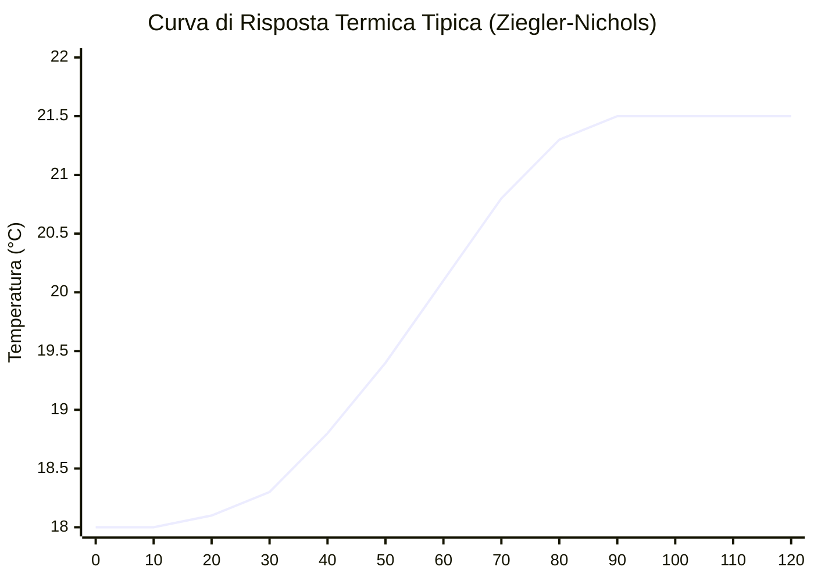

# Algoritmi di Termoregolazione & Autotuning

STABILE

Il cuore di **Multizone Thermostat** è un motore matematico a due stadi progettato per eliminare le complesse tarature manuali dei termostati tradizionali, garantendo comfort termico senza pendolamenti e ottimizzando il consumo energetico.

---

## 1. Architettura a Due Stadi: Da Isteresi a PID

Quando una zona termica viene configurata per la prima volta, il sistema non conosce la fisica dell'ambiente (capacità termica dell'aria e delle pareti, dispersione verso l'esterno, potenza erogata dal corpo scaldante).

Per evitare oscillazioni incontrollate o surriscaldamenti durante i primi avvii, l'integrazione adotta una strategia dinamica di auto-apprendimento:

### Stadio 1: Isteresi Adattiva (Fase di Apprendimento)
* **Banda di tolleranza**: ± 0.3 °C rispetto al setpoint impostato.
* **Comportamento**: La valvola o il relè si aprono quando la temperatura scende sotto $(T_{\text{target}} - 0.3\ ^\circ\text{C})$ e si chiudono al raggiungimento di $(T_{\text{target}} + 0.3\ ^\circ\text{C})$.
* **Obiettivo**: Mantenere la stanza confortevole mentre l'osservatore matematico registra la risposta reale al gradino termico.

### Stadio 2: Regolazione PID Continua
* Una volta completata la fase di apprendimento, la zona passa in modo trasparente alla modulazione proporzionale integrale derivativa.
* Il fabbisogno termico della stanza viene espresso su scala continua **da 0.0% a 100.0%**, aggiornato a ogni lettura della sonda.

---

## 2. Autotuning Passivo (Ziegler-Nichols Adattivo)

L'algoritmo di autotuning di Multizone Thermostat è **completamente passivo**: non forza mai l'impianto in cicli di riscaldamento artificiali dannosi per la caldaia o fastidiosi per gli inquilini.

L'osservatore monitora l'andamento reale della stanza analizzando la curva di risposta al gradino:

### Parametri Fisici Misurati
1. **Tempo Morto $L$ (Ritardo Idraulico & Inerzia)**:
   Il tempo in minuti trascorso tra l'apertura della valvola/accensione caldaia e il momento in cui la temperatura ambiente comincia effettivamente a salire di almeno 0.1 °C.
2. **Pendenza Massima di Risalita $R$ (°C/ora)**:
   La velocità con cui la temperatura cresce nella fase di riscaldamento a pieno carico.
3. **Tasso Naturale di Dispersione $D$ (°C/ora)**:
   La velocità con cui la temperatura cala a valvole chiuse in assenza di apporti termici.

### Derivazione dei Guadagni
Dai valori $L$, $R$ e $D$, l'autotuner calcola i coefficienti di regolazione:

* **Guadagno Proporzionale**: $K_p = \frac{1.2}{R \cdot L}$
* **Tempo Integrale**: $T_i = 2.0 \cdot L \quad \implies \quad K_i = \frac{K_p}{T_i}$
* **Tempo Derivativo**: $T_d = 0.5 \cdot L \quad \implies \quad K_d = K_p \cdot T_d$

* **Anti-Windup Integrale**: Il termine integrale $K_i$ è limitato matematicamente per impedire l'accumulo di errore quando la caldaia è spenta o durante assenze prolungate.
* **Filtro Derivativo a Basso Passaggio**: Il termine $K_d$ è attenuato per ignorare rumori di lettura ad alta frequenza generati da sonde Zigbee o correnti d'aria passeggere.

---

## 3. Gestione Attuatori Idronici (Valvole & Relè)

Multizone Thermostat traduce il fabbisogno percentuale (0–100%) in comandi precisi in funzione dell'hardware presente in ogni stanza:

| Tipologia Attuatore | Metodo di Pilotaggio | Descrizione |
|---|---|---|
| **Valvole Proporzionali 0–100%** | Entità `valve.*` diretta | Imposta l'apertura fisica della valvola proporzionale al fabbisogno calcolato. |
| **Moduli Analogici 0–10V** | Entità `number.*` scalata | Converte linearmente il fabbisogno percentuale in tensione: $V_{\text{out}} = (\% / 100) \cdot 10.0\text{ V}$. Ideale per servomotori di collettori a pavimento o fancoil. |
| **Relè Elettrotermici (PWM)** | Entità `switch.*` temporizzata | Applica una modulazione a larghezza di impulso con finestra temporale standard (es. 15 minuti). Un fabbisogno del 40% corrisponde a 6 minuti di relè ON e 9 minuti OFF. |
| **Teste Termostatiche TRV (Direct-Pin)** | Entità `valve.*` interna | Se la TRV espone il controllo diretto dello spillo, bypassa l'algoritmo interno del produttore, pilotando direttamente la posizione meccanica per evitare conflitti tra due algoritmi PID concorrenti. |
| **Teste TRV Standard (`climate.*`)** | Offset matematico calibrato | Se la TRV accetta solo setpoint numerici, inietta uno scostamento dinamico per allinearla alla temperatura della stanza misurata ad altezza uomo. |

---

## 4. Compensazione Climatica Esterna (Curva Climatica)

La regolazione può essere arricchita dalla compensazione climatica predittiva (**Feed-Forward**), collegando un sensore di temperatura esterna (`CONF_WEATHER_SENSOR`):

$$T_{\text{mandata}} = T_{\text{base}} + K_{\text{curva}} \cdot (20^\circ\text{C} - T_{\text{esterno}})$$

* **Vantaggio**: Quando fuori la temperatura crolla repentinamente, l'integrazione incrementa anticipatamente il calore erogato prima ancora che la stanza interna si raffreddi.
* **Sensibilità regolabile**: Tramite il parametro `number.master_control_weather_curve` (default: 0.0 disabilitato, consigliato 0.5–1.5 per radiatori, 0.2–0.6 per pavimento radiante).

---

## 5. Strategie di Aggregazione del Fabbisogno Centrale

Quando più stanze richiedono calore contemporaneamente, come viene calcolato il carico da inviare alla centrale termica? Tramite il selettore `select.master_control_demand_strategy`:

1. **`max` (Massimo tra le zone)**:
   La richiesta della centrale termica coincide con il valore più alto registrato tra tutte le zone attive. Ideale per impianti a radiatori tradizionali ad alta temperatura.
2. **`weighted_average` (Media Ponderata)**:
   Ogni zona contribuisce alla richiesta proporzionalmente al proprio peso volumetrico (`weight` configurabile nella stanza, default 1.0). Evita accensioni spinte della caldaia per un piccolo disimpegno.
3. **`sum_capped` (Somma Saturata a 100%)**:
   I fabbisogni di tutte le stanze si sommano tra loro fino al massimo del 100%. Ideale per collettori con molteplici circuiti indipendenti.
