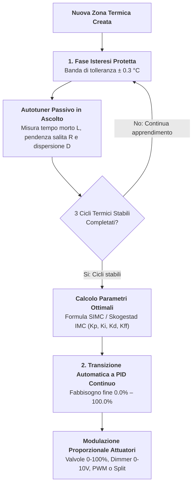
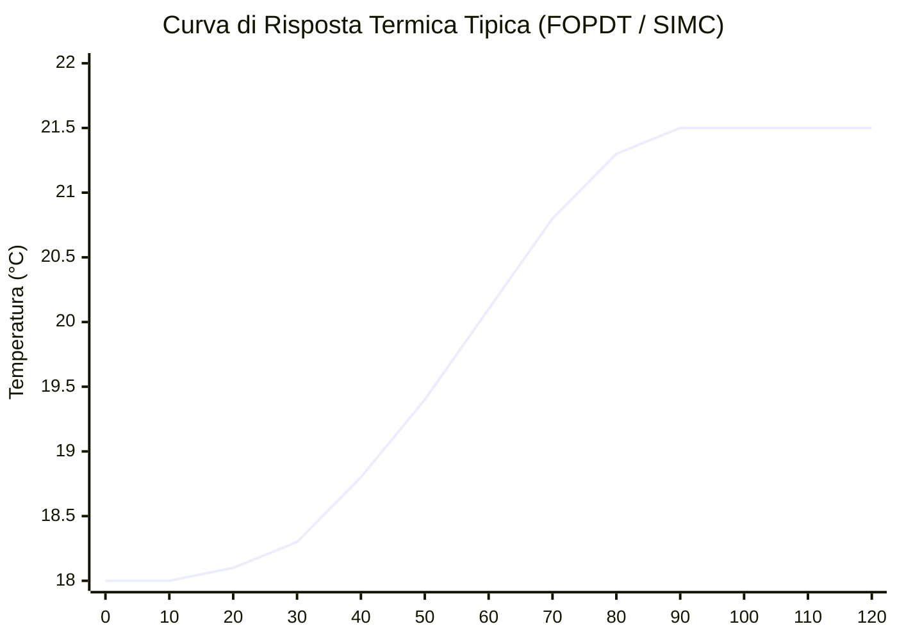

# Algoritmi di Termoregolazione & Autotuning

STABILE

Il cuore di **Multizone Thermostat** è un motore matematico a due stadi progettato per eliminare le complesse tarature manuali dei termostati tradizionali, garantendo comfort termico senza pendolamenti e ottimizzando il consumo energetico.

---

## 1. Architettura a Due Stadi: Da Isteresi a PID

Quando una zona termica viene configurata per la prima volta, il sistema non conosce la fisica dell'ambiente (capacità termica dell'aria e delle pareti, dispersione verso l'esterno, potenza erogata dal corpo scaldante).

Per evitare oscillazioni incontrollate o surriscaldamenti durante i primi avvii, l'integrazione adotta una strategia dinamica di auto-apprendimento:

### Stadio 1: Isteresi Adattiva (Fase di Apprendimento)
* **Banda di tolleranza**: ± 0.3 °C rispetto al setpoint impostato.
* **Comportamento**: La valvola o il relè si aprono quando la temperatura scende sotto $(T_{\text{target}} - 0.3\ ^\circ\text{C})$ e si chiudono al raggiungimento di $(T_{\text{target}} + 0.3\ ^\circ\text{C})$.
* **Obiettivo**: Mantenere la stanza confortevole mentre l'osservatore matematico registra la risposta reale al gradino termico.

### Stadio 2: Regolazione PID Continua & Smart Stop Dinamico
* Una volta completata la fase di apprendimento, la zona passa in modo trasparente alla modulazione proporzionale integrale derivativa.
* Il fabbisogno termico della stanza viene espresso su scala continua **da 0.0% a 100.0%**, aggiornato a ogni lettura della sonda.
* **Smart Stop Dinamico**: In modalità Smart PID, l'anticipo Smart Stop viene scalato dinamicamente sulla pendenza reale di riscaldamento (`last_slope`): frena attivamente durante le rampe di salita e scende a **offset 0.0 °C a regime o in raffreddamento**, permettendo alla stanza di mantenere il setpoint esatto senza fermarsi leggermente sotto (l'Isteresi conserva invece lo Smart Stop statico completo).

---

## 2. Autotuning Passivo (SIMC — Skogestad IMC)

L'algoritmo di autotuning di Multizone Thermostat è **completamente passivo**: non forza mai l'impianto in cicli di riscaldamento artificiali dannosi per la caldaia o fastidiosi per gli inquilini.

L'osservatore monitora l'andamento reale della stanza analizzando la curva di risposta al gradino:

### Parametri Fisici Misurati
1. **Tempo Morto $L$ (Ritardo Idraulico & Inerzia)**:
   Il tempo in minuti trascorso tra l'apertura della valvola/accensione caldaia e il momento in cui la temperatura ambiente comincia effettivamente a salire di almeno 0.1 °C.
2. **Pendenza Massima di Risalita $R$ (°C/ora — Regressione OLS)**:
   Estratta tramite **regressione lineare ai minimi quadrati (OLS)** su finestre mobili ($\ge 180\text{ s}$ e $\ge 3$ campioni) per filtrare i gradini di quantizzazione dei sensori, con fallback pulito su finestre rade.
3. **Tasso Naturale di Dispersione $D$ & Coefficiente Newton $k_{\text{loss}}$**:
   Velocità di raffreddamento quieto (°C/ora) e coefficiente esponenziale indipendente dal meteo $k_{\text{loss}}$ (`1/h`).

### Derivazione dei Guadagni (SIMC — Skogestad IMC)
Dal tempo morto $L$ (in secondi) e dalla pendenza normalizzata sul carico $R_{\text{eff}} = R_{\text{max}} / \max(0.7, \min(1.0, u_{\text{avg}}))$ (in °C/s), l'autotuner ricava coefficienti **SIMC (Skogestad IMC)** tarati per il comfort domestico con costante $\tau_c = \max(2.0 \cdot L,\ 600.0\text{ s})$:

* **Guadagno Proporzionale**: $K_p = \text{clamp}\!\left(\frac{100.0}{R_{\text{eff}} \cdot (\tau_c + L)},\ 10.0,\ 500.0\right)$
* **Tempo Integrale**: $T_i = \max(900.0,\ 4.0 \cdot (\tau_c + L)) \quad \implies \quad K_i = \min\!\left(0.15,\ \frac{K_p}{T_i}\right)$
* **Tempo Derivativo**: $T_d = \min(60.0,\ 0.25 \cdot L) \quad \implies \quad K_d = \min\!\left(500.0,\ K_p \cdot T_d\right)$

* **Aggregazione a Mediana Coerente `(L, slope)`**: Al termine dei cicli iniziali, `_compute_final_pid()` calcola la mediana coerente dei parametri fisici `(median(L), median(slope))` e ricava `(Kp, Ki, Kd)` da quella coppia, evitando che singoli cicli anomali a caldo gonfino $K_i$ o generino guadagni aggressivi.
* **Integrale Trapezoidale, Deadband & Anti-Windup**: Usa **integrazione trapezoidale** (`0.5 * (last_error + error) * dt`) con una **banda morta di `0.03 °C`** (`INTEGRAL_DEADBAND`) per azzerare micro-derive da quantizzazione, unita a integrazione condizionale, back-calculation (`max_dt = 600 s`), limiti fisici (`Ti >= 900 s`, `Ki <= 0.15`) e reset intelligente su cali setpoint (`>= 1.5 °C`).
* **Derivata ai Minimi Quadrati su 15 Minuti & Filtro Anti-Flickering**: Il termine $D$ è calcolato tramite regressione lineare ai minimi quadrati su finestra di `900 s` (15 min, almeno `3` campioni su almeno 5 min, limitata a `±15.0%`), con guardia `MIN_DERIVATIVE_TEMP_SPAN = 0.105 °C` che elimina i falsi picchi sulle sonde wireless con risoluzione a step di `0.1 °C`.
* **Tempo Morto Esteso & Apprendimento Intermedio**: Supporta massetti radianti lenti fino a 4 ore (`L <= 14400 s`). L'apertura finestra sospende istantaneamente le rampe dell'autotuner. Le rampe candidate settimanali richiedono `demand >= 85%` (`>= 300 s`, `>= 0.4 °C`, normalizzazione duty `>= 70%`) con guardia anti-avvio-caldo su gap di `1800 s` (`_was_idle_before_ramp`).

### EMA Settimanale, Guardrail Anti-Overshoot & PID Manuale Dual-Season
* **EMA Settimanale & Guardrail Anti-Overshoot Automatico**: Dopo i primi 3 cicli, l'osservatore rifinisce i guadagni settimanalmente (`alpha = 0.15`, `>= 3` candidati, `±10%/settimana`, `[0.5x, 2.0x]` baseline). Prima di ogni aggiornamento settimanale salva uno snapshot (`pre_kp/ki/kd`) e monitora i successivi **`2` picchi di overshoot post-spegnimento** (`GUARDRAIL_MIN_CYCLES = 2`): se l'overshoot supera **`0.45 °C`** peggiorando di **`> +0.25 °C`** rispetto alla baseline, l'autotuner **ripristina automaticamente** i parametri precedenti (`weekly_guardrail_status = "reverted"` su `AutotuneSensor`; controllo in scadenza dopo `7` giorni o annullato su modifica manuale).
* **Controllo Manuale per Zona & Blocco di Sicurezza**: Il dispositivo di ogni singola zona (`Zona <Nome>`) espone nella sezione **Configurazione** le entità `PID Kp` (`0.1–500.0`), `PID Ki` (`0.0–10.0`), `PID Kd` (`0.0–50000.0`) (`number`), `PID Manual Unlock` (`switch`, bloccato di default) e `Reset Autotuner` (`button`).
* **Isolamento Doppio Binario (`heat` / `cool`)**: I parametri PID di riscaldamento e raffrescamento sono separati; modifiche manuali o reset agiscono solo sulla stagione attiva (o sul parametro `mode` dei servizi `set_pid_parameters` / `reset_autotune`). I parametri modificati manualmente non vengono sovrascritti dall'EMA automatica.
* **Seed Autotuner, Modalità PI Puro & Backup Pre-Reset (`v6.1.0-beta`)**: È possibile impostare `Kp/Ki/Kd` direttamente come baseline appresa dell'Auto EMA (`seed_autotuner: true` o dalla Zone Energy Card) per far proseguire l'ottimizzazione settimanale da quei valori; impostare `Kd = 0.0` preserva il funzionamento PI puro (`_seeded_pi_only`) tra aggiornamenti settimanali e riavvii. Prima di ogni reset viene salvato un backup automatico ripristinabile tramite `multizone_thermostat.restore_autotune` (o dalla Zone Energy Card).

---

## 2a. Modello Termico Sensorless (`ThermalObserver`) & Coefficiente Newton `k_loss`

Per evitare che finestre aperte, correnti d'aria o micro-oscillazioni delle sonde falsino la stima di dispersione (`cooling_rate`, Tempo di Ritenzione e Classe Energetica):

* **Esclusione Finestra Aperta**: L'apertura finestra (gestore interno o `window_sensor` configurato) sospende immediatamente aggiornamenti termici e rampe dell'autotuner.
* **Finestre Quiete di Raffreddamento**: Ogni campione naturale richiede almeno **`30 minuti` (`1800 s`)** e un calo di **`>= 0.25 °C`**, rigorosamente **fuori dalla coda di inerzia post-spegnimento**.
* **Protezioni Sensorless (anche senza sensori finestra fisici)**:
  * **Conferma Rimbalzo Termico Muri (10 min)**: Al termine di una discesa rapida attende `600 s` verificando l'eventuale risalita dei muri (`>= 0.1 °C`) per distinguere uno spiffero passeggero dal vero raffreddamento strutturale.
  * **Rilevatore Spifferi Rapidi & Blocco 40 Minuti**: Cali superiori a `2.0 °C/h` scartano il campione e applicano un **blocco di riequilibrio di `40 minuti` (`2400 s`)** prima di riprendere l'apprendimento.
* **Linearità OLS, Scarto Outlier & 35° Percentile**: Le finestre con `>= 4` campioni devono superare la verifica di linearità OLS (`R² >= 0.65`). I campioni validi alimentano un buffer a 10 elementi protetto da filtro outlier asimmetrico (`> 2.5×` mediana scartato) ed **estimatore al 35° percentile**, con **auto-riparazione all'avvio** che azzera eventuali vecchi valori corrotti o fuori scala.
* **Coefficiente di Newton `k_loss` Indipendente dal Meteo**: Oltre ai `°C/h`, `ThermalObserver` apprende il coefficiente normalizzato sul $\Delta T$ interno-esterno $k_{\text{loss}}$ (`1/h`, intervallo `0.001–0.25`), utilizzato da `get_zone_energy_class()` come metrica primaria affinché la Classe Energetica resti coerente tra pomeriggi miti e notti gelide.

---

## 3. Gestione Attuatori Idronici (Valvole & Relè)

Multizone Thermostat traduce il fabbisogno percentuale (0–100%) in comandi precisi in funzione dell'hardware presente in ogni stanza:

| Tipologia Attuatore | Metodo di Pilotaggio | Descrizione |
|---|---|---|
| **Valvole Proporzionali 0–100%** | Entità `valve.*` diretta | Imposta l'apertura fisica della valvola proporzionale al fabbisogno. Supporta `invert_valve` per attuatori Normalmente Aperti (NO) o ad azione inversa. |
| **Moduli Analogici 0–10V** | Entità `number.*` scalata | Converte linearmente il fabbisogno percentuale in tensione: $V_{\text{out}} = (\% / 100) \cdot 10.0\text{ V}$ (o invertito con `invert_valve`). Ideale per collettori o fancoil. |
| **Relè Elettrotermici (PWM)** | Entità `switch.*` temporizzata | Applica modulazione anti-chattering (`PWMEngine`) con **latch a singolo impulso OFF per ciclo**, azzeramento domande residue (*trickle*), **soglia ON continuo al `95%`** e **periodo PWM adattivo sincronizzato in fase** `max(900 s, 2 × (min_on + min_off))` (`20 min` di default con `5 + 5 min` = max 3 cicli/h). Supporta `invert_switch` per testine **Normalmente Aperte (NO)**. |
| **Teste Termostatiche TRV (Direct-Pin)** | Entità `valve.*` interna | Se la TRV espone il controllo diretto dello spillo, bypassa l'algoritmo interno del produttore per evitare conflitti PID. |
| **Teste TRV Standard (`climate.*`)** | Calibrazione / Demand-Driven | Supporta iniezione offset (deadband `0.25 °C`, cooldown `180 s`, assestamento `300 s`), invio `external_temperature_input`, modalità `disabled` (binding Matter/Zigbee) e Bounded Overdrive (`demand_driven`). |

---

## 4. Compensazione Climatica Esterna (Curva Climatica)

La regolazione può essere arricchita dalla compensazione climatica predittiva (**Feed-Forward**), collegando un sensore di temperatura esterna (`CONF_WEATHER_SENSOR`):

$$T_{\text{mandata}} = T_{\text{base}} + K_{\text{curva}} \cdot (20^\circ\text{C} - T_{\text{esterno}})$$

* **Vantaggio**: Quando fuori la temperatura crolla repentinamente, l'integrazione incrementa anticipatamente il calore erogato prima ancora che la stanza interna si raffreddi.
* **Sensibilità regolabile**: Tramite il parametro `number.master_control_weather_curve` (`default: 1.0`; impostare `0.0` per disabilitare completamente il feed-forward; consigliato `0.5–1.5` per radiatori, `0.2–0.6` per pavimento radiante). Sugli impianti **OpenTherm**, il feed-forward di zona viene saltato automaticamente per evitare doppie compensazioni insieme a `opentherm_backend`.

---

## 5. Strategie di Aggregazione del Fabbisogno Centrale

Quando più stanze richiedono calore contemporaneamente, come viene calcolato il carico da inviare alla centrale termica? Tramite il selettore `select.master_control_demand_strategy`:

1. **`max` (Massimo tra le zone)**:
   La richiesta della centrale termica coincide con il valore più alto registrato tra tutte le zone attive. Ideale per impianti a radiatori tradizionali ad alta temperatura.
2. **`weighted_average` (Media Ponderata)**:
   Ogni zona contribuisce alla richiesta proporzionalmente al proprio peso volumetrico (`weight` configurabile nella stanza, default 1.0) diviso per la somma dei pesi primari configurati, garantendo una domanda strettamente monotona con un pavimento minimo del 70% sul picco. Evita accensioni spinte della caldaia per un piccolo disimpegno.
3. **`sum_capped` (Somma Saturata a 100%)**:
   I fabbisogni di tutte le stanze si sommano tra loro fino al massimo del 100%. Ideale per collettori con molteplici circuiti indipendenti.
