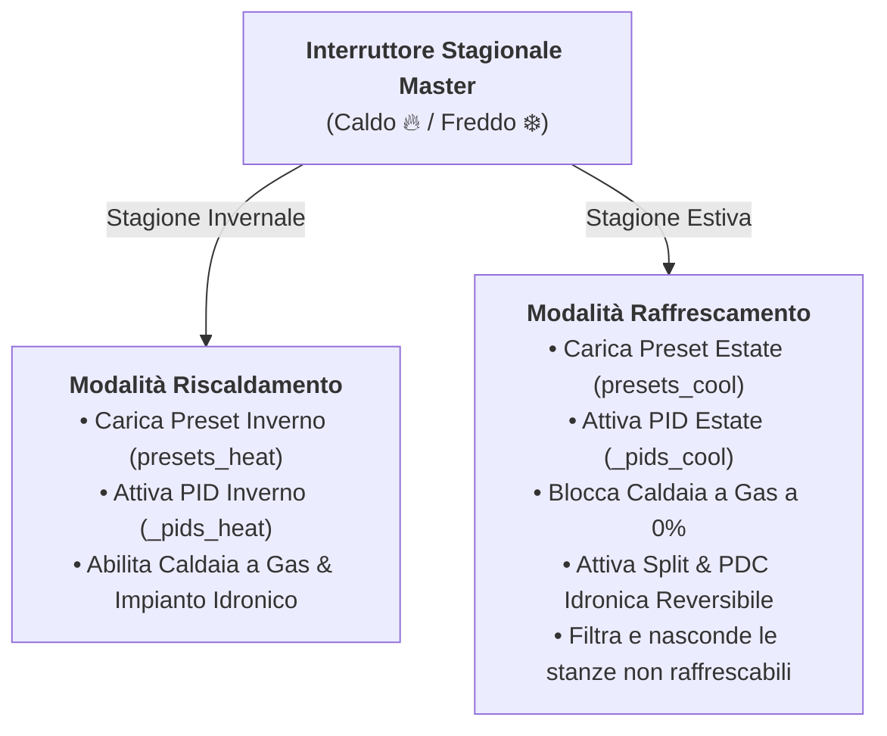

# Raffrescamento Estivo & Architettura a Doppio Binario

BETA

Con la **Fase 11**, Multizone Thermostat diventa una piattaforma climatica integrale per tutte e quattro le stagioni, gestendo con estrema precisione sia il riscaldamento invernale sia il raffrescamento estivo (tramite split ad espansione diretta o pompa di calore idronica reversibile).

---

## 1. Commutazione Stagionale Master (Caldo 🔥 / Freddo ❄️)

Sulla **Global Preset Card** è posizionato l'interruttore stagionale:
* **Modalità Inverno (Caldo 🔥)**: Il sistema attiva le logiche di riscaldamento (caldaia a gas, pompe di circolazione, split in pompa di calore).
* **Modalità Estate (Freddo ❄️)**: Il sistema attiva le logiche di raffrescamento:
  * La caldaia a gas viene categoricamente forzata a **`0%` (spenta)**.
  * La richiesta di raffrescamento viene inviata agli split d'ambiente o alla pompa di calore idronica reversibile.

---

## 2. Memorie Preset a Doppio Binario Indipendente

In estate e in inverno le abitudini e le temperature di comfort sono diametralmente opposte:
* **Inverno**: Comfort a 20.5 °C, Eco a 18.0 °C, Notte a 17.5 °C.
* **Estate**: Comfort a 24.5 °C, Eco a 27.0 °C, Notte a 26.0 °C.

Nei termostati convenzionali l'utente è costretto a riconfigurare a mano tutte le temperature di ogni singola stanza a ogni cambio di stagione.
Multizone Thermostat risolve il problema alla radice con due binari di memorizzazione fisicamente separati:
1. `presets_heat`: memorizza setpoint e modalità zona invernali.
2. `presets_cool`: memorizza setpoint e modalità zona estivi.

Spostando la levetta da Caldo a Freddo, l'intera casa richiama all'istante le proprie memorie estive, preservando intatti i valori invernali per l'autunno successivo.

---

## 3. Doppio Binario Matematico PID & Autotuning Estivo

Il raffrescamento (in particolare quello idronico con pavimento radiante o fancoil) presenta dinamiche termofisiche asimmetriche rispetto al riscaldamento:
* In inverno, il salto termico tra l'acqua dei radiatori ($55-65^\circ\text{C}$) e l'aria ($20^\circ\text{C}$) è di circa $35-45^\circ\text{C}$.
* In estate, il salto termico tra l'acqua refrigerata ($7-12^\circ\text{C}$ nei fancoil o $16-18^\circ\text{C}$ nel radiante) e l'aria ($26^\circ\text{C}$) è di soli $8-15^\circ\text{C}$.

Per questo motivo, utilizzare i medesimi guadagni PID per caldo e freddo provocherebbe instabilità o risposte lentissime.

### Il Motore Dual-Track PID
Ogni stanza gestisce due regolatori PID indipendenti in memoria:
* `_pids_heat` e `_autotuners_heat` per il riscaldamento.
* `_pids_cool` e `_autotuners_cool` per il raffrescamento.

### Autotuner Passivo per il Freddo (`mode="cool"`)
L'osservatore passivo analizza i cicli naturali di abbassamento della temperatura ambiente durante l'azione del condizionatore o del fancoil, registrando il tempo morto $L$ e la pendenza massima di discesa $R$ per derivare con la curva di Ziegler-Nichols i guadagni ottimali ($Kp, Ki, Kd$) dedicati alla stagione estiva.

---

## 4. Raffrescamento Idronico vs Climatizzatori Split

In base alla configurazione della tua abitazione, Multizone Thermostat gestisce il freddo con logiche dedicate:

| Tipologia Raffrescamento | Attuatori Coinvolti | Comportamento Sistema |
|---|---|---|
| **Climatizzatori Split d'Ambiente** | Entità `climate.*` split | Lo split risponde direttamente alla richiesta di raffrescamento della stanza. La valvola idronica della stanza rimane chiusa a 0%. |
| **Pavimento Radiante + PDC Reversibile** | Valvole proporzionali / relè + PDC centrale | La PDC genera acqua fredda (es. $18^\circ\text{C}$), le valvole modulano il flusso in base al PID estivo. Richiede deumidificatori dedicati per prevenire condensa. |
| **Fancoil Idronici Centralizzati** | Valvole 0-10V + Ventilconvettori | La mandata scende a $7-12^\circ\text{C}$, con modulazione continua del ventilatore e della valvola di mandata. |

---

## 5. Filtro Estivo Automatico delle Schede Lovelace

Nelle abitazioni reali molte stanze secondarie non dispongono di condizionamento (ripostigli, corridoi, cabine armadio o bagni di servizio hanno unicamente radiatori invernali).

Impostando `hide_if_cannot_cool: true` nelle opzioni della card:
* In modalità estiva, le card delle stanze prive di capacità di raffrescamento **vengono automaticamente rimosse dalla vista della dashboard Lovelace**, liberando spazio a schermo.
* Al ritorno della stagione invernale (switch su Caldo 🔥), tutte le stanze ricompaiono istantaneamente nella propria griglia senza alcun intervento di configurazione.
