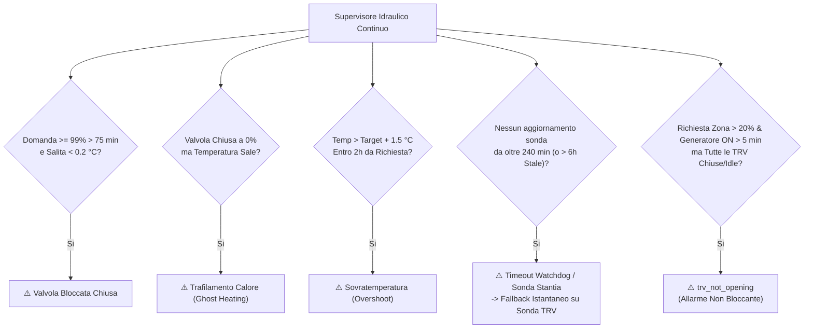

# Protezioni Meccaniche & Diagnostica Impianto

STABILE

Multizone Thermostat agisce come supervisore centrale dell'impianto idraulico, proteggendo la caldaia dall'usura e rilevando guasti meccanici prima che causino danni alle tubature o sprechi in bolletta.

---

## 1. Sorveglianza Guasti Idraulici

La diagnostica esamina in tempo reale l'evoluzione della temperatura di ogni singola stanza, confrontandola con lo storico termico registrato dall'autotuner per identificare tempestivamente le anomalie fisiche dell'impianto:

### Anomalie Attive su Impianto e Zone

| Anomalia | Criteri di Attivazione | Risposta Automatica del Sistema |
|---|---|---|
| **Valvola Bloccata Chiusa (`stuck_closed`)** | Richiesta di zona `>= 99%` per **`> 75 minuti`** con generatore attivo, mentre la temperatura sale di `< 0.2 °C`. | Segnalazione rossa sulla scheda Lovelace, notifica persistente su Home Assistant e attivazione del sensore binario anomalia di zona. |
| **TRV Non in Apertura (`trv_not_opening`)** | Richiesta di zona `> 20%` e generatore centrale attivo (`boiler_on`) per `> 5 minuti` mentre tutte le TRV risultano chiuse/`idle`. | **Allarme diagnostico non bloccante**: segnala la zona interessata senza fermare la centrale, lasciando servire le altre stanze. |
| **Trafilamento di Calore (`ghost_heating`)** | La temperatura ambiente sale significativamente mentre valvola o relè di zona sono comandati a 0% (sospeso se `allow_passive_heat` è attivo). | Avvisa di guarnizione danneggiata, spillo non a battuta o valvola bypass difettosa. |
| **Sovratemperatura (`overshoot`)** | La temperatura ambiente supera il target di oltre `1.5 °C` entro 2 ore da una chiamata termica attiva. | Segnala sovra-erogazione termica o guadagni PID/radiatore sovradimensionati. |
| **Watchdog / Sonda Stantia / Guasto (`stale_sensor`, `sensor_fault`)** | Batteria scarica o assenza aggiornamenti (`> sensor_timeout_min` default `240 min`, stale `> 6h`, o valori/picchi implausibili). | **Fallback istantaneo (`safety_fallback_active`)**: regola tramite sonda interna TRV, riporta `trv_sensor_selects` sul sensore locale e riporta TRV `demand_driven` a `standard`. |
| **Batteria Bassa / Cicli Brevi / Pressione & Errori Caldaia** | Batteria TRV/sonda `<= 10%` (`low_battery`), caldaia `> 5` cicli/ora (`short_cycling`), pressione OpenTherm `< 0.8 bar` (`boiler_low_pressure`) o codice guasto OEM (`boiler_fault`). | Aggiorna lo stato salute impianto (`Optimal` / `Warning` / `Critical`) e i badge diagnostici. |

---

## 2. Protezioni Meccaniche & Sicurezza della Centrale

Quattro livelli di protezione hardware salvaguardano la caldaia e gli attuatori da usura o danneggiamenti:

### 1. Protezione Anti-Short-Cycle & PWM Anti-Chattering (Caldaia & PDC)
Le continue accensioni e spegnimenti riducono l'efficienza e usurano bruciatori o compressori:
* **Caldaia a Gas**: `number.master_control_min_cycle_on` / `min_cycle_off` (default: **5 minuti**).
* **PWM Anti-Chattering sui Relè**: `PWMEngine` impone un latch rigoroso a singolo impulso OFF per ciclo, azzera domande residue (*trickle*), resta in **ON continuo oltre il `95%` di domanda** ed esegue `RelayBoilerBackend` con periodo adattivo sincronizzato in fase `max(900 s, 2 × (min_on + min_off))` (`20 min` default con `5 + 5 min` = max 3 cicli/h).
* **Pompa di Calore Centrale**: Controlli indipendenti `number.master_control_hp_min_cycle_on` / `hp_min_cycle_off` dedicati al compressore.
* **Diagnostica Impianto**: Il conteggio cicli/ora e le ore di funzionamento giornaliere supportano anche impianti in sola pompa di calore.

### 2. Ritardo Apertura Valvole Motorizzate & Guardia Idraulica TRV (`number.master_control_valve_delay`)
Le testine elettrotermiche dei collettori a pavimento o le valvole di zona motorizzate impiegano tipicamente tra 90 e 180 secondi per completare l'apertura meccanica dello spillo.
Impostando un ritardo (es. **120 secondi**), la caldaia/PDC e la pompa di circolazione si avviano solo a valvole completamente aperte, evitando rumorosi colpi d'ariete o sovrapressioni nelle tubazioni.
* **Guardia Unificata Apertura Valvole TRV (`HOLD_TRV_CLOSED`)**: `HOLD_TRV_CLOSED` sospende automaticamente l'avvio del generatore di calore fino a **max 120 s** mentre le TRV delle zone in richiesta risultano ancora chiuse—controllando sia gli attributi di posizione valvola (`position`, `valve_position`, `pi_heating_demand`, `heating_demand` > 10%) sia il fallback su `hvac_action` (`"heating"` vs `"idle"`/`"off"`)—seguito dall'eventuale ritardo motorizzato `valve_delay` (`number.master_control_valve_delay`) se `> 0 s`. Si applica a **Caldaia a Relè**, **OpenTherm solo a freddo (cold-start)** (non spegne mai un bruciatore già acceso) e **Pompa di Calore Centrale in modalità HEAT**.

### 3. Esercizio Anti-Bloccaggio Estivo (Anti-Seize)
Durante la stagione estiva le valvole dei termosifoni e le giranti delle pompe rimangono ferme per mesi, rischiando di bloccarsi a causa dei depositi di calcare:
* Se l'impianto rimane inattivo per più di 15 giorni (`number.master_control_anti_seize_idle_days`), l'integrazione esegue automaticamente un ciclo di apertura completa di tutte le valvole per una durata di 2 minuti (`number.master_control_anti_seize_duration`), richiudendole subito dopo (protetto da guardia anti-duplicazione e compatibile sia con caldaia che con pompa di calore tramite `anti_seize_boiler`).

### 4. Protezione Antigelo di Emergenza (Anti-Frost) & Ripristino Persistente
Se la temperatura di qualsiasi stanza dell'abitazione scende al di sotto della soglia impostata su `number.master_control_anti_frost_temperature` (intervallo `5.0–16.0 °C`, default: **`12.0 °C`**):
* Il sistema attiva immediatamente il riscaldamento forzato al 100% con temperatura di mandata configurabile (`number.master_control_frost_protection_flow_temp`, default: `40.0 °C`), scavalcando qualsiasi blocco (finestra aperta, Master spento o preset Fuori Casa), per scongiurare il congelamento delle tubature.
* **Ripristino Persistente**: I target precedenti (`pre_frost_targets`) vengono salvati tra i riavvii di Home Assistant.
* **Fallback Emergenza L5**: Se sia la sonda ambiente sia le TRV diventano non disponibili con temperatura esterna (meteo o `sensor.*` numerico) inferiore a **2.0 °C**, entra in funzione una protezione antigelo conservativa.

### 5. Tetto Pavimento 40.0 °C, Punto di Rugiada & Sicurezza Finestre
* **Tetto Termico Pavimento Radiante**: Impone un limite massimo rigoroso di **40.0 °C** sull'acqua di mandata nei sistemi a pavimento non miscelati (anche in impianti misti con radiatori).
* **Anti-Condensa da Punto di Rugiada**: Mantiene l'acqua refrigerata almeno **+2.0 °C** sopra il punto di rugiada peggiore delle sole zone attive in raffrescamento.
* **Blocco Finestra Aperta**: L'apertura di una finestra azzera immediatamente la richiesta di zona e cancella eventuali override manuali dello split locale.

### 6. Overdrive Limitato TRV Demand-Driven & Ripristino di Sicurezza
* **Overdrive Limitato (`trv_control_mode: demand_driven`)**: Impedisce alle TRV intelligenti di strozzare prematuramente la valvola grazie all'isteresi sulla domanda PID (`>= 5.0%` apre, `<= 0.0%` chiude), debounce anti-oscillazione di `60 s`, tick di valutazione ogni `10 s` e guardia idle anti-chatter. Il target di apertura è limitato a `min(trv_max, room_temp + trv_open_boost, zone_target + trv_open_boost)` (non spara mai un valore fisso a 30 °C) e il target di chiusura a `max(trv_min, min(zone_target, room_temp - trv_close_offset))`.
* **Ripristino Automatico di Sicurezza (`safety_fallback_active`)**: Se la sonda ambiente principale risulta persa o scaduta, le TRV `demand_driven` tornano automaticamente in modalità `standard` (setpoint diretto di zona) e `trv_sensor_selects` ripristina il sensore interno/locale della TRV per una regolazione autonoma sicura.

---

## 3. Telemetria Avanzata Bus OpenTherm

Se la caldaia è collegata tramite un'interfaccia OpenTherm, Multizone Thermostat dialoga direttamente con la scheda madre del generatore:

* **Pressione Idraulica del Circuito (Bar)**: Monitoraggio continuo della pressione con allarme automatico di sicurezza in caso di calo al di sotto di 0.8 Bar.
* **Temperatura Mandata & Ritorno Impianto (°C)**: Calcolo in tempo reale del salto termico $\Delta T = (T_{\text{mandata}} - T_{\text{ritorno}})$ per verificare la condensazione ottimale.
* **Modulazione Fiamma (%)**: Visualizzazione istantanea della potenza percentuale erogata dal bruciatore.
* **Codici Errore OEM della Caldaia**: Cattura e decodifica istantanea dei codici guasto inviati dalla centralina della caldaia (es. blocco fiamma, mancanza tiraggio fumi, sovratemperatura).
* **Priorità Acqua Calda Sanitaria (DHW Freeze)**: Quando un rubinetto apre l'acqua calda sanitaria (incluso rilevamento multi-dispositivo EMS-ESP ed entità ACS personalizzate), la caldaia devia la valvola a tre vie sul boiler o sullo scambiatore a piastre. Multizone Thermostat **congela istantaneamente il calcolo integrale del PID del riscaldamento**, impedendo l'accumulo di errore fasullo mentre il bruciatore è dedicato al sanitario.

---

## 4. Diagnostica JSON Nativa Home Assistant (`pid_state`, `trv_health` & Attuatori)

Da **Impostazioni → Dispositivi e Servizi → Multizone Thermostat → Scarica diagnostica**, ogni zona include telemetria dettagliata in tempo reale:

* **Stato Live PID (`pid_state` / `pid_state_cool`)**: Espone `kp`, `ki`, `kd`, `p_contribution`, `i_contribution`, `d_contribution`, `integral_accumulator`, `pid_raw_output`, `pid_clamped_output`, `pid_error`, `pid_target` e `dt_seconds` nella diagnostica JSON.
* **Attributi Live su `DemandSensor` (`sensor.<zona>_demand`)**: Espone direttamente negli attributi di stato `control_mode`, `p_term`, `i_term`, `d_term`, `integral_accumulator`, `error`, `set_point`, `raw_output`, `clamped_output`, `kp`, `ki`, `kd`, `weather_ff`, `smart_stop_offset`, `window_open` e `active_track`, pronti per essere plottati in ApexCharts senza calcoli inversi.
* **Guardrail Autotuner & Modello Termico**: `AutotuneSensor` espone `weekly_guardrail_status` (`idle`, `monitoring`, `confirmed`, `reverted`, `cancelled_manual`, `expired`) per i rollback automatici su overshoot; la Classe Energetica usa il coefficiente di Newton `k_loss` indipendente dal meteo con auto-riparazione all'avvio dei vecchi valori corrotti; `target_temp_step` (`0.5` / `0.1`) è esposto per zona.
* **Salute Calibrazione TRV (`trv_health`)**: Riporta `ext_temp_feed_mode` (`"auto"`, `"offset"`, `"external_temperature"` o `"disabled"`). La modalità offset applica deadband di `0.25 °C`, cooldown di `180 s`, finestra di assestamento anti-ratchet di `300 s` e attiva **`offset_stalled: true`** dopo 2 scritture non recepite (es. TRV associata via Matter Binding nativo), ripristinandosi automaticamente al primo reset manuale o risposta attesa della TRV.
* **Inversione Attuatori**: Espone per ogni zona i flag `invert_switch` e `invert_valve` per testine Normalmente Aperte (NO) e valvole proporzionali/0–10V ad azione inversa.
