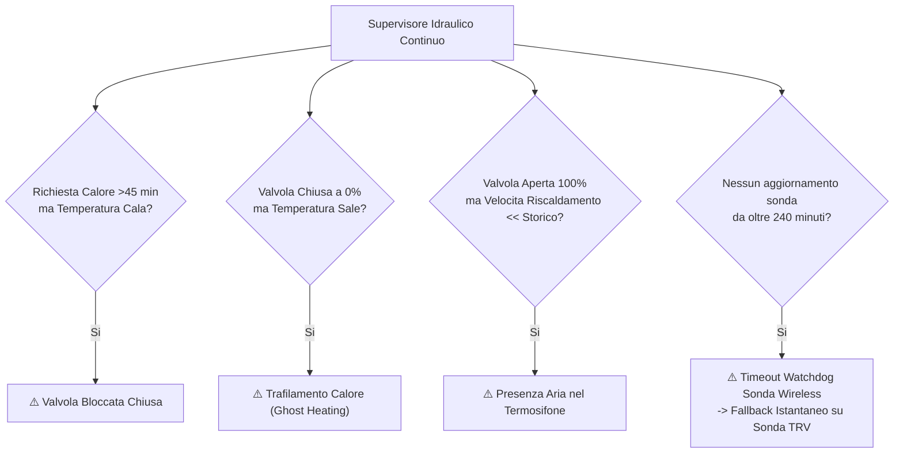

# Protezioni Meccaniche & Diagnostica Impianto

STABILE

Multizone Thermostat agisce come supervisore centrale dell'impianto idraulico, proteggendo la caldaia dall'usura e rilevando guasti meccanici prima che causino danni alle tubature o sprechi in bolletta.

---

## 1. Sorveglianza Guasti Idraulici

La diagnostica esamina in tempo reale l'evoluzione della temperatura di ogni singola stanza, confrontandola con lo storico termico registrato dall'autotuner per identificare tempestivamente le anomalie fisiche dell'impianto:

### Le 4 Anomalie Meccaniche Principali

| Anomalia | Causa Rilevata | Azione Automatica del Sistema |
|---|---|---|
| **Valvola Bloccata Chiusa** | La stanza richiede calore continuativo da oltre 45 minuti con caldaia attiva, ma la temperatura ambiente continua inesorabilmente a scendere. | Segnalazione rossa sulla scheda Lovelace, notifica persistente su Home Assistant e attivazione dell'entità `binary_sensor.heating_zones_[stanza]_anomaly`. |
| **Trafilamento di Calore (*Ghost Heating*)** | La temperatura della stanza sale in modo significativo mentre la valvola o il relè della stanza dovrebbero essere sigillati a 0%. | Rilevamento di trafilamento della guarnizione della valvola, testina non a battuta o bypass idraulico difettoso. |
| **Presenza di Aria nel Radiatore** | La valvola è aperta al 100% ma la velocità di riscaldamento registrata è inferiore al 30% della pendenza storica $R$. | Segnalazione di spurgo aria necessario sul corpo scaldante per ripristinare lo scambio termico. |
| **Timeout Watchdog Sonda Wireless** | La sonda di temperatura a batteria (Zigbee, Wi-Fi o BLE) non invia aggiornamenti per oltre 240 minuti (tempo configurabile tramite `CONF_ZONE_SENSOR_TIMEOUT`). | **Fallback istantaneo di sicurezza**: il sistema commuta automaticamente la regolazione sulla sonda di temperatura integrata nella valvola TRV, evitando il congelamento della stanza. |

---

## 2. Protezioni Meccaniche & Sicurezza della Centrale

Quattro livelli di protezione hardware salvaguardano la caldaia e gli attuatori da usura o danneggiamenti:

### 1. Protezione Anti-Short-Cycle (Anti-Pendolamento Bruciatore)
Le continue accensioni e spegnimenti del bruciatore a gas nel giro di pochi minuti provocano una rapida usura delle candelette di accensione, dei relè e un crollo dell'efficienza energetica della condensazione:
* `number.master_control_min_cycle_on`: Forza un tempo minimo di accensione continuativa della caldaia (default: **5 minuti**).
* `number.master_control_min_cycle_off`: Impone un tempo minimo di riposo della caldaia prima di consentire una nuova riaccensione (default: **5 minuti**).

### 2. Ritardo Apertura Valvole Motorizzate (`number.master_control_valve_delay`)
Le testine elettrotermiche dei collettori a pavimento o le valvole di zona motorizzate impiegano tipicamente tra 90 e 180 secondi per completare l'apertura meccanica dello spillo.
Impostando un ritardo (es. **120 secondi**), la caldaia e la pompa di circolazione si avviano solo a valvole completamente aperte, evitando rumorosi colpi d'ariete o sovrapressioni nelle tubazioni.

### 3. Esercizio Anti-Bloccaggio Estivo (Anti-Seize)
Durante la stagione estiva le valvole dei termosifoni e le giranti delle pompe rimangono ferme per mesi, rischiando di bloccarsi a causa dei depositi di calcare:
* Se l'impianto rimane inattivo per più di 15 giorni (`number.master_control_anti_seize_idle_days`), l'integrazione esegue automaticamente un ciclo di apertura completa di tutte le valvole per una durata di 2 minuti (`number.master_control_anti_seize_duration`), richiudendole subito dopo.

### 4. Protezione Antigelo di Emergenza (Anti-Frost)
Se la temperatura di qualsiasi stanza dell'abitazione scende al di sotto della soglia di sicurezza impostata su `number.master_control_anti_frost_temperature` (default: **7.0°C**):
* Il sistema attiva immediatamente il riscaldamento forzato al 100%, scavalcando qualsiasi blocco (finestra aperta, riscaldamento Master disattivato o preset Fuori Casa attivo), per scongiurare il congelamento e l'esplosione delle tubature.

---

## 3. Telemetria Avanzata Bus OpenTherm

Se la caldaia è collegata tramite un'interfaccia OpenTherm, Multizone Thermostat dialoga direttamente con la scheda madre del generatore:

* **Pressione Idraulica del Circuito (Bar)**: Monitoraggio continuo della pressione con allarme automatico di sicurezza in caso di calo al di sotto di 0.8 Bar.
* **Temperatura Mandata & Ritorno Impianto (°C)**: Calcolo in tempo reale del salto termico $\Delta T = (T_{\text{mandata}} - T_{\text{ritorno}})$ per verificare la condensazione ottimale.
* **Modulazione Fiamma (%)**: Visualizzazione istantanea della potenza percentuale erogata dal bruciatore.
* **Codici Errore OEM della Caldaia**: Cattura e decodifica istantanea dei codici guasto inviati dalla centralina della caldaia (es. blocco fiamma, mancanza tiraggio fumi, sovratemperatura).
* **Priorità Acqua Calda Sanitaria (DHW Freeze)**: Quando un rubinetto apre l'acqua calda sanitaria, la caldaia devia la valvola a tre vie sul boiler o sullo scambiatore a piastre. Multizone Thermostat **congela istantaneamente il calcolo integrale del PID del riscaldamento**, impedendo l'accumulo di errore fasullo mentre il bruciatore è dedicato al sanitario.
