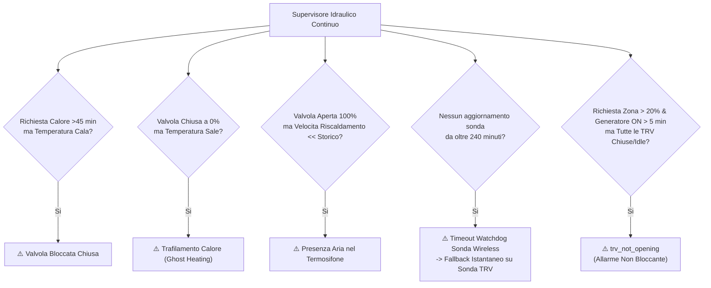

# Protezioni Meccaniche & Diagnostica Impianto

STABILE

Multizone Thermostat agisce come supervisore centrale dell'impianto idraulico, proteggendo la caldaia dall'usura e rilevando guasti meccanici prima che causino danni alle tubature o sprechi in bolletta.

---

## 1. Sorveglianza Guasti Idraulici

La diagnostica esamina in tempo reale l'evoluzione della temperatura di ogni singola stanza, confrontandola con lo storico termico registrato dall'autotuner per identificare tempestivamente le anomalie fisiche dell'impianto:

### Le 5 Anomalie Meccaniche Principali

| Anomalia | Causa Rilevata | Azione Automatica del Sistema |
|---|---|---|
| **Valvola Bloccata Chiusa** | La stanza richiede calore continuativo da oltre 45 minuti con caldaia attiva, ma la temperatura ambiente continua inesorabilmente a scendere. | Segnalazione rossa sulla scheda Lovelace, notifica persistente su Home Assistant e attivazione dell'entità `binary_sensor.heating_zones_[stanza]_anomaly`. |
| **TRV Non in Apertura (`trv_not_opening`)** | *"TRV valve not opening despite active zone heating demand"*: richiesta di riscaldamento zona > 20% e generatore centrale attivo (`boiler_on`) per > 5 minuti mentre tutte le TRV della zona risultano chiuse/`idle`. | **Allarme diagnostico non bloccante**: segnala l'anomalia sulla zona senza fermare la centrale, consentendo di continuare a servire le altre stanze. |
| **Trafilamento di Calore (*Ghost Heating*)** | La temperatura della stanza sale in modo significativo mentre la valvola o il relè della stanza dovrebbero essere sigillati a 0%. | Rilevamento di trafilamento della guarnizione della valvola, testina non a battuta o bypass idraulico difettoso. |
| **Presenza di Aria nel Radiatore** | La valvola è aperta al 100% ma la velocità di riscaldamento registrata è inferiore al 30% della pendenza storica $R$. | Segnalazione di spurgo aria necessario sul corpo scaldante per ripristinare lo scambio termico. |
| **Timeout Watchdog Sonda Wireless** | La sonda di temperatura a batteria (Zigbee, Wi-Fi o BLE) non invia aggiornamenti per oltre 240 minuti (tempo configurabile tramite `CONF_ZONE_SENSOR_TIMEOUT`). | **Fallback istantaneo di sicurezza (`safety_fallback_active`)**: commuta la regolazione sulla sonda integrata nella TRV, riporta `trv_sensor_selects` sul sensore interno/locale e riporta eventuali TRV `demand_driven` in modalità `standard`. |

---

## 2. Protezioni Meccaniche & Sicurezza della Centrale

Quattro livelli di protezione hardware salvaguardano la caldaia e gli attuatori da usura o danneggiamenti:

### 1. Protezione Anti-Short-Cycle (Caldaia & Pompa di Calore)
Le continue accensioni e spegnimenti riducono l'efficienza e usurano bruciatori o compressori:
* **Caldaia a Gas**: `number.master_control_min_cycle_on` / `min_cycle_off` (default: **5 minuti**).
* **Pompa di Calore Centrale**: Controlli indipendenti `number.master_control_hp_min_cycle_on` / `hp_min_cycle_off` dedicati al compressore.
* **Diagnostica Impianto**: Il conteggio cicli/ora e le ore di funzionamento giornaliere supportano anche impianti in sola pompa di calore.

### 2. Ritardo Apertura Valvole Motorizzate & Guardia Idraulica TRV (`number.master_control_valve_delay`)
Le testine elettrotermiche dei collettori a pavimento o le valvole di zona motorizzate impiegano tipicamente tra 90 e 180 secondi per completare l'apertura meccanica dello spillo.
Impostando un ritardo (es. **120 secondi**), la caldaia e la pompa di circolazione si avviano solo a valvole completamente aperte, evitando rumorosi colpi d'ariete o sovrapressioni nelle tubazioni.
* **Guardia Unificata Apertura Valvole TRV (`HOLD_TRV_CLOSED`)**: `HOLD_TRV_CLOSED` sospende automaticamente l'avvio del generatore fino a **max 120 s** mentre le TRV delle zone in richiesta risultano ancora chiuse—controllando sia gli attributi di posizione valvola (`position`, `valve_position`, `pi_heating_demand`, `heating_demand` > 10%) sia il fallback su `hvac_action` (`"heating"` vs `"idle"`/`"off"`)—seguito dall'eventuale ritardo motorizzato `valve_delay` (`number.master_control_valve_delay`) se `> 0 s`. Si applica a **Caldaia a Relè** e **OpenTherm solo a freddo (cold-start)** (non spegne mai un bruciatore già acceso).

### 3. Esercizio Anti-Bloccaggio Estivo (Anti-Seize)
Durante la stagione estiva le valvole dei termosifoni e le giranti delle pompe rimangono ferme per mesi, rischiando di bloccarsi a causa dei depositi di calcare:
* Se l'impianto rimane inattivo per più di 15 giorni (`number.master_control_anti_seize_idle_days`), l'integrazione esegue automaticamente un ciclo di apertura completa di tutte le valvole per una durata di 2 minuti (`number.master_control_anti_seize_duration`), richiudendole subito dopo (protetto da guardia anti-duplicazione e compatibile sia con caldaia che con pompa di calore tramite `anti_seize_boiler`).

### 4. Protezione Antigelo di Emergenza (Anti-Frost) & Ripristino Persistente
Se la temperatura di qualsiasi stanza dell'abitazione scende al di sotto della soglia di sicurezza impostata su `number.master_control_anti_frost_temperature` (default: **7.0°C**):
* Il sistema attiva immediatamente il riscaldamento forzato al 100% con temperatura di mandata configurabile (`number.master_control_frost_flow_temp`), scavalcando qualsiasi blocco (finestra aperta, Master spento o preset Fuori Casa), per scongiurare il congelamento delle tubature.
* **Ripristino Persistente**: I target precedenti (`pre_frost_targets`) vengono salvati tra i riavvii di Home Assistant.
* **Fallback Emergenza L5**: Se sia la sonda ambiente sia le TRV diventano non disponibili con temperatura esterna (meteo o `sensor.*` numerico) inferiore a **2.0 °C**, entra in funzione una protezione antigelo conservativa.

### 5. Tetto Pavimento 40.0 °C, Punto di Rugiada & Sicurezza Finestre
* **Tetto Termico Pavimento Radiante**: Impone un limite massimo rigoroso di **40.0 °C** sull'acqua di mandata nei sistemi a pavimento non miscelati (anche in impianti misti con radiatori).
* **Anti-Condensa da Punto di Rugiada**: Mantiene l'acqua refrigerata almeno **+2.0 °C** sopra il punto di rugiada peggiore delle sole zone attive in raffrescamento.
* **Blocco Finestra Aperta**: L'apertura di una finestra azzera immediatamente la richiesta di zona e cancella eventuali override manuali dello split locale.

### 6. Overdrive Limitato TRV Demand-Driven & Ripristino di Sicurezza
* **Overdrive Limitato (`trv_control_mode: demand_driven`)**: Impedisce alle TRV intelligenti di strozzare prematuramente la valvola grazie all'isteresi sulla domanda PID (`>= 5.0%` apre, `<= 0.0%` chiude), debounce anti-oscillazione di `60 s`, tick di valutazione ogni `10 s` e guardia idle anti-chatter. Il target di apertura è limitato a `min(trv_max, room_temp + trv_open_boost, zone_target + trv_open_boost)` (non spara mai un valore fisso a 30 °C) e il target di chiusura a `max(trv_min, min(zone_target, room_temp - trv_close_offset))`.
* **Ripristino Automatico di Sicurezza (`safety_fallback_active`)**: Se la sonda ambiente principale risulta persa o scaduta, le TRV `demand_driven` tornano automaticamente in modalità `standard` (setpoint diretto di zona) e `trv_sensor_selects` ripristina il sensore interno/locale della TRV per una regolazione autonoma sicura.

---

## 3. Telemetria Avanzata Bus OpenTherm

Se la caldaia è collegata tramite un'interfaccia OpenTherm, Multizone Thermostat dialoga direttamente con la scheda madre del generatore:

* **Pressione Idraulica del Circuito (Bar)**: Monitoraggio continuo della pressione con allarme automatico di sicurezza in caso di calo al di sotto di 0.8 Bar.
* **Temperatura Mandata & Ritorno Impianto (°C)**: Calcolo in tempo reale del salto termico $\Delta T = (T_{\text{mandata}} - T_{\text{ritorno}})$ per verificare la condensazione ottimale.
* **Modulazione Fiamma (%)**: Visualizzazione istantanea della potenza percentuale erogata dal bruciatore.
* **Codici Errore OEM della Caldaia**: Cattura e decodifica istantanea dei codici guasto inviati dalla centralina della caldaia (es. blocco fiamma, mancanza tiraggio fumi, sovratemperatura).
* **Priorità Acqua Calda Sanitaria (DHW Freeze)**: Quando un rubinetto apre l'acqua calda sanitaria (incluso rilevamento multi-dispositivo EMS-ESP ed entità ACS personalizzate), la caldaia devia la valvola a tre vie sul boiler o sullo scambiatore a piastre. Multizone Thermostat **congela istantaneamente il calcolo integrale del PID del riscaldamento**, impedendo l'accumulo di errore fasullo mentre il bruciatore è dedicato al sanitario.
