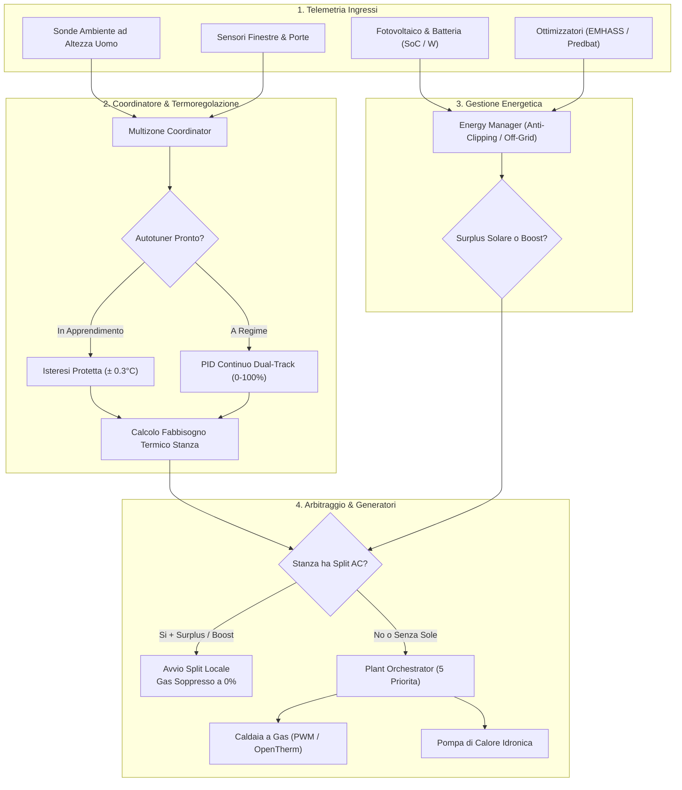

# Multizone Thermostat — L'Hub Termico Unico per Home Assistant

Benvenuto nella documentazione ufficiale di **Multizone Thermostat**, l'integrazione personalizzata più avanzata, modulare e completa mai realizzata per la termoregolazione e la climatizzazione intelligente in Home Assistant.

  <strong>Novità Fase 11 (v6.1.0-beta.1 — Ramo Beta)</strong> 
  La Fase 11 introduce il supporto completo a <strong>centrali termiche bivalenti (Caldaia + Pompa di Calore)</strong>, gestione dei <strong>climatizzatori split per singola stanza</strong> con bypass sonda a soffitto, ottimizzazione per <strong>fotovoltaico e batterie Off-Grid</strong> con bridge EMHASS/Predbat, commutazione stagionale <strong>Caldo 🔥 / Freddo ❄️</strong> con doppio binario di preset e schede grafiche <strong>Visual Twin 1-a-1</strong> con il termostato nativo di Home Assistant.

---

## 🎯 La Visione: Il Centro di Gestione Termica Unico

> **L'obiettivo di questo progetto è diventare il centro di gestione termica unico, definitivo e universale per Home Assistant.**

Nei moderni edifici residenziali la termoregolazione è spesso frammentata: caldaie a condensazione gestite da un termostato a parete, pompe di calore con la propria app proprietaria, condizionatori split controllati da telecomandi a infrarossi o integrazioni separate, valvole termostatiche TRV Zigbee con letture falsate dalla vicinanza ai termosifoni, e pannelli fotovoltaici che immettono energia in rete mentre la casa brucia gas fossile.

**Multizone Thermostat unifica tutti questi sistemi sotto un'unica regia autonoma e intelligente:**
* **Qualsiasi Generatore Termico**: Caldaie a gas/gasolio (Relè PWM o OpenTherm modulante), Pompe di Calore idroniche centralizzate, Stufe a pellet o biomassa, Resistenze elettriche.
* **Qualsiasi Terminale d'Ambiente**: Radiatori con valvole TRV, Riscaldamento a pavimento idronico, Ventilconvettori (Fancoil), Attuatori progressivi 0–10V o valvole 0–100%, Climatizzatori Split ad espansione diretta.
* **Tutte e Quattro le Stagioni**: Riscaldamento invernale ad alta o bassa temperatura e Raffrescamento estivo continuo con gestione dell'inerzia termica.
* **Energie Rinnovabili & Accumuli**: Ottimizzazione dell'autoconsumo fotovoltaico anche per impianti **Off-Grid a isola**, protezione della batteria domestica e interfacciamento con intelligenze previsionali (EMHASS, Predbat, Solcast).

Nessun'altra integrazione o termostato commerciale racchiude questa flessibilità: tutto viene configurato tramite interfaccia grafica (UI), senza bisogno di scrivere centinaia di righe di script o automazioni YAML.

---

## 📸 Anteprima della Dashboard: Inverno vs Estate

  

    🔥 Stagione Invernale (Riscaldamento a Gas & Split)
    
    
Tutte le stanze attive (3 colonne), aura arancione riscaldamento e pulsante Split locale.

  

  

    ❄️ Stagione Estiva (Raffrescamento Elettrico)
    
    
Aura ciano, preset estivo e <b>filtro automatico attivo</b>: lo Studio senza climatizzatore è nascosto!

  

---

## 🌟 Cosa Rende Unico Multizone Thermostat?

Le 11 caratteristiche fondamentali che distinguono il progetto da qualsiasi altra soluzione sul mercato:

### 1. Centrale Bivalente Ibrida (Caldaia a Gas + Pompa di Calore Idronica)
L'orchestrazione (`PlantOrchestrator`) coordina simultaneamente o in alternativa la caldaia a combustibile e la pompa di calore centrale secondo **5 modalità di priorità selezionabili** (`auto`, `hybrid`, `combined`, `electric_only`, `gas_only`). Supporta la reversibilità estiva della PDC per fancoil o pavimento radiante escludendo tassativamente la caldaia a gas a 0%.

### 2. Climatizzatori Split d'Ambiente con Bypass Sonda a Soffitto
Ogni singola stanza può associare il proprio condizionatore split (`climate.*`) per operare in sinergia con i termosifoni.
* **Iniezione Sensore Reale**: Lo split legge l'aria calda accumulata a soffitto e taglierebbe la potenza prima del dovuto; Multizone Thermostat calcola e inietta nello split un setpoint corretto in tempo reale basato sul termometro ad altezza d'uomo.
* **Quick Heat Boost**: A stanza fredda (ΔT ≥ 1.5 °C), split e termosifoni partono insieme (**Dual Heat**) per riscaldare l'ambiente in un terzo del tempo.
* **Disaccoppiamento Idronico**: Quando lo split scalda la stanza con energia solare o elettrica, la richiesta verso la caldaia per quella stanza viene azzerata (0%), chiudendo la valvola e azzerando il consumo di gas.

### 3. Autoconsumo Solare Off-Grid & Protezione Batterie
Progettato specificamente per impianti grid-tied, zero-immissione (zero-export) o **completamente a isola (Off-Grid)**:
* **Anti-Clipping Inverter**: Rileva la saturazione della batteria (SoC ≥ 95%) e la produzione solare (≥ 300 W), attivando il riscaldamento elettrico *prima* che l'inverter tagli la resa dei pannelli fotovoltaici.
* **Guardia Anti-Scarica Batteria**: Se il passaggio di nuvole o carichi pesanti costringe la casa a prelevare energia dalla batteria (> 150 W continui) per oltre 5 minuti, il sistema **interrompe subito il carico elettrico e riaccende la caldaia a gas**, garantendo l'autonomia notturna.
* **Bridge EMHASS / Predbat**: Riceve comandi da ottimizzatori economici locali sia via segnali booleani sia leggendo sensori numerici di potenza differibile in Watt.

### 4. Architettura a Doppio Binario Stagionale (Caldo 🔥 / Freddo ❄️)
* Lo slider master commuta istantaneamente tutta l'abitazione tra inverno ed estate.
* **Preset a Doppio Binario**: I profili (*Comfort, Eco, Notte, Fuori Casa, Manuale*) conservano memorie target completamente separate tra caldo (`presets_heat`) e freddo (`presets_cool`), senza dover riconfigurare i gradi a ogni cambio stagione.
* **Doppio PID Indipendente**: Regolatori PID distinti per riscaldamento e raffrescamento idronico per gestire le asimmetrie termiche dell'acqua.

### 5. Doppio Comando Caldaia (Relè PWM & OpenTherm Modulante)
* **Relè ON/OFF**: Algoritmo Time-Proportional Integral (PWM) con finestre temporali proporzionali e protezione rigorosa contro i cicli rapidi (*anti-short-cycle*).
* **OpenTherm Modulante**: Mappatura lineare o curva climatica del fabbisogno termico dell'edificio (0–100%) direttamente sul setpoint dell'acqua di mandata caldaia (35 °C – 75 °C).

### 6. Autotuning Dinamico Adattivo (Da Isteresi a PID Silenzioso)
La zona parte in modalità Isteresi sicura (± 0.3 °C). L'osservatore passivo analizza la pendenza naturale di riscaldamento $R$ e il tempo di ritardo $L$, calcolando con la curva di Ziegler-Nichols i guadagni ottimali ($Kp, Ki, Kd, Kff$) e transitando automaticamente a PID continuo senza pendolamenti né surriscaldamenti.

### 7. Zone Termiche Gerarchiche (Primaria, Secondaria, Bypass)
* **Primaria**: La stanza ha piena autorità e può accendere la caldaia centrale quando scende sotto target.
* **Secondaria**: La stanza apre la valvola solo per assorbire calore gratuito quando la caldaia è già accesa da una zona primaria, senza mai consumare gas da sola.
* **Bypass**: Esclude totalmente la stanza dal circuito termico.

### 8. Override Fisico & Sincronizzazione Manopole TRV
Se qualcuno ruota manualmente la manopola fisica di una valvola termostatica, il sistema intercetta l'evento, sincronizza il setpoint su Home Assistant e inietta la calibrazione dinamica per forzare la valvola a rispettare il termometro della stanza e non la sonda a bordo radiatore.

### 9. Sorveglianza Continua delle Anomalie Meccaniche
Un supervisore idraulico esamina le risposte termiche di ogni stanza, rilevando:
* Valvole termostatiche bloccate chiuse.
* Trafilamenti idraulici (*Ghost Heating* a valvola sigillata a 0%).
* Presenza di bolle d'aria nei termosifoni.
* Perdita di comunicazione con le sonde wireless (con passaggio istantaneo in sicurezza sulla sonda locale TRV).

### 10. Metriche Energetiche dell'Involucro Edilizio
L'algoritmo calcola in tempo reale le proprietà fisiche dell'edificio:
* **Classe Energetica Stimata (da A4 a G)**.
* **Tempo di Ritenzione Termica**: Numero di ore necessarie all'ambiente per perdere 1.0 °C a riscaldamento spento.
* **Valutazione Dimensionamento Radiatore**: Sottodimensionato, Ottimale o Sovradimensionato.

### 11. Schede Lovelace Visual Twin 1-a-1 & Strategie Automatiche
Schede custom gemelle del termostato nativo di Home Assistant:
* Regolazione istantanea al tocco sull'arco circolare (**Direct Arc Touch**).
* Pulsanti step `[-]` e `[+]` ergonomici per variazioni di 0.5 °C.
* Badge dinamico della sorgente (`🔥 GAS`, `⚡ ELETTRICO`, `🔥⚡ GAS + ELETTRICO`).
* Pulsante centrale per accensione split locale indipendente (a Master spento) con blocco di sicurezza a Master acceso.
* Strategie automatiche di generazione per costruire la dashboard completa in 5 righe di YAML.

---

## ⚡ Matrice Completa delle Funzionalità

### Centrale Bivalente & Climatizzazione Ibrida (v6.1.0-beta)
* 🔄 **Arbitraggio Multi-Generatore (`PlantOrchestrator`)**: Gestione gerarchica tra Caldaia a Gas e Pompa di Calore Idronica basata su 5 modalità di priorità: `auto`, `hybrid`, `combined`, `electric_only` e `gas_only`.
* ❄️ **Raffrescamento Idronico Reversibile (`heat_pump_cooling`)**: Gestione fancoil e pavimento radiante in estate, con blocco rigoroso della caldaia a gas a 0%.
* ⚡ **Modalità Full Electric**: Funzionamento al 100% solo con pompe di calore o split, senza alcuna caldaia a gas configurata.

### Integrazione Climatizzatori Split d'Ambiente (v6.1.0-beta)
* 🎯 **Associazione Split per Zona Termica**: Assegna condizionatori (`climate.*`) con ruoli personalizzati (`heat_cool`, `heating_only`, `cooling_only`).
* 🌡️ **Bypass Sonda a Soffitto (Iniezione Dinamica)**: Compensa l'accumulo di aria calda a soffitto iniettando un setpoint corretto calcolato sulla sonda ad altezza uomo.
* 🚀 **Quick Heat Boost (Shock Termico)**: Avvia split e radiatori contemporaneamente quando la stanza è fredda ($\Delta T \ge 1.5^\circ\text{C}$), disattivando lo split una volta raggiunto il comfort ($\Delta T \le 0.3^\circ\text{C}$).
* 🛑 **Disaccoppiamento Idronico Automatico**: Sopprime la richiesta gas a `0.0%` per le stanze che stanno scaldando via split elettrico.
* 🔘 **Pulsante Split Singola Stanza**: Pulsante rapido sulla Dial Card per accendere il condizionatore a Master spento, con lockout automatico a Master acceso.

### Autoconsumo Solare & Gestione Energetica (v6.1.0-beta)
* ☀️ **Rilevamento Off-Grid & Anti-Clipping**: Avvia il riscaldamento elettrico su saturazione batteria (SoC $\ge 95\%$) e produzione FV ($\ge 300\text{ W}$) prima che l'inverter tagli la potenza.
* 🛡️ **Guardia Anti-Scarica Batteria**: Ritorna immediatamente al gas se la batteria domestica viene scaricata ($> 150\text{ W}$) per oltre 5 minuti continuativi.
* 🔋 **Riserva Notturna Batteria**: Soglia minima di sicurezza (consigliata 80-85%) sotto la quale il riscaldamento elettrico viene escluso.
* 🤖 **Integrazione AI EMHASS & Predbat**: Supporto nativo per segnali booleani e sensori numerici a carico differibile (`p_deferrable0 > 0 W`).
* 🏠 **Offset di Accumulo Termico nei Muri**: Sovralzo programmabile ($0.0^\circ\text{C} \dots +3.0^\circ\text{C}$) per stoccare calore solare gratuito nelle strutture murarie nelle ore di picco.
* ⏱️ **Protezione Anti-pendolamento Compressore**: Ciclo minimo di 10 minuti per salvaguardare i compressori inverter dai passaggi nuvolosi.

### Termoregolazione & Gestione Zone
* 🖥️ **Config Flow 100% UI con Sezioni Ripiegabili (v5.0.1)**: Procedura guidata senza YAML con accordion (*TRV*, *Valvole Proporzionali 0-10V*, *Relè*, *Climatizzatori Split*, *Protezioni e Avanzate*).
* 🎛️ **Valvole Proporzionali e 0-10V (v5.0.1)**: Controllo ad apertura continua per collettori radianti e testine TRV con pin proporzionale (`0-100%` o `0.0-10.0 V`).
* 🔘 **Master Switch & Commutazione Stagionale**: Un unico interruttore per accendere/spegnere l'intero impianto, con commutazione rapida Inverno 🔥 ed Estate ❄️.
* 🏠 **Modalità di Zona Gerarchiche**: Selettore per stanza (`Primaria`, `Secondaria`, `Bypass`) direttamente dalle schede Lovelace.
* 📍 **Geofencing & Presenza Dinamica**: Passaggio automatico a Fuori Casa o Notte tramite sensori di presenza.
* 🪟 **Rilevamento Finestra Aperta**: Esclude la singola zona all'apertura e la ripristina alla chiusura.
* 🌡️ **Termostati Virtuali**: Trasforma qualsiasi relè o attuatore e sensore di temperatura in un termostato PID completo.
* 🧠 **Aggregazione Multi-TRV**: Raggruppa più testine termostatiche nella stessa stanza calcolando media e sincronizzando setpoint.
* 🔄 **Preset a Doppio Binario**: Manuale, Eco, Comfort, Notte, Fuori Casa con memorie separate per riscaldamento e raffrescamento.
* 📅 **Integrazione Calendario & Smart Return Predittivo**: Programmazione con Local Calendar HA e preriscaldamento anticipato basato sull'inerzia dell'edificio.
* 🌤️ **Compensazione Climatica Adattiva**: Correzione feed-forward continua basata sulla temperatura esterna e sulla dispersione termica appresa.

### Protezioni Hardware & Sicurezza
* 🛡️ **Motore Anti-Short-Cycle**: Tempi minimi ON e OFF configurabili per evitare accensioni repentine della caldaia e usura del bruciatore.
* ⏱️ **Ritardo Apertura Valvole**: Ritardo programmabile per attendere l'apertura delle valvole elettrotermiche prima di accendere la caldaia.
* 🐕 **Watchdog Timeout Sonda & Fallback TRV (v4.7)**: Se un sensore wireless cade offline o esaurisce la batteria, la zona passa automaticamente alla sonda interna del TRV.
* ❄️ **Protezione Antigelo di Emergenza (v4.3)**: Switch e soglia dedicati per forzare il 100% della potenza termica sotto soglia critica (es. 7°C) ignorando finestre aperte o master spento.
* ☀️ **Esercizio Anti-Bloccaggio Estivo**: Movimentazione periodica di circolatori e valvole nei mesi estivi per prevenire grippaggi meccanici.
* 🔄 **Sincronizzazione Fisica TRV Bidirezionale (v4.3)**: Switch dedicati per consentire alle manopole fisiche sui radiatori di aggiornare il setpoint virtuale senza conflitti.

### Diagnostica Impianto & Efficienza Energetica (v4.5 - v4.7)
* 🔍 **Supervisione Salute Centrale Termica**: Monitoraggio frequenza accensioni (cicli/ora), tempo di accensione cumulativo 24h e motivazioni di stato in tempo reale.
* 🔥 **Telemetria OpenTherm & Bus Errori (v4.7)**: Acquisizione pressione acqua (Bar), temperatura di ritorno (°C), fiamma, modulazione bruciatore e codici errore OEM. Blocco PID su prelivo ACS (Acqua Calda Sanitaria).
* 🔋 **Sorveglianza Batterie Universale (v4.7)**: Rilevamento automatico percentuale batteria per dispositivi Zigbee2MQTT, ZHA e Tuya.
* 🚨 **Rilevamento Anomalie Meccaniche**: Individuazione valvole bloccate chiuse e trafilamenti idraulici (*ghost heating*).
* ♨️ **Apporto Termico Passivo**: Opzione per zona per sopprimere falsi allarmi in open space, soppalchi o ventilconvettori senza valvola d'intercettazione.
* 📊 **Classificazione Energetica Edificio (A4 → G)**: Stima della classe energetica europea calcolata dalla dispersione termica reale e dal $\Delta T$ esterno.
* ⏱️ **Tempo di Ritenzione Termica**: Calcolo delle ore necessarie a perdere $1.0^\circ\text{C}$.
* 📐 **Valutazione Dimensionamento Radiatori**: Rilevamento radiatori sottodimensionati, ottimali o sovradimensionati.
* 🩺 **Diagnostica Nativa Home Assistant (v4.4)**: Dump JSON scaricabile dalle impostazioni del dispositivo in HA.

---

## 🏛️ Architettura dei Flussi di Sistema

Il diagramma sottostante illustra come le informazioni fluiscono dai sensori fisici fino ai generatori dell'edificio:

---

## 🚀 Guida Rapida di Consultazione

* **Installazione & Setup**:
  * [📥 Guida all'Installazione & Requisiti](installation.md)
  * [⚙️ Configurazione Guidata (Config Flow & Opzioni)](setup_wizard.md)
* **Novità Fase 11 (Beta)**:
  * [🔥 Centrale Bivalente & Gestione Energetica](hybrid_energy.md)
  * [❄️ Climatizzatori Split d'Ambiente](split_climate.md)
  * [🔄 Raffrescamento Estivo & Doppio Binario](cooling_season.md)
* **Algoritmi & Funzionalità**:
  * [🧠 Autotuning, PID & Valvole 0-10V](algorithms_tuning.md)
  * [📅 Programmazione Settimanale & Smart Return](scheduling.md)
  * [🛡️ Protezioni Meccaniche & Diagnostica Impianto](diagnostics_safety.md)
* **Riferimenti Tecnici**:
  * [📋 Entità Generate & Servizi Esposti](entities_services.md)
  * [❓ Risoluzione Problemi & Domande Frequenti (FAQ)](faq_troubleshooting.md)
* **Interfaccia Grafica**:
  * [🎨 Guida alle Schede Lovelace](cards_guide.md)
  * [🎮 Simulatore Live Interattivo (3 Dashboard)](simulator_view.md)
