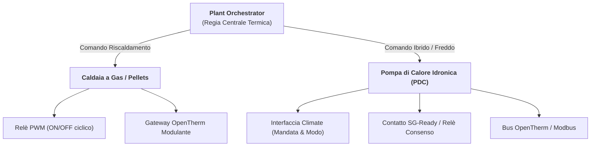
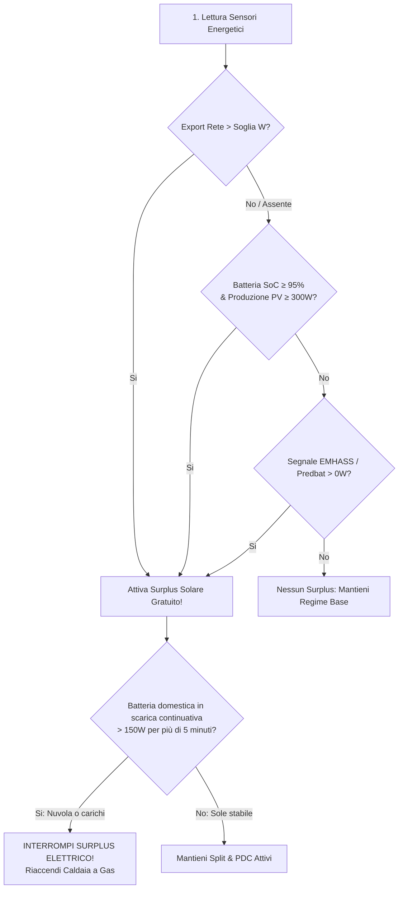

# Centrale Bivalente & Gestione Energetica

BETA

La **Fase 11** trasforma Multizone Thermostat da un termostato tradizionale monogeneratore a un avanzato motore di orchestrazione termico ed energetico (`PlantOrchestrator` & `EnergyManager`), capace di coordinare contemporaneamente generatori a combustibile e pompe di calore idroniche, ottimizzando l'autoconsumo da fonti rinnovabili anche in contesti totalmente **Off-Grid** o con inverter a immissione zero.

---

## 1. Centrale Termica Bivalente (Caldaia + Pompa di Calore)

L'impianto centrale può pilotare contemporaneamente o alternativamente due classi di generatori primari:

### Tipologie di Impianto Supportate
1. **Impianto Ibrido Standard (Bivalente)**: Caldaia a gas per la stagione rigida invernale e Pompa di Calore per le mezze stagioni o per il freddo estivo.
2. **Impianto Full-Electric (Solo PDC)**: Disabilitando la caldaia (`enable_gas_heater: False`), la PDC gestisce il 100% dell'abitazione in caldo e in freddo.
3. **Impianto a Gas Tradizionale + Split d'Ambiente**: Caldaia per radiatori con ausilio di climatizzatori split nelle stanze principali per sfruttare l'energia solare.

---

## 2. Le 5 Modalità di Priorità Riscaldamento

Configurabili istantaneamente dalla barra Lovelace (Preset Card) o tramite l'entità `select.master_control_heat_source_priority`:

| Priorità | Comportamento Caldaia a Gas | Comportamento Elettrico (Split & PDC) | Scenario Consigliato |
|---|---|---|---|
| **`auto`** | Copre il fabbisogno di base dell'abitazione. | Interviene automaticamente con **Surplus Solare**, pianificazione EMHASS o avvio rapido **Quick Boost** (ΔT ≥ 1.5 °C). | Massima flessibilità quotidiana senza pensieri. |
| **`hybrid`** | Riscalda tutte le stanze convenzionali. | Le stanze con split usano l'elettrico **solo se c'è sole**; se il sole manca, tornano a gas per non consumare la batteria. | Impianti fotovoltaici con batteria da preservare per la sera. |
| **`combined`** | Lavora stabilmente a regime idronico. | Lavora in parallelo continuo al gas in caso di surplus o forte dislivello termico per riscaldare la casa nel minor tempo possibile. | Abitazioni con grande volumetria o rientri da assenze prolungate. |
| **`electric_only`** | **Forzata a 0%** (zero gas bruciato). | 100% della richiesta termica gestito da Pompa di Calore centrale e split d'ambiente. | Case Full-Electric, allarmi fornitura gas o giornate di sole pieno. |
| **`gas_only`** | 100% della richiesta termica erogata a gas. | Split e pompe di calore disattivati in riscaldamento. | Blackout solare o manutenzione condizionatori. |

---

## 3. Autoconsumo Fotovoltaico & Sistemi a Isola (Off-Grid)

La maggior parte degli algoritmi di termoregolazione sul mercato dipende rigorosamente da un sensore di esportazione verso la rete pubblica (`grid_export > 500 W`).
Questo approccio fallisce completamente negli **impianti a isola (Off-Grid)** o con **inverter configurati a zero immissione (*zero-export/curtailment*)**, dove la potenza esportata rimane sempre pari a 0 Watt e l'inverter riduce la produzione solare dei pannelli non appena la batteria è carica.

Il motore energetico di Multizone Thermostat adotta un algoritmo evoluto:

### Salvaguardie Fondamentali per la Batteria

1. **Guardia Anti-Scarica Continua (`battery_max_discharge_time`)**:
   Se la produzione solare cala improvvisamente a causa di nuvole o se in casa si avviano carichi importanti (forno, piano cottura), l'inverter comincia a prelevare energia dalla batteria domestica. Se la scarica supera **150 W** ininterrottamente per più di **5 minuti** (tempo configurabile), il sistema interrompe immediatamente il riscaldamento elettrico e **riaccende la caldaia a gas**, salvaguardando l'accumulo.
2. **Riserva Minima Notturna (`battery_min_reserve_soc`)**:
   Soglia minima di sicurezza (consigliato 80% o 85%). Al di sotto di questa soglia l'impianto termico non può mai attivare carichi elettrici a carico della batteria.
3. **Anti-Pendolamento Compressore (`solar_min_run_time`)**:
   Impone che ogni attivazione di condizionatore split o pompa di calore abbia una durata minima continuativa (default: **10 minuti**), preservando la vita utile dell'inverter meccanico da transitori causati da nuvole veloci.
4. **Accumulo Termico Gratuito nei Muri (`solar_overheat_offset`)**:
   Durante le ore di picco solare a batteria satura, il sistema permette di innalzare temporaneamente il target delle stanze climatizzate da **+0.5 °C** fino a **+3.0 °C**. L'energia solare eccedente viene così immagazzinata gratuitamente nella massa termica delle pareti e del pavimento, ritardando l'accensione della caldaia la sera.

---

## 4. Bridge Predittivo EMHASS & Predbat

Puoi collegare direttamente l'entità di output del tuo ottimizzatore economico locale:
* **Segnali Booleani**: Riconosce stati `on`, `true`, `active`, `boost`.
* **Sensori Numerici in Watt**: Se EMHASS pianifica un carico differibile (es. `sensor.p_deferrable0`), Multizone Thermostat legge direttamente il valore numerico in Watt: non appena il valore è $> 0\text{ W}$, il surplus viene attivato automaticamente.

---

## 5. Tabella Parametri di Configurazione Energetica

| Parametro | Chiave Configurazione | Default | Note |
|---|---|---|---|
| Abilita Caldaia Gas | `enable_gas_heater` | `True` | Se disabilitato, opera in modalità Full-Electric. |
| Abilita Pompa Calore | `enable_heat_pump` | `False` | Attiva il coordinamento della PDC idronica centrale. |
| Tipo Controllo PDC | `heat_pump_type` | `climate` | Selezionabile tra `climate`, `switch` o `opentherm`. |
| Reversibilità Estiva PDC | `heat_pump_cooling` | `True` | Abilita il raffrescamento idronico in estate escludendo il gas. |
| Gestione Solare | `energy_management_enabled` | `False` | Interruttore principale dell'Energy Manager. |
| Sensore Produzione PV | `solar_power_sensor` | `None` | Potenza istantanea generata dai pannelli in Watt. |
| Sensore Immissione Rete | `grid_export_sensor` | `None` | Potenza esportata verso la rete in Watt (facoltativo). |
| Soglia Minima Export | `solar_export_threshold` | `500.0 W` | Potenza esportata minima per avviare il surplus a rete. |
| Sensore Carica Batteria | `battery_soc_sensor` | `None` | Percentuale di carica della batteria domestica (SoC). |
| Sensore Potenza Batteria | `battery_power_sensor` | `None` | Potenza di carica/scarica della batteria in Watt. |
| Riserva Minima Notturna | `battery_min_reserve_soc` | `20.0%` | Consigliato 80–85% per preservare la batteria per la notte. |
| Guardia Scarica Batteria | `battery_max_discharge_time` | `5 min` | Minuti consecutivi di scarica prima del fallback a gas. |
| Tempo Minimo Ciclo PV | `solar_min_run_time` | `10 min` | Protezione anti-chatter del compressore inverter. |
| Offset Accumulo Muri | `solar_overheat_offset` | `0.0°C` | Innalzamento target durante surplus (fino a +3.0°C). |
| Entità Override Esterno | `external_solar_override_entity` | `None` | Sensore EMHASS o segnale Predbat. |
