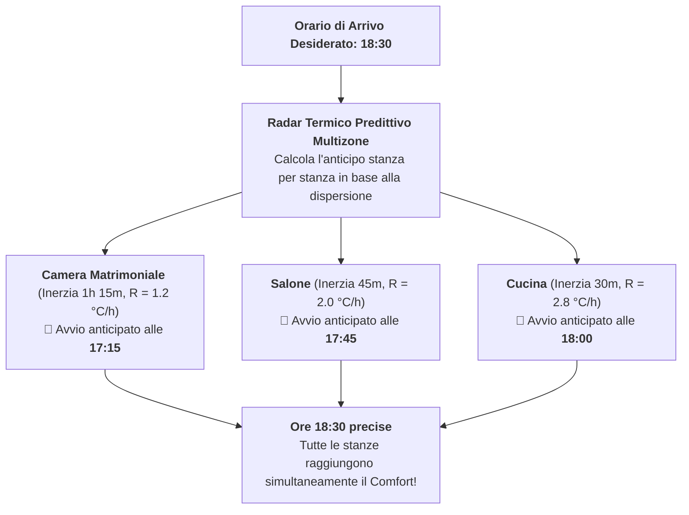

# Programmazione Settimanale & Smart Return

<span class="badge-stable">STABILE</span>

Multizone Thermostat integra un motore di programmazione oraria settimanale completo e nativo, visualizzabile tramite una matrice grafica a 24 ore e arricchito da algoritmi di anticipo termico predittivo (**Smart Return**).

---

## 1. La Scheda Scheduler (`custom:multizone-thermostat-scheduler-card`)

La scheda di programmazione visuale permette di gestire con la massima semplicità gli orari di comfort di tutta la famiglia:

* **Visualizzazione a Matrice 24 Ore**: Una vista orizzontale a fasce colorate che mostra l'alternanza dei preset (Comfort, Eco, Notte, Fuori Casa) per tutte le zone dell'abitazione lungo l'arco della giornata.
* **Modifica Intuitiva dei Blocchi Orari**: Toccando qualsiasi fascia oraria è possibile regolare con estrema facilità ora di inizio, ora di fine e il preset termico associato.
* **Copia Veloce Multi-Giorno**: Pulsante dedicato per replicare la configurazione dal Lunedì al Venerdì (giorni lavorativi) o sull'intero fine settimana con un solo tocco.

---

## 2. Gestione Multi-Profilo & Scadenze Temporali

Il sistema supporta la definizione di molteplici profili settimanali in funzione delle abitudini di vita:
* **Standard**: La routine lavorativa feriale standard.
* **Festivo / Weekend**: Sveglia posticipata e comfort continuo durante le ore diurne.
* **Smart Working**: Riscaldamento continuativo per le stanze adibite a ufficio/studio durante le ore diurne.
* **Vacanze / Ospiti**: Profili personalizzati salvati per eventi specifici.

### Attivazione Temporanea con Scadenza Automatica
È possibile attivare un profilo speciale impostando una data/ora di scadenza (sia dall'interfaccia sia tramite servizio Home Assistant):
* Ad esempio: attiva il profilo **"Ospiti"** fino a Domenica alle 23:00.
* Al raggiungimento dell'orario stabilito, l'integrazione ripristina in modo del tutto autonomo il profilo **"Standard"**, evitando sprechi di energia dovuti a dimenticanze.

---

## 3. Pianificatore Rientro Intelligente ("Smart Return")

Quando sei fuori casa o l'impianto è spento (Master OFF) e desideri trovare la casa perfettamente calda (o fresca in estate) al tuo arrivo, i termostati tradizionali costringono a indovinare un orario di accensione anticipata casuale (es. "accendo un'ora prima").

Multizone Thermostat adotta invece un **Radar Termico Predittivo**:



### Come Funziona il Calcolo di Anticipo
Grazie all'autotuner passivo, il sistema conosce la pendenza di riscaldamento $R$ (°C/ora) di ciascuna stanza:

$$\Delta t_{\text{anticipo}} = \frac{T_{\text{comfort}} - T_{\text{corrente}}}{R}$$

* L'impianto non accende tutte le stanze contemporaneamente, ma scagliona l'avvio: le stanze a riscaldamento più lento partiranno per prime, mentre quelle veloci partiranno più tardi.
* **Risultato**: Alle 18:30 precise tutte le stanze raggiungono la temperatura desiderata nello stesso istante, evitando sprechi dovuti ad accensioni troppo anticipate.

---

## 4. Esempi di Automazioni YAML

### Attivare un Rientro Intelligente da Automazione GPS
Se Home Assistant rileva che ti stai avvicinando a casa (es. esci dal lavoro):

```yaml
automation:
  - alias: "Smart Return su Uscita Ufficio"
    trigger:
      - platform: zone
        entity_id: person.alessandro
        zone: zone.ufficio
        event: leave
    action:
      - service: multizone_thermostat.set_smart_return
        data:
          arrival_time: "19:00"
          preset: comfort
```

### Commutare su Profilo Smart Working nei Giorni di Lavoro da Casa
```yaml
automation:
  - alias: "Attiva Smart Working"
    trigger:
      - platform: state
        entity_id: input_boolean.lavoro_da_casa
        to: "on"
    action:
      - service: multizone_thermostat.activate_schedule_profile
        data:
          profile_id: smart_working
          fallback_profile: standard
```
