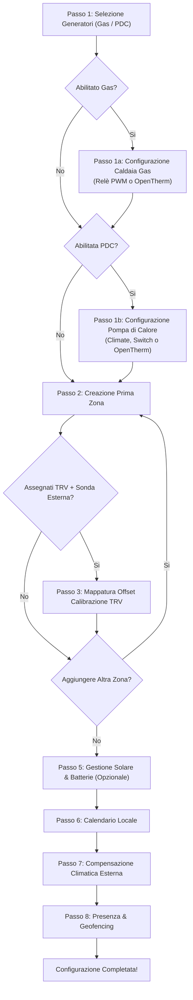

# Procedura Guidata (Config Flow & Opzioni)

L'intera configurazione e personalizzazione di **Multizone Thermostat** si svolge al 100% tramite interfaccia grafica interattiva (Config Flow & Options Flow) all'interno di Home Assistant, eliminando qualsiasi necessità di modificare file YAML a mano.

---

## 1. Prima Configurazione (Config Flow)

Per avviare la procedura guidata iniziale:
1. Accedi a **Impostazioni → Dispositivi e Servizi**.
2. Fai clic su **Aggiungi Integrazione** in basso a destra.
3. Cerca **"Multizone Thermostat"** e selezionalo.

---

### Dettaglio dei Passaggi di Configurazione

#### Passo 1: Selezione Generatori Centrali
BETA

Seleziona i generatori fisici presenti nella tua centrale termica:
* ☑️ **Caldaia a Gas / Combustibile (`enable_gas_heater`)**: Abilita il supporto a generatori a combustione (metano, GPL, gasolio, pellet).
* ☑️ **Pompa di Calore Idronica (`enable_heat_pump`)**: Abilita la pompa di calore centrale (per impianti ibridi bivalenti o Full-Electric a sola PDC).

#### Passo 1a: Configurazione Caldaia a Gas
STABILE

* **Modalità Relè (ON/OFF PWM)**:
  * `boiler_switch`: Seleziona l'entità interruttore (`switch.*`) che comanda il consenso caldaia o il circolatore generale.
* **Modalità OpenTherm (Modulante)**:
  * `opentherm_entity`: Seleziona l'entità termostato o riscaldatore del gateway OpenTherm (`climate`, `water_heater` o `number`).
  * `opentherm_ch_switch`: Interruttore opzionale di consenso riscaldamento (CH switch).
  * `opentherm_min_temp` / `opentherm_max_temp`: Limiti di mandata dell'acqua (es. 35°C – 75°C per radiatori, 25°C – 45°C per pavimento).

#### Passo 1b: Configurazione Pompa di Calore Idronica
BETA

* **Tipo di Interfaccia (`heat_pump_type`)**:
  * `climate`: Modula il setpoint mandata acqua e gestisce i modi `heat`/`cool`/`off`.
  * `switch`: Contatto pulito di consenso o contatto **Smart Grid Ready (SG-Ready)**.
  * `opentherm`: Controllo modulante via bus OpenTherm/Modbus dedicato.
* **Range Riscaldamento**: Mandata minima e massima in caldo (es. 25°C – 50°C).
* **Raffrescamento Reversibile (`heat_pump_cooling`)**: Abilita la produzione di acqua refrigerata in estate per fancoil o radiante con deumidificatori, escludendo categoricamente la caldaia a gas (`0%`).

---

#### Passo 2: Creazione della Zona Termica (Stanza)
La schermata di creazione della stanza raccoglie tutti i componenti tramite sezioni intuitive a fisarmonica:

* **Impostazioni Principali**:
  * **Nome Stanza**: Etichetta visualizzata nella dashboard (es. "Salone", "Camera Matrimoniale").
  * **Sensore Temperatura Principale (`temp_sensor`)**: Il termometro di riferimento posto ad altezza d'uomo (`sensor.*`).
  * **Temperatura Target di Base**: Setpoint iniziale (es. 20.5°C).
* **▶ Teste Termostatiche TRV (Standard)** STABILE:
  * Seleziona una o più valvole termostatiche (`climate.*`). Il sistema calcolerà la media e manterrà sincronizzati i setpoint.
* **▶ Valvole Proporzionali & 0-10V** STABILE:
  * Per attuatori motorizzati graduali o dimmer 0-10V (`valve.*` o `number.*`).
  * **Scala Valvola**: Seleziona tra **Percentuale (0–100%)** o **Volt (0.0–10.0 V)**.
* **▶ Attuatori a Relè (PWM)** STABILE:
  * Relè o testine elettrotermiche ON/OFF pilotate a modulazione temporale su finestra di ciclo.
* **▶ Climatizzatore Split d'Ambiente** BETA:
  * Entità condizionatore split (`climate.*`).
  * **Ruolo Operativo**: `heat_cool` (tutto l'anno), `heating_only` (supporto riscaldamento), `cooling_only` (aria condizionata estiva).
  * **Bypass Sonda a Soffitto (Iniezione Sensore Reale)**: Attivo di default. Inietta nello split un target ricalcolato per contrastare la stratificazione dell'aria calda a soffitto.
  * **Quick Heat Boost**: Accende lo split a massima potenza se la stanza parte fredda con dislivello $\Delta T \ge 1.5^\circ\text{C}$.
* **▶ Protezioni & Avanzate** STABILE:
  * **Sensori Finestre**: Spegne automaticamente il riscaldamento/raffrescamento se l'infisso rimane aperto.
  * **Timeout Watchdog Sonde**: Minuti massimi prima di dichiarare la sonda wireless offline e passare in sicurezza su sonda locale TRV.
  * **Anti-Bloccaggio Estivo & Apporto Passivo**.

---

#### Passo 5: Gestione Energetica, Fotovoltaico & Batterie
BETA

* **Sensore Produzione Fotovoltaica**: Potenza istantanea in Watt generata dai pannelli (`sensor.*`).
* **Sensore Immissione in Rete**: Potenza esportata in Watt (facoltativo per impianti Off-Grid).
* **Sensore Percentuale Carica Batteria (SoC)**: Percentuale da 0% a 100% (`sensor.*`).
* **Sensore Potenza Batteria**: Watt in ingresso/uscita con rilevamento segno di carica/scarica.
* **Riserva Minima Notturna (`battery_min_reserve_soc`)**: Soglia minima (consigliato 80–85%) al di sotto della quale l'elettrico non può riscaldare la casa.
* **Guardia Anti-Scarica Batteria (`battery_max_discharge_time`)**: Minuti massimi di scarica continuativa ($> 150\text{ W}$) prima di interrompere il surplus e riaccendere la caldaia a gas (default: 5 min).
* **Integrazione EMHASS / Predbat**: Entità di carico differibile (`sensor.p_deferrable0 > 0 W`) o segnale booleano.
* **Offset Accumulo Termico Gratuito**: Innalzamento setpoint ($0.0^\circ\text{C} \dots +3.0^\circ\text{C}$) per stoccare calore nei muri nelle ore di picco solare.

---

## 2. Menu Opzioni Post-Installazione (Options Flow)

In qualsiasi momento successivo all'installazione iniziale, puoi modificare ogni singolo parametro senza perdere la memoria o le curve apprese:

1. Vai in **Impostazioni → Dispositivi e Servizi**.
2. Clicca sulla scheda di **Multizone Thermostat** e poi su **Configura** (*Configure*).
3. Si aprirà il menu principale delle opzioni:

* **Modifica Generatori Centrali**: Aggiungi o rimuovi caldaia a gas o pompa di calore, cambia da Relè a OpenTherm o adegua le temperature di mandata minima/massima.
* **Configura Gestione Solare & Batterie**: Modifica soglie di surplus, tempi di guardia batteria, sensori EMHASS e offset di accumulo termico.
* **Aggiungi Nuova Zona Termica**: Configura una nuova stanza con la stessa procedura guidata.
* **Modifica Zona Esistente**: Modifica attuatori, associa un condizionatore split, aggiungi sensori finestra o regola l'apporto passivo.
* **Rimuovi una Zona Termica**: Elimina in modo pulito una zona e tutte le entità ad essa collegate.
* **Modifica Calendario, Curva Climatica o Geofencing**: Aggiorna sensori meteo esterni o dispositivi di rilevamento presenza.

---

## 3. Mappa Dettagliata delle Impostazioni: Dove Trovare Ogni Funzionalità

Per aiutarti a individuare istantaneamente dove attivare e tarare ciascuna funzione dell'integrazione, consulta questa tabella di riferimento rapido:

| Funzionalità | Dove si Trova nell'Interfaccia | Parametri / Entità Coinvolte |
|---|---|---|
| **Caldaia a Gas (Relè PWM / OpenTherm)** | *Configura → Modifica Generatori Centrali* | `boiler_mode`, `boiler_switch`, `opentherm_entity`, `opentherm_min_temp`, `opentherm_max_temp` |
| **Pompa di Calore Idronica (PDC)** | *Configura → Modifica Generatori Centrali* | `enable_heat_pump`, `heat_pump_type`, `heat_pump_entity`, `heat_pump_cooling` |
| **Priorità Sorgente Termica (5 Modi)** | *Lovelace Preset Card* oppure nei controlli entità | `select.master_control_heat_source_priority` (`auto`, `hybrid`, `combined`, `electric_only`, `gas_only`) |
| **Commutazione Stagionale (Caldo/Freddo)**| *Lovelace Preset Card* (Slider) oppure entità | `select.master_control_master_operation_mode` (`heat`, `cool`) |
| **Climatizzatore Split d'Ambiente** | *Configura → Modifica Zona → [Stanza] → Climatizzatore Split* | `split_climate_entity`, `split_role` (`heat_cool`, `heating_only`, `cooling_only`) |
| **Bypass Sonda a Soffitto (Iniezione)** | *Configura → Modifica Zona → [Stanza] → Climatizzatore Split* | `split_sensor_injection: True` (attivo di default) |
| **Quick Heat Boost Termico (ΔT)** | *Configura → Modifica Zona → [Stanza] → Climatizzatore Split* | `split_quick_boost: True`, soglia `split_boost_delta` (default: 1.5 °C) |
| **Pulsante Split Singola Stanza** | *Lovelace Dial Card* (centro dell'header) | Visibile automaticamente per stanze con split (attivo a Master spento, bloccato a Master acceso) |
| **Filtro Estivo Automatico Card Lovelace** | *Configurazione YAML della Dial Card* | Opzione scheda: `hide_if_cannot_cool: true` |
| **Stile Grafico Schede (Classic vs Luxury)**| *Configurazione YAML della Dial Card* | Opzione scheda: `card_style: classic` oppure `luxury` |
| **Surplus Solare & Inverter Clipping** | *Configura → Configura Gestione Solare & Batterie* | `solar_power_sensor`, `battery_soc_sensor`, `battery_power_sensor` |
| **Guardia Anti-Scarica Batteria** | *Configura → Configura Gestione Solare & Batterie* | `battery_max_discharge_time` (default: 5 min prima di tornare a gas) |
| **Riserva Notturna Batteria** | *Configura → Configura Gestione Solare & Batterie* | `battery_min_reserve_soc` (consigliato 80–85%) |
| **Accumulo Termico Muri (Overheat)** | *Configura → Configura Gestione Solare & Batterie* | `solar_overheat_offset` (da 0.0 °C a +3.0 °C) |
| **Bridge AI EMHASS / Predbat** | *Configura → Configura Gestione Solare & Batterie* | `external_solar_override_entity` (sensore Watt o booleano) |
| **Protezione Anti-Short-Cycle Caldaia** | *Impostazioni → Dispositivi e Servizi → Entità Master* | `number.master_control_min_cycle_on` e `min_cycle_off` (default: 5 min) |
| **Ritardo Apertura Valvole Motorizzate** | *Impostazioni → Dispositivi e Servizi → Entità Master* | `number.master_control_valve_delay` (default: 0 sec, consigliato 90-120s per elettrotermiche) |
| **Esercizio Anti-Bloccaggio Estivo** | *Impostazioni → Dispositivi e Servizi → Entità Master* | `number.master_control_anti_seize_idle_days` (15 gg) e `duration` (2 min) |
| **Protezione Antigelo di Emergenza** | *Impostazioni → Dispositivi e Servizi → Entità Master* | `number.master_control_anti_frost_temperature` (default: 7.0 °C) |
| **Sensore Apertura Finestre** | *Configura → Modifica Zona → [Stanza] → Protezioni* | `window_sensor` (`binary_sensor.*`) |
| **Calibrazione Offset TRV Radiatori** | *Configura → Modifica Zona → [Stanza] → Calibrazione TRV* | Entità di calibrazione TRV (es. `number.trv_calibration_offset`) |
| **Valvole Proporzionali 0–100% o 0–10V** | *Configura → Modifica Zona → [Stanza] → Valvole Proporzionali* | `valve_entities`, scala `percent` (0-100%) o `volt` (0-10.0 V) |
| **Programmazione Oraria Settimanale** | *Lovelace Scheduler Card* | Matrice visuale 24h con profili (Standard, Weekend, Smart Working, Custom) |
| **Smart Return (Pianifica Rientro)** | *Lovelace Scheduler Card* o servizio HA | `multizone_thermostat.set_smart_return` |
