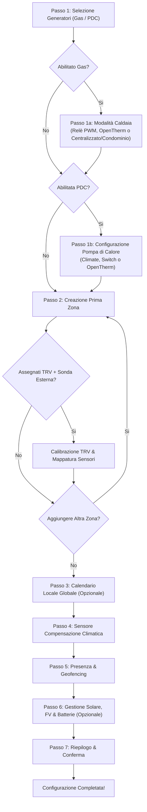

# Procedura Guidata (Config Flow & Opzioni)

L'intera configurazione e personalizzazione di **Multizone Thermostat** si svolge al 100% tramite interfaccia grafica interattiva (Config Flow & Options Flow) all'interno di Home Assistant, eliminando qualsiasi necessità di modificare file YAML a mano.

---

## 1. Prima Configurazione (Config Flow)

Per avviare la procedura guidata iniziale:
1. Accedi a **Impostazioni → Dispositivi e Servizi**.
2. Fai clic su **Aggiungi Integrazione** in basso a destra.
3. Cerca **"Multizone Thermostat"** e selezionalo.

---

### Dettaglio dei Passaggi di Configurazione

#### Passo 1: Selezione Generatori Centrali
BETA

Seleziona i generatori fisici presenti nella tua centrale termica (almeno uno deve essere abilitato):
* ☑️ **Caldaia a Gas / Combustibile (`enable_gas_heater`)**: Abilita il supporto a generatori a combustione (default: `True`; mantienilo attivo selezionando `boiler_mode: central` per impianti condominiali/teleriscaldamento).
* ☑️ **Pompa di Calore Idronica (`enable_heat_pump`)**: Abilita la pompa di calore centrale (per impianti ibridi bivalenti o Full-Electric a sola PDC, default: `False`).

#### Passo 1a: Configurazione Caldaia a Gas
STABILE

* **Modalità Relè (ON/OFF PWM)**:
  * `boiler_switch`: Seleziona l'entità interruttore (`switch.*`) che comanda il consenso caldaia o il circolatore generale.
  * `dhw_active_sensor` *(opzionale)*: Sensore binario per priorità Acqua Calda Sanitaria (ACS), per congelare i PID di zona durante il prelievo sanitario.
  * `has_mixing_valve`: Indica la presenza di valvola miscelatrice su circuiti misti radiatori/pavimento (default: `False`).
* **Modalità OpenTherm (Modulante)**:
  * `opentherm_entity`: Seleziona l'entità termostato o riscaldatore del gateway OpenTherm (`climate`, `water_heater` o `number`).
  * `opentherm_ch_switch`: Interruttore opzionale di consenso riscaldamento (CH switch).
  * `dhw_active_sensor`: Sensore opzionale per priorità Acqua Calda Sanitaria (supporta anche rilevamento multi-dispositivo EMS-ESP).
  * `has_mixing_valve`: Indica la presenza di valvola miscelatrice su impianti misti radiatori/pavimento (in assenza, vige il tetto di sicurezza a 40.0 °C sul pavimento).
  * `opentherm_min_temp` / `opentherm_max_temp`: Limiti di mandata dell'acqua (default `35.0 °C – 75.0 °C`; es. 25 °C – 45 °C per pavimento).
* **Centralizzato / Senza Caldaia (Condominiale)**:
  * Modalità `central`: salta la selezione di switch/gateway caldaia e pilota direttamente TRV e valvole di zona—ideale per riscaldamento condominiale centralizzato o teleriscaldamento.

#### Passo 1b: Configurazione Pompa di Calore Idronica
BETA

* **Tipo di Interfaccia (`heat_pump_type`)**:
  * `climate` *(default)*: Modula il setpoint mandata acqua e gestisce i modi `heat`/`cool`/`off`.
  * `switch`: Contatto pulito di consenso o contatto **Smart Grid Ready (SG-Ready)**.
  * `opentherm`: Controllo modulante via bus OpenTherm/Modbus dedicato.
* **Entità PDC (`heat_pump_entity`)**: Entità `climate.*`, `switch.*` o `number.*` della pompa di calore.
* **Range Riscaldamento (`heat_pump_min_temp` / `heat_pump_max_temp`)**: Mandata minima e massima in caldo (default: `25.0 °C – 55.0 °C`).
* **Interruttore Consenso Caldo (`heat_pump_ch_switch`)** *(opzionale)*: Relè esterno di abilitazione riscaldamento per la PDC.
* **Raffrescamento Reversibile (`heat_pump_cooling`)**: Default `True`. Abilita la produzione di acqua refrigerata in estate per fancoil o radiante, escludendo categoricamente la caldaia a gas (`0%`).
* **Range Raffrescamento (`hp_cool_min_temp` / `hp_cool_max_temp`)**: Limiti mandata acqua refrigerata (default: `7.0 °C – 18.0 °C`).
* **Valvola Miscelatrice Presente (`has_mixing_valve`)**: Default `False`. Indica se un miscelatore esterno protegge i circuiti a bassa temperatura.

---

#### Passo 2: Creazione della Zona Termica (Stanza)
La schermata di creazione della stanza raccoglie tutti i componenti tramite sezioni intuitive a fisarmonica:

* **Impostazioni Principali**:
  * **Nome Stanza (`name`)**: Etichetta visualizzata nella dashboard (es. "Salone", "Camera Matrimoniale").
  * **Sensore Temperatura Principale (`temp_sensor`)**: Il termometro di riferimento posto ad altezza d'uomo (`sensor.*`).
  * **Sensore Umidità (`humidity_sensor`)** *(Opzionale)*: Usato per il calcolo del punto di rugiada e protezione anti-condensa in raffrescamento idronico.
  * **Tipo Terminale (`emitter_type`)**: Seleziona `radiator` *(default)*, `underfloor` (pavimento radiante) o `fancoil` per calibrare curve di mandata e limiti di sicurezza.
  * **Temperatura Target di Base (`target_temperature`)**: Setpoint iniziale (default: `20.0 °C`, regolabile a passi di `0.1 °C`).
  * **Passo Setpoint Temperatura (`target_temp_step`)**: Seleziona `0.5° (Standard)` *(default)* oppure `0.1° (Fine / Sensore ad Alta Risoluzione)` per ogni zona; i comandi verso le TRV fisiche continuano ad arrotondarsi allo step hardware della valvola.
* **▶ Teste Termostatiche TRV (`trv_settings`)** STABILE:
  * **`climate_entities`**: Seleziona una o più valvole termostatiche (`climate.*`). Il sistema calcola la media e mantiene sincronizzati i setpoint.
  * **`trv_preset_sync`**: Sincronizza i preset sulle TRV quando supportati (default: `False`).
  * **`authoritative_climate_sync`**: Sincronizzazione autorevole opzionale che consente a termostati a parete/TRV fisici di commutare lo stato OFF/HEAT della zona (default: `False`).
  * **Modalità Calibrazione TRV (`trv_calibration_mode`)**: Scegli tra `"auto"` *(default)*, `"offset"`, `"external_temperature"` oppure `"disabled"` (consigliata per TRV con binding nativo Matter/Zigbee ai sensori ambiente: disattiva scritture offset e heartbeat lasciando attivo `demand_driven`).
  * **Modalità Controllo TRV (`trv_control_mode`)**: Scegli tra `"standard"` *(default; invia il setpoint diretto della zona)* oppure `"demand_driven"` (**Smart Bounded Overdrive**) per TRV il cui algoritmo proporzionale interno strozza o chiude la valvola troppo presto prima che la stanza raggiunga il target.
  * **Parametri Demand-Driven**: Configura `trv_open_boost` (default `+1.5 °C`, intervallo `0.0–5.0 °C`) e `trv_close_offset` (default `1.0 °C`, intervallo `0.0–5.0 °C`). Usa l'isteresi sulla domanda PID (`>= 5.0%` apre, `<= 0.0%` chiude), debounce anti-oscillazione di `60 s`, tick di valutazione periodico ogni `10 s` e guardia idle anti-chatter. Compatibile con i delta relativi di `physical_sync`, con ripristino automatico a `"standard"` se si attiva `safety_fallback_active`.
* **▶ Valvole Proporzionali & 0-10V (`valve_settings`)** STABILE:
  * Per attuatori motorizzati graduali o dimmer 0-10V (`valve.*` o `number.*`).
  * **Scala Valvola (`valve_scale`)**: Seleziona tra **Percentuale (0–100%)** *(default: `percent`)* o **Volt (0.0–10.0 V)** (`volt`).
  * **Inverti Valvola (`invert_valve`)**: Default `False`. Abilita per attuatori **Normalmente Aperti (NO) / ad azione inversa** (`effective_pct = 100.0 - target_pct` su scala 0–100% o 0.0–10.0 V).
* **▶ Attuatori a Relè (`relay_settings`)** STABILE:
  * Relè o testine elettrotermiche ON/OFF (`switch_entities`) pilotate a modulazione temporale PWM.
  * **Inverti Switch (`invert_switch`)**: Default `False`. Abilita per testine/relè **Normalmente Aperti (NO)**: invia `switch.turn_off` (toglie alimentazione per aprire) quando c'è domanda attiva e `switch.turn_on` (alimenta per chiudere) a riposo o in `OFF`.
* **▶ Climatizzatore Split d'Ambiente (`split_settings`)** BETA:
  * Associa un condizionatore split (`split_climate_entity`: `climate.*`).
  * **Ruolo Operativo (`split_role`)**: `heat_cool` *(default, tutto l'anno)*, `heating_only` (supporto riscaldamento), `cooling_only` (aria condizionata estiva).
  * **Priorità Solare Split (`split_solar_priority`)**: Default `True`. Consente al surplus FV di avviare lo split prima della caldaia a gas.
  * **Quick Heat Boost (`split_quick_boost` / `split_boost_delta`)**: Default `False` (`split_boost_delta` default `1.5 °C`). Se abilitato, avvia lo split insieme ai radiatori a stanza fredda ($\Delta T \ge 1.5^\circ\text{C}$).
  * **Bypass Sonda a Soffitto (`split_sensor_injection`)**: Default `True`. Inietta nello split un target ricalcolato per contrastare la stratificazione dell'aria calda a soffitto.
* **▶ Protezioni & Avanzate (`safety_settings`)** STABILE:
  * **Sensore Finestra (`window_sensor`)**: Contatto opzionale (`binary_sensor.*`) che arresta la zona all'apertura dell'infisso.
  * **Timeout Watchdog Sonde (`sensor_timeout_min`)**: Minuti massimi prima di dichiarare la sonda wireless offline e passare in sicurezza su sonda locale TRV (default: `240` min).
  * **Peso Priorità Zona (`weight`)**: Moltiplicatore usato dall'aggregatore `WEIGHTED_AVERAGE` (default: `1.0`).
  * **Anti-Bloccaggio Estivo (`anti_seize_zone_enable`)**: Movimentazione periodica delle valvole in estate (default: `True`).
  * **Apporto Termico Passivo (`allow_passive_heat`)**: Sopprime falsi allarmi ghost-heating su open space o fancoil senza valvola (default: `False`).

---

#### Passo 2b: Calibrazione TRV, Invio Temperatura Esterna & Selettore Sorgente
STABILE

Mostrato automaticamente dopo la creazione/modifica di una zona con `temp_sensor` e `climate_entities` configurati:
* **Entità Calibrazione per TRV**: Associa ogni `climate.*` alla relativa entità `number.*` di offset o temperatura esterna:
  * `auto` *(default)*: Rileva automaticamente entità di temperatura esterna (parole chiave `external_temperature_input`, `external_temp`, `remote_temp`, oppure range `[-10..50]`); altrimenti usa la modalità offset.
  * `offset`: Inietta dinamicamente la correzione offset sulla temperatura locale (`number.*`), protetta da deadband di errore `0.25 °C`, cooldown di `180 s`, finestra di assestamento anti-ratchet di `300 s` e blocco automatico `offset_stalled` dopo 2 scritture non recepite.
  * `external_temperature`: Per TRV dotate di `number.*external_temperature_input` (es. Sonoff TRVZB, Aqara, Tuya/Zigbee2MQTT), scrive direttamente la temperatura della sonda ambiente in °C (arrotondata allo step, limitata a min/max) con heartbeat anti-offline ogni `1200 s` (20 min) e rate-limit jitter di `60 s` su variazioni `<= 0.1 °C`.
  * `disabled`: Disattiva completamente scritture offset e heartbeat di temperatura esterna mantenendo attivo l'overdrive `demand_driven`—consigliata per TRV con **binding nativo Matter o Zigbee** verso sensori ambiente esterni (es. Eve Thermo + sensori ambiente collegati via Matter Binding) per evitare derive/ratchet sugli offset.
* **Selettore Sorgente Sensore TRV (`trv_sensor_selects`)** *(Opzionale)*:
  * Associa ogni entità `climate.*` della TRV alla sua entità `select.*` direttamente nella schermata **Calibrazione TRV** (Setup/Opzioni).
  * Commuta automaticamente sul sensore esterno/remoto quando attivo (escludendo opzioni `"offline"` come `remote_source_offline`) e ripristina in sicurezza il sensore interno/locale se si attiva `safety_fallback_active` (sonda stanza scaduta o non disponibile).

*(Scegli `add_another` per aggiungere altre stanze prima di proseguire con le impostazioni globali.)*

---

#### Passo 3: Calendario Locale Globale (`calendar`)
* **`global_calendar`** *(Opzionale)*: Seleziona un'entità `calendar.*` di Home Assistant per pilotare i preset della casa insieme o in alternativa allo Scheduler Settimanale integrato.

#### Passo 4: Compensazione Climatica (`weather`)
* **`weather_sensor`**: Seleziona un'entità meteo o sensore di temperatura esterna (`weather.*` o `sensor.*`, default `"none"`). Abilita la correzione feed-forward tramite `number.master_control_weather_curve`.

#### Passo 5: Presenza & Geofencing (`geofencing`)
* **`geofencing_enabled`**: Abilita il passaggio automatico a Fuori Casa / In Casa (default: `True`).
* **`presence_sensor`**: Entità di occupazione monitorata dal geofencing (default: `"zone.home"`).

#### Passo 6: Gestione Energetica, Fotovoltaico & Batterie (`energy_management`)
BETA

* **`energy_management_enabled`**: Abilitazione generale dell'Energy Manager solare (default: `False`).
* **`solar_power_sensor`**: Potenza istantanea in Watt generata dai pannelli (`sensor.*`).
* **`grid_export_sensor`**: Potenza esportata in Watt (facoltativo per impianti Off-Grid), con opzione **`grid_export_inverted`** (`False`) se il contatore riporta l'immissione come valore negativo.
* **`solar_export_threshold`**: Soglia minima di esportazione in Watt per attivare il surplus (default: `500.0 W`).
* **`battery_soc_sensor`**: Percentuale di carica della batteria domestica (`sensor.*`).
* **`battery_power_sensor`**: Potenza batteria in Watt (convenzione: **positivo = carica**, **negativo = scarica**). Abilita **`battery_power_inverted`** (`False`) se il tuo inverter usa segno positivo in scarica.
* **`battery_min_reserve_soc`**: Soglia minima di carica sotto la quale il riscaldamento elettrico viene bloccato (default: `20.0%`; consigliato `50–85%` per preservare la riserva notturna).
* **`battery_max_discharge_time`**: Minuti massimi di scarica continuativa ($> 150\text{ W}$) prima di tornare a gas (default: `5` min).
* **`solar_min_run_time`**: Durata minima ciclo compressore anti-pendolamento in minuti (default: `10` min).
* **`solar_overheat_offset`**: Sovralzo setpoint ($0.0^\circ\text{C} \dots +3.0^\circ\text{C}$, default `0.0 °C`) per accumulare calore gratuito nei muri nelle ore di picco solare.
* **`solar_forecast_sensor`** / **`solar_irradiance_sensor`** *(Opzionali)*: Sensori di previsione produzione FV (`W`/`kWh`) e irraggiamento solare (`W/m²`/`lux`).
* **`external_solar_override_entity`**: Entità di carico differibile EMHASS (`sensor.p_deferrable0 > 0 W`) o segnale booleano Predbat.

#### Passo 7: Riepilogo & Conferma (`confirm`)
Mostra il riepilogo completo di generatori, zone e opzioni globali prima della creazione definitiva dell'integrazione.

---

## 2. Menu Opzioni Post-Installazione (Options Flow)

In qualsiasi momento successivo all'installazione iniziale, puoi modificare ogni singolo parametro senza perdere la memoria o le curve apprese:

1. Vai in **Impostazioni → Dispositivi e Servizi**.
2. Clicca sulla scheda di **Multizone Thermostat** e poi su **Configura** (*Configure*).
3. Si aprirà il menu delle 9 azioni disponibili:

* **Modifica caldaia / modalità impianto (`change_boiler`)**: Abilita/disabilita la caldaia a gas (`enable_gas_heater`), cambia tra Relè PWM, OpenTherm o Centralizzato Condominiale e aggiorna limiti di mandata o `dhw_active_sensor`.
* **Modifica Pompa di Calore (PDC) (`edit_heat_pump`)**: Abilita/disabilita la PDC centrale (`enable_heat_pump`), aggiorna `heat_pump_type`, limiti caldo/freddo o `has_mixing_valve`.
* **Modifica Gestione Solare ed Energetica (`edit_energy_management`)**: Aggiorna sensori PV/rete/batteria, inversione segni, timeout batteria, entità EMHASS e offset di accumulo termico.
* **Aggiungi una zona (`add_zone`)**: Configura una nuova stanza (con relativa mappatura calibrazione TRV).
* **Modifica una zona (`edit_zone`)**: Modifica attuatori, aggiorna `target_temp_step` (`0.5°`/`0.1°`), attiva `invert_switch` / `invert_valve`, regola `trv_calibration_mode`, associa uno split o aggiorna le protezioni.
* **Rimuovi una zona (`remove_zone`)**: Elimina in modo pulito una zona e le relative entità.
* **Modifica Compensazione Climatica (`edit_weather_comp`)**: Aggiorna il sensore `weather_sensor`.
* **Modifica Impostazioni Geofencing (`edit_geofencing`)**: Abilita/disabilita il geofencing o cambia `presence_sensor`.
* **Modifica Calendario Globale (`edit_calendar`)**: Imposta o rimuove `global_calendar`.

---

## 3. Mappa Dettagliata delle Impostazioni: Dove Trovare Ogni Funzionalità

Per aiutarti a individuare istantaneamente dove attivare e tarare ciascuna funzione dell'integrazione, consulta questa tabella di riferimento rapido:

| Funzionalità | Dove si Trova nell'Interfaccia | Parametri / Entità Coinvolte |
|---|---|---|
| **Caldaia a Gas (Relè PWM / OpenTherm / Centralizzato)** | *Configura → Modifica caldaia / modalità impianto* | `enable_gas_heater`, `boiler_mode`, `boiler_switch`, `opentherm_entity`, `opentherm_min_temp`, `opentherm_max_temp`, `dhw_active_sensor`, `has_mixing_valve` |
| **Pompa di Calore Idronica (PDC)** | *Configura → Modifica Pompa di Calore (PDC)* | `enable_heat_pump`, `heat_pump_type`, `heat_pump_entity`, `heat_pump_cooling`, `heat_pump_min_temp`, `heat_pump_max_temp`, `hp_cool_min_temp`, `hp_cool_max_temp`, `heat_pump_ch_switch` |
| **Priorità Sorgente Termica (7 Modi)** | *Lovelace Preset Card* (5 pillole principali) o controllo entità (tutti e 7) | `select.master_control_heat_source_priority` (`auto`, `hybrid`, `combined`, `electric_only`, `gas_only`, `gas_priority`, `electric_priority`) |
| **Commutazione Stagionale (Caldo 🔥 / Freddo ❄️)**| *Lovelace Preset Card* (Slider) oppure entità | `select.master_control_master_operation_mode` (`heat`, `cool`) |
| **Climatizzatore Split d'Ambiente** | *Configura → Modifica una zona → [Stanza] → Climatizzatore Split* | `split_climate_entity`, `split_role` (`heat_cool`, `heating_only`, `cooling_only`), `split_solar_priority` |
| **Bypass Sonda a Soffitto (Iniezione)** | *Configura → Modifica una zona → [Stanza] → Climatizzatore Split* | `split_sensor_injection` (default: `True`) |
| **Quick Heat Boost Termico (ΔT)** | *Configura → Modifica una zona → [Stanza] → Climatizzatore Split* | `split_quick_boost` (default: `False`), soglia `split_boost_delta` (default: `1.5 °C`) |
| **Pulsante Split Singola Stanza** | *Lovelace Dial Card* (centro dell'header) | Visibile automaticamente per stanze con split (attivo a Master spento, bloccato a Master acceso) |
| **Filtro Estivo Automatico Card Lovelace** | *Editor Dial Card / Configurazione YAML* | Opzione scheda: `hide_if_cannot_cool: true` (opt-in) |
| **Stile Grafico Schede (Classic vs Luxury)**| *Configurazione YAML della Dial Card* | Opzione scheda: `card_style: classic` oppure `luxury` |
| **Surplus Solare & Inverter Clipping** | *Configura → Modifica Gestione Solare ed Energetica* | `solar_power_sensor`, `grid_export_sensor`, `grid_export_inverted`, `solar_export_threshold` (`500.0 W`), `battery_soc_sensor`, `battery_power_sensor`, `battery_power_inverted`, `solar_forecast_sensor`, `solar_irradiance_sensor` |
| **Guardia Anti-Scarica Batteria** | *Configura → Modifica Gestione Solare ed Energetica* | `battery_max_discharge_time` (default: `5` min prima di tornare a gas) |
| **Riserva Notturna Batteria** | *Configura → Modifica Gestione Solare ed Energetica* | `battery_min_reserve_soc` (default: `20.0%`, consigliato `50–85%`) |
| **Accumulo Termico Muri (Overheat)** | *Configura → Modifica Gestione Solare ed Energetica* | `solar_overheat_offset` (da `0.0 °C` a `+3.0 °C`) |
| **Bridge AI EMHASS / Predbat** | *Configura → Modifica Gestione Solare ed Energetica* | `external_solar_override_entity` (sensore Watt o booleano) |
| **Protezione Anti-Short-Cycle Caldaia & PDC** | *Impostazioni → Dispositivi e Servizi → Master Control* | `number.master_control_min_cycle_on` / `off` (`0–60 min`, default: `5`); `number.master_control_heat_pump_min_cycle_on` / `off` (`0–30 min`, default: `5`) |
| **Ritardo Apertura Valvole Motorizzate & Guardia TRV** | *Impostazioni → Dispositivi e Servizi → Master Control* | `number.master_control_valve_delay` (default: `0` s, consigliato 90–120 s; eseguito dopo la guardia automatica `HOLD_TRV_CLOSED` fino a max `120 s`) |
| **Esercizio Anti-Bloccaggio Estivo** | *Impostazioni → Dispositivi e Servizi → Master Control* | `number.master_control_anti_seize_idle_days` (`1–30`, default: `15` gg) e `duration` (default: `2` min) |
| **Protezione Antigelo di Emergenza** | *Impostazioni → Dispositivi e Servizi → Master Control* | `number.master_control_anti_frost_temperature` (`5.0–16.0 °C`, default: **`12.0 °C`**) & `number.master_control_frost_protection_flow_temp` (`25.0–55.0 °C`, default: `40.0 °C`, modulante/PDC) |
| **Sensore Apertura Finestre** | *Configura → Modifica una zona → [Stanza] → Protezioni & Avanzate* | `window_sensor` (`binary_sensor.*`), `sensor_timeout_min` (default: `240`), `weight` (default: `1.0`) |
| **Calibrazione TRV & Invio Temp. Esterna** | *Configura → Modifica una zona → [Stanza] → Teste Termostatiche TRV* (+ step *Calibrazione TRV*) | `trv_calibration_mode` (`auto`, `offset`, `external_temperature`, `disabled`), entità `number.*`, `trv_sensor_selects` (`select.*`) |
| **Modalità TRV Demand-Driven** | *Configura → Modifica una zona → [Stanza] → Teste Termostatiche TRV* | `trv_control_mode` (`standard`, `demand_driven`), `trv_open_boost` (`0.0–5.0 °C`, default `1.5 °C`), `trv_close_offset` (`0.0–5.0 °C`, default `1.0 °C`) |
| **Valvole Proporzionali 0–100% / 0–10V & NO/NC** | *Configura → Modifica una zona → [Stanza] → Valvole Proporzionali* | `valve_entities`, `valve_scale` (`percent` / `volt`), `invert_valve` (inversione per valvole Normalmente Aperte) |
| **Passo Setpoint per Zona (`0.5°` / `0.1°`)** | *Configura → Modifica una zona → [Stanza] → Impostazioni Principali* | `target_temp_step` (`0.5` o `0.1`), `target_temperature` (step `0.1°`) |
| **Attuatori Relè PWM & Normalmente Aperti (NO)** | *Configura → Modifica una zona → [Stanza] → Attuatori a Relè (PWM)* | `switch_entities`, `invert_switch` (inversione logica per testine Normalmente Aperte) |
| **Programmazione Oraria Settimanale** | *Lovelace Scheduler Card* | Matrice visuale 24h con 3 profili predefiniti (`Standard`, `Smart Working`, `Holiday`) + Custom |
| **Smart Return (Pianifica Rientro)** | *Lovelace Scheduler Card* o servizio HA | `multizone_thermostat.set_smart_return` (orizzonte max `6.0 h`) |
