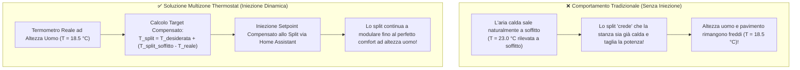

# Climatizzatori Split d'Ambiente

BETA

La **Fase 11** consente di associare a ogni singola zona termica il proprio condizionatore split (`climate.*`), integrandolo armoniosamente nell'orchestrazione con i termosifoni e le valvole idroniche.

---

## 1. Il Problema della Stratificazione & Sonda a Soffitto

Tutti i condizionatori a split commerciali (Daikin, Mitsubishi, Gree, Haier, Samsung, Panasonic, ecc.) integrano il proprio sensore di temperatura direttamente all'interno dello split a parete, posizionato a pochi centimetri dal soffitto.

### La Formula di Iniezione Dinamica

Quando `split_sensor_injection: True` è attivo, Multizone Thermostat intercetta la lettura della sonda a soffitto e calcola lo scostamento in tempo reale rispetto al termometro di stanza:

$$T_{\text{split\_inviato}} = T_{\text{desiderato}} + \left(T_{\text{split\_letto}} - T_{\text{sensore\_reale}}\right)$$

#### Esempio Pratico di Funzionamento
* **Temperatura desiderata nella stanza**: 20.5 °C
* **Temperatura reale misurata ad altezza uomo**: 19.0 °C (la stanza è ancora fredda)
* **Temperatura rilevata dalla sonda a soffitto dello split**: 22.0 °C (accumulo di calore vicino al soffitto)
* **Calcolo**: $T_{\text{split\_inviato}} = 20.5 + (22.0 - 19.0) = 23.5\ ^\circ\text{C}$
* **Risultato**: Multizone Thermostat ordina allo split di puntare a 23.5 °C. Lo split continuerà a erogare calore fino a quando la sonda a terra non raggiungerà effettivamente i 20.5 °C, eliminando completamente la sensazione di freddo ai piedi.

---

## 2. Quick Heat Boost (Shock Termico a Freddo)

Quando una stanza è rimasta chiusa o non riscaldata per ore e presenta un dislivello termico significativo rispetto al setpoint desiderato:

1. **Scatto del Boost**: Se $\Delta T = (T_{\text{target}} - T_{\text{ambiente}}) \ge 1.5\ ^\circ\text{C}$ (soglia configurabile tramite `split_boost_delta`), il sistema attiva simultaneamente sia i radiatori idronici sia lo split alla massima potenza (**Dual Heat**).
2. **Accelerazione Termica**: L'aria forzata calda dello split rimescola i volumi d'aria, abbattendo i tempi di riscaldamento del 60–70%.
3. **Uscita a Soglia di Comfort**: Quando la temperatura si avvicina a soli 0.3 °C dal target, lo split si spegne con spegnimento dolce.
4. **Mantenimento Silenzioso**: Il mantenimento stazionario viene affidato esclusivamente ai radiatori idronici silenziosi a bassa temperatura, azzerando rumori di ventole e correnti d'aria fastidiose durante la permanenza.

---

## 3. Disaccoppiamento Idronico Automatico

Quando una stanza viene riscaldata dallo split (per disponibilità di surplus fotovoltaico, per avvio rapido o per accensione manuale):
* Multizone Thermostat **sopprime istantaneamente a `0.0%` la richiesta idronica di quella specifica stanza**.
* La valvola di zona o la testina termostatica TRV del termosifone si chiude.
* La caldaia a gas non consuma combustibile e non produce calore per quell'ambiente.
* Tutte le altre stanze sprovviste di split continuano a essere servite regolarmente dall'impianto a gas senza la minima perturbazione.

---

## 4. Pulsante Accensione Manuale Singola Stanza

Nella scheda Lovelace **Dial Card**, al centro esatto dell'header, è collocato il pulsante dedicato per lo split locale:

* **Visibilità Intelligente**: Appare unicamente nelle stanze configurate con un climatizzatore split (`split_climate_entity`). Nelle stanze con soli radiatori è nascosto (poiché non avrebbe senso avviare una caldaia centrale per una singola stanza).
* **Funzionamento a Master Spento (OFF)**:
  * Facendo clic a riscaldamento generale spento, si accende **esclusivamente lo split elettrico** di quella stanza.
  * La caldaia a gas e le pompe di circolazione rimangono rigorosamente spente (`switch.switch_caldaia: off`).
  * La card visualizza immediatamente il badge **`⚡ ELETTRICO`** e l'arco luminescente ciano.
* **Blocco di Sicurezza a Master Acceso**:
  * Quando l'impianto centrale della casa è acceso, il pulsante viene disabilitato per proteggere l'orchestrazione termica globale della famiglia da tocchi involontari.
* **Riallineamento Automatico al Master**:
  * Se il Master generale viene successivamente acceso, l'accensione manuale locale si disattiva e la stanza si risincronizza con il preset globale dell'abitazione.

---

## 5. Ruoli Operativi dello Split

Configurabile tramite il parametro `split_role` nel Config Flow o nelle Opzioni:
* **`heat_cool` (Tutto l'anno)**: Lo split interviene sia per il supporto riscaldamento in inverno sia come climatizzatore principale in estate.
* **`heating_only` (Solo Inverno)**: Utilizzato per integrare i radiatori o per il surplus solare, disattivato nella stagione estiva.
* **`cooling_only` (Solo Estate)**: Riservato esclusivamente all'aria condizionata estiva (non interviene mai in inverno).
