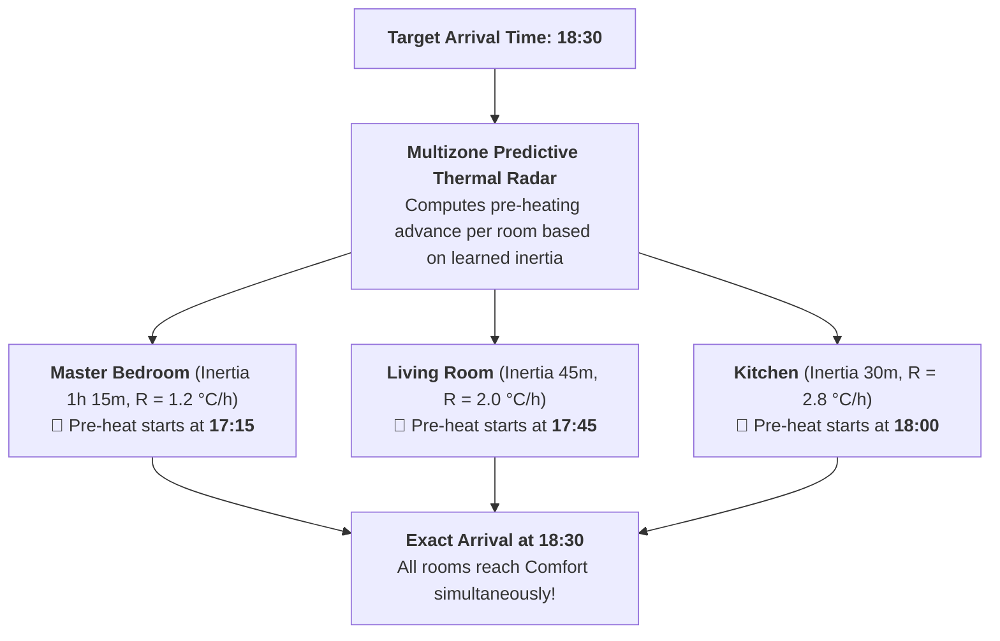

# Weekly Scheduling & Smart Return

<span class="badge-stable">STABLE</span>

Multizone Thermostat integrates a native weekly schedule engine with a visual 24-hour timeline matrix and predictive thermal anticipation (**Smart Return**).

---

## 1. The Scheduler Card (`custom:multizone-thermostat-scheduler-card`)

* **24-Hour Timeline Matrix**: Visual timeline with color-coded preset blocks (Comfort, Eco, Sleep, Away) across all rooms throughout the day.
* **Touch-Friendly Block Editing**: Tap any time block to adjust start time, end time, and assigned preset mode.
* **Quick Multi-Day Copy**: Copy configurations across weekdays (Monday–Friday) or weekends with a single tap.

---

## 2. Multi-Profile Management & Timed Expirations

* **Standard**: Typical weekday work schedule.
* **Weekend / Holiday**: Delayed wake-up and continuous daytime comfort.
* **Smart Working**: Dedicated daytime heating for home offices.
* **Guests / Vacation**: Custom profiles for temporary events.

### Temporary Profiles with Auto-Reversion
Activate special profiles with an expiration timestamp via UI or Home Assistant service:
* E.g.: Activate **"Guests"** until Sunday at 23:00.
* Once expired, the system automatically reverts to **"Standard"**, preventing accidental energy waste.

---

## 3. Predictive Smart Return (Pianifica Rientro)

Conventional setback systems rely on guesswork ("turn on heating 1 hour before arrival").
Multizone Thermostat deploys a **Predictive Thermal Radar**:



### Pre-Heating Time Calculation
Using the learned warm-up rate $R$ (°C/hour):

$$\Delta t_{\text{lead\_time}} = \frac{T_{\text{comfort}} - T_{\text{current}}}{R}$$

* Rooms warm up at their natural rates without wasted early heating.
* **Result**: At 18:30 sharp, every room reaches comfort simultaneously.

---

## 4. YAML Automation Examples

### Trigger Smart Return on Leaving the Office (GPS Geofence)
```yaml
automation:
  - alias: "Smart Return upon Leaving Work"
    trigger:
      - platform: zone
        entity_id: person.alex
        zone: zone.office
        event: leave
    action:
      - service: multizone_thermostat.set_smart_return
        data:
          arrival_time: "19:00"
          preset: comfort
```

### Switch to Smart Working Profile
```yaml
automation:
  - alias: "Activate Smart Working Profile"
    trigger:
      - platform: state
        entity_id: input_boolean.work_from_home
        to: "on"
    action:
      - service: multizone_thermostat.activate_schedule_profile
        data:
          profile_id: smart_working
          fallback_profile: standard
```
