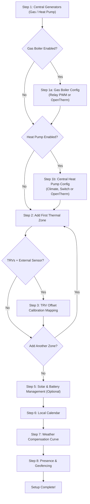

# Setup Wizard (Config Flow & Options)

The entire configuration of **Multizone Thermostat** is performed 100% via Home Assistant's visual interface (Config Flow & Options Flow), eliminating the need for manual YAML editing.

---

## 1. Initial Setup (Config Flow)

To launch the setup wizard:
1. Go to **Settings → Devices & Services**.
2. Click **Add Integration** in the bottom right corner.
3. Search for **"Multizone Thermostat"** and select it.

---

### Step-by-Step Configuration Guide

#### Step 1: Central Generator Selection
BETA

Select the physical generators present in your heating plant:
* ☑️ **Gas / Fuel Boiler (`enable_gas_heater`)**: Enables combustion boilers (natural gas, LPG, diesel, pellets).
* ☑️ **Central Hydronic Heat Pump (`enable_heat_pump`)**: Enables central heat pump coordination for bivalent hybrid or full-electric systems.

#### Step 1a: Gas Boiler Configuration
STABLE

* **Relay Mode (ON/OFF PWM)**:
  * `boiler_switch`: Select the switch entity (`switch.*`) controlling the boiler burner or circulation pump.
* **OpenTherm Modulating Mode**:
  * `opentherm_entity`: Select the OpenTherm gateway entity (`climate`, `water_heater`, or `number`).
  * `opentherm_ch_switch`: Optional central heating enable switch (CH switch).
  * `opentherm_min_temp` / `opentherm_max_temp`: Water flow temperature limits (e.g. 35 °C – 75 °C for radiators, 25 °C – 45 °C for underfloor).

#### Step 1b: Central Heat Pump Configuration
BETA

* **Control Interface (`heat_pump_type`)**:
  * `climate`: Modulates flow temperature setpoints and handles `heat`/`cool`/`off` mode switching.
  * `switch`: Dry contact relay or **Smart Grid Ready (SG-Ready)** input.
  * `opentherm`: Modulating OpenTherm / Modbus bus drive.
* **Heating Range**: Flow setpoint limits for heating (e.g. 25 °C – 50 °C).
* **Reversible Cooling (`heat_pump_cooling`)**: Enables summer chilled water generation for fancoils or underfloor cooling with dehumidifiers, strictly locking the gas boiler to 0%.

---

#### Step 2: Thermal Zone Creation (Rooms)
Organized into collapsible accordion sections:

* **Main Settings**:
  * **Room Name**: Display label in the dashboard (e.g. "Living Room", "Master Bedroom").
  * **Primary Temperature Sensor (`temp_sensor`)**: Eye-level reference thermometer (`sensor.*`).
  * **Base Target Temperature**: Initial setpoint (e.g. 20.5 °C).
* **▶ Smart Radiator TRVs (Standard)** STABLE:
  * Select smart radiator valves (`climate.*`). The system synchronizes setpoints and averages temperatures.
* **▶ Proportional & 0-10V Analog Actuators** STABLE:
  * For gradual motorized valves or 0–10V dimmer modules (`valve.*` or `number.*`).
  * **Valve Scale**: Choose between **Percentage (0–100%)** or **Voltage (0.0–10.0 V)**.
* **▶ Relay Actuators (PWM)** STABLE:
  * Electrothermal actuators driven via time-proportional cycles.
* **▶ Room Split Air Conditioners** BETA:
  * Associate an individual split unit (`climate.*`).
  * **Operational Role**: `heat_cool` (all year), `heating_only` (winter boost), `cooling_only` (summer cooling).
  * **Ceiling Sensor Bypass (Real Sensor Injection)**: Enabled by default. Injects a compensated target to prevent premature throttling caused by ceiling heat pooling.
  * **Quick Heat Boost**: Fires the split at maximum power alongside radiators when starting cold (ΔT ≥ 1.5 °C).
* **▶ Protections & Advanced** STABLE:
  * **Window Sensors**: Automatically halts heating/cooling when windows are opened.
  * **Sensor Watchdog Timeout**: Maximum minutes before declaring a wireless sensor offline and switching to TRV internal sensors.
  * **Summer Anti-Seize & Passive Heat Intake**.

---

#### Step 5: Solar Energy, PV & Battery Storage
BETA

* **Solar Generation Sensor**: Real-time rooftop PV power in Watts (`sensor.*`).
* **Grid Export Sensor**: Export power in Watts (optional for off-grid setups).
* **Battery SoC Sensor**: Household battery state of charge percentage (`sensor.*`).
* **Battery Power Sensor**: Charge/discharge power in Watts with automatic polarity detection.
* **Minimum Night Reserve SoC (`battery_min_reserve_soc`)**: Threshold (recommended 80–85%) below which electric heating is locked out.
* **Continuous Discharge Safeguard (`battery_max_discharge_time`)**: Maximum consecutive minutes of battery discharge (> 150 W) before reverting to the gas boiler (default: 5 min).
* **EMHASS / Predbat Bridge**: Deferrable load sensor (`sensor.p_deferrable0 > 0 W`) or boolean boost entity.
* **Thermal Mass Storage Offset**: Room target boost (0.0 °C to +3.0 °C) to store free solar heat into building walls during peak generation.

---

## 2. Post-Installation Options Menu (Options Flow)

At any time after initial installation, you can adjust settings without losing learned thermal curves or state:

1. Navigate to **Settings → Devices & Services**.
2. Click on **Multizone Thermostat** and select **Configure**.
3. Choose from the available options:

* **Modify Central Generators**: Add or remove boiler/heat pump, switch between Relay and OpenTherm, or update water temperature limits.
* **Configure Solar & Battery Management**: Adjust surplus thresholds, battery timeouts, EMHASS entities, and thermal overheating offsets.
* **Add New Thermal Zone**: Add a new room with the guided wizard.
* **Edit Existing Zone**: Reassign actuators, add a room split AC, configure window sensors, or adjust passive heat.
* **Remove a Thermal Zone**: Cleanly delete a zone and its associated entities.
* **Edit Calendar, Weather Curve, or Geofencing**: Update weather sensors or presence devices.

---

## 3. Complete Settings Map: Where to Find Every Feature

Use this reference table to find exactly where to activate and tune every single feature:

| Feature | Location in Home Assistant UI | Configuration Keys / Entities |
|---|---|---|
| **Gas Boiler (Relay PWM / OpenTherm)** | *Configure → Modify Central Generators* | `boiler_mode`, `boiler_switch`, `opentherm_entity`, `opentherm_min_temp`, `opentherm_max_temp` |
| **Central Hydronic Heat Pump (PDC)** | *Configure → Modify Central Generators* | `enable_heat_pump`, `heat_pump_type`, `heat_pump_entity`, `heat_pump_cooling` |
| **Heat Source Priority (5 Modes)** | *Lovelace Preset Card* or Entity Controls | `select.master_control_heat_source_priority` (`auto`, `hybrid`, `combined`, `electric_only`, `gas_only`) |
| **Seasonal Mode (Heat 🔥 / Cool ❄️)** | *Lovelace Preset Card* (Slider) or Entity | `select.master_control_master_operation_mode` (`heat`, `cool`) |
| **Room Split Air Conditioners** | *Configure → Edit Zone → [Room] → Room Split AC* | `split_climate_entity`, `split_role` (`heat_cool`, `heating_only`, `cooling_only`) |
| **Ceiling Sensor Bypass (Target Injection)** | *Configure → Edit Zone → [Room] → Room Split AC* | `split_sensor_injection: True` (enabled by default) |
| **Quick Heat Boost (Thermal Shock)** | *Configure → Edit Zone → [Room] → Room Split AC* | `split_quick_boost: True`, threshold `split_boost_delta` (default: 1.5 °C) |
| **Single-Room Split Manual Button** | *Lovelace Dial Card* (Header center) | Automatically visible for rooms with split (active when Master is OFF, locked when Master is ON) |
| **Automatic Dashboard Summer Filter** | *Dial Card YAML Configuration* | Card option: `hide_if_cannot_cool: true` |
| **Card Visual Style (Classic vs Luxury)** | *Dial Card YAML Configuration* | Card option: `card_style: classic` or `luxury` |
| **Solar Surplus & Inverter Anti-Clipping** | *Configure → Configure Solar & Batteries* | `solar_power_sensor`, `battery_soc_sensor`, `battery_power_sensor` |
| **Battery Discharge Safeguard** | *Configure → Configure Solar & Batteries* | `battery_max_discharge_time` (default: 5 min before gas fallback) |
| **Minimum Night Reserve SoC** | *Configure → Configure Solar & Batteries* | `battery_min_reserve_soc` (recommended 80–85%) |
| **Thermal Pre-Storage (Wall Overheating)** | *Configure → Configure Solar & Batteries* | `solar_overheat_offset` (0.0 °C to +3.0 °C) |
| **AI Optimizer Bridge (EMHASS / Predbat)** | *Configure → Configure Solar & Batteries* | `external_solar_override_entity` (Watt sensor or boolean) |
| **Boiler Anti-Short-Cycle Protection** | *Settings → Devices & Services → Master Entities* | `number.master_control_min_cycle_on` and `min_cycle_off` (default: 5 min) |
| **Motorized Valve Opening Delay** | *Settings → Devices & Services → Master Entities* | `number.master_control_valve_delay` (default: 0 sec, 90-120s recommended for wax actuators) |
| **Summer Anti-Seize Valve Exercise** | *Settings → Devices & Services → Master Entities* | `number.master_control_anti_seize_idle_days` (15 days) and `duration` (2 min) |
| **Emergency Anti-Frost Protection** | *Settings → Devices & Services → Master Entities* | `number.master_control_anti_frost_temperature` (default: 7.0 °C) |
| **Window Open Contact Sensor** | *Configure → Edit Zone → [Room] → Protections* | `window_sensor` (`binary_sensor.*`) |
| **TRV Calibration Offset Injection** | *Configure → Edit Zone → [Room] → TRV Calibration* | Calibration offset entity (e.g. `number.trv_calibration_offset`) |
| **Proportional 0–100% or 0–10V Valves** | *Configure → Edit Zone → [Room] → Proportional Valves* | `valve_entities`, scale `percent` (0-100%) or `volt` (0-10.0 V) |
| **Weekly Matrix Scheduling** | *Lovelace Scheduler Card* | 24-hour visual matrix with profiles (Standard, Weekend, Smart Working, Custom) |
| **Predictive Smart Return** | *Lovelace Scheduler Card* or HA Service | `multizone_thermostat.set_smart_return` |
