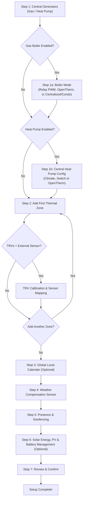

# Setup Wizard (Config Flow & Options)

The entire configuration of **Multizone Thermostat** is performed 100% via Home Assistant's visual interface (Config Flow & Options Flow), eliminating the need for manual YAML editing.

---

## 1. Initial Setup (Config Flow)

To launch the setup wizard:
1. Go to **Settings → Devices & Services**.
2. Click **Add Integration** in the bottom right corner.
3. Search for **"Multizone Thermostat"** and select it.

---

### Step-by-Step Configuration Guide

#### Step 1: Central Generator Selection
BETA

Select the physical generators present in your heating plant (at least one must be enabled):
* ☑️ **Gas / Fuel Boiler (`enable_gas_heater`)**: Enables combustion boilers (default: `True`; also select this with `boiler_mode: central` for centralized condo/district heating).
* ☑️ **Central Hydronic Heat Pump (`enable_heat_pump`)**: Enables central heat pump coordination for bivalent hybrid or full-electric systems (default: `False`).

#### Step 1a: Gas Boiler Configuration
STABLE

* **Relay Mode (ON/OFF PWM)**:
  * `boiler_switch`: Select the switch entity (`switch.*`) controlling the boiler burner or circulation pump.
  * `dhw_active_sensor` *(optional)*: Custom binary sensor indicating active Domestic Hot Water (DHW) production so zone PIDs freeze during hot water draw-off.
  * `has_mixing_valve`: Indicates whether a hydraulic mixing valve is present on mixed radiator/underfloor circuits (default: `False`).
* **OpenTherm Modulating Mode**:
  * `opentherm_entity`: Select the OpenTherm gateway entity (`climate`, `water_heater`, or `number`).
  * `opentherm_ch_switch`: Optional central heating enable switch (CH switch).
  * `dhw_active_sensor`: Optional custom DHW active sensor (supports EMS-ESP multi-device charging detection).
  * `has_mixing_valve`: Indicates whether a hydraulic mixing valve is installed on mixed radiator/underfloor circuits (otherwise a strict 40.0 °C cap protects unmixed underfloor loops).
  * `opentherm_min_temp` / `opentherm_max_temp`: Water flow temperature limits (default `35.0 °C – 75.0 °C`; e.g. 25 °C – 45 °C for underfloor).
* **Centralized / No Boiler (Condo)**:
  * `central` mode: Skips boiler entity selection and drives TRVs and zone actuators directly—ideal for centralized condominium or district heating plants.

#### Step 1b: Central Heat Pump Configuration
BETA

* **Control Interface (`heat_pump_type`)**:
  * `climate` *(default)*: Modulates flow temperature setpoints and handles `heat`/`cool`/`off` mode switching.
  * `switch`: Dry contact relay or **Smart Grid Ready (SG-Ready)** input.
  * `opentherm`: Modulating OpenTherm / Modbus bus drive.
* **Heat Pump Entity (`heat_pump_entity`)**: Target `climate.*`, `switch.*`, or `number.*` entity.
* **Heating Range (`heat_pump_min_temp` / `heat_pump_max_temp`)**: Flow setpoint limits for heating (default: `25.0 °C – 55.0 °C`).
* **Heating Enable Switch (`heat_pump_ch_switch`)** *(optional)*: External CH enable relay for the heat pump.
* **Reversible Cooling (`heat_pump_cooling`)**: Default `True`. Enables summer chilled water generation for fancoils or underfloor cooling, strictly locking the gas boiler to 0%.
* **Cooling Range (`hp_cool_min_temp` / `hp_cool_max_temp`)**: Chilled water flow limits in cooling mode (default: `7.0 °C – 18.0 °C`).
* **Mixing Valve Present (`has_mixing_valve`)**: Default `False`. Marks whether an external hydraulic mixer protects low-temperature radiant loops.

---

#### Step 2: Thermal Zone Creation (Rooms)
Organized into collapsible accordion sections:

* **Main Settings**:
  * **Room Name (`name`)**: Display label in the dashboard (e.g. "Living Room", "Master Bedroom").
  * **Primary Temperature Sensor (`temp_sensor`)**: Eye-level reference thermometer (`sensor.*`).
  * **Humidity Sensor (`humidity_sensor`)** *(Optional)*: Used for indoor dew-point anti-condensation protection during hydronic cooling.
  * **Emitter Type (`emitter_type`)**: Choose `radiator` *(default)*, `underfloor`, or `fancoil` to tailor flow curves and safety ceilings.
  * **Base Target Temperature (`target_temperature`)**: Initial setpoint (default: `20.0 °C`, configurable in `0.1 °C` increments).
  * **Setpoint Temperature Step (`target_temp_step`)**: Choose `0.5° (Standard)` *(default)* or `0.1° (Fine / High-Resolution Sensor)` per zone; outbound physical TRV commands still round to each valve's hardware step.
* **▶ Smart Radiator TRVs (`trv_settings`)** STABLE:
  * **`climate_entities`**: Select one or more smart radiator valves (`climate.*`). The system averages temperatures and syncs setpoints.
  * **`trv_preset_sync`**: Synchronize presets to TRVs when supported (default: `False`).
  * **`authoritative_climate_sync`**: Opt-in authoritative mode allowing physical wall thermostats/TRVs to drive zone OFF/HEAT mode (default: `False`).
  * **TRV Calibration Mode (`trv_calibration_mode`)**: Choose `"auto"` *(default)*, `"offset"`, `"external_temperature"`, or `"disabled"` (recommended for TRVs using native Matter/Zigbee binding to external room sensors; skips all calibration writes/heartbeats while keeping `demand_driven` active).
  * **TRV Control Mode (`trv_control_mode`)**: Choose `"standard"` *(default; sends direct zone setpoint)* or `"demand_driven"` (**Smart Bounded Overdrive**) for TRVs whose internal proportional algorithm pinches/closes too early before the room reaches target.
  * **Demand-Driven Tuning**: Configure `trv_open_boost` (default `+1.5 °C`, range `0.0–5.0 °C`) and `trv_close_offset` (default `1.0 °C`, range `0.0–5.0 °C`). Uses zone PID demand hysteresis (`>= 5.0%` opens, `<= 0.0%` closes), `60 s` anti-chatter debounce, `10 s` evaluation tick, and an idle no-chatter guard. Compatible with `physical_sync` relative deltas and automatically reverts to `"standard"` mode if `safety_fallback_active` triggers.
* **▶ Proportional & 0-10V Analog Actuators (`valve_settings`)** STABLE:
  * For gradual motorized valves or 0–10V dimmer modules (`valve.*` or `number.*`).
  * **Valve Scale (`valve_scale`)**: Choose between **Percentage (0–100%)** *(default: `percent`)* or **Voltage (0.0–10.0 V)** (`volt`).
  * **Invert Valve (`invert_valve`)**: Default `False`. Enable for **Normally Open (NO) / reverse-acting proportional actuators** (`effective_pct = 100.0 - target_pct`, mapped to 0–100% or 0.0–10.0 V).
* **▶ Relay Actuators (`relay_settings`)** STABLE:
  * Electrothermal actuators (`switch_entities`) driven via time-proportional PWM cycles.
  * **Invert Switch (`invert_switch`)**: Default `False`. Enable for **Normally Open (NO)** zone relays: sends `switch.turn_off` (de-energizes to open NO valve) when PWM demand is active, and `switch.turn_on` (energizes to close) when idle or `OFF`.
* **▶ Room Split Air Conditioners (`split_settings`)** BETA:
  * Associate an individual split unit (`split_climate_entity`: `climate.*`).
  * **Operational Role (`split_role`)**: `heat_cool` *(default, all year)*, `heating_only` (winter boost), `cooling_only` (summer cooling).
  * **Solar Priority (`split_solar_priority`)**: Default `True`. Allows solar PV surplus to dispatch the split ahead of gas heating.
  * **Quick Heat Boost (`split_quick_boost` / `split_boost_delta`)**: Default `False` (`split_boost_delta` default `1.5 °C`). When enabled, fires the split alongside radiators when starting cold ($\Delta T \ge 1.5^\circ\text{C}$).
  * **Ceiling Sensor Bypass (`split_sensor_injection`)**: Default `True`. Injects a compensated target to prevent premature throttling caused by ceiling heat pooling.
* **▶ Protections & Advanced (`safety_settings`)** STABLE:
  * **Window Sensor (`window_sensor`)**: Optional contact sensor (`binary_sensor.*`) that halts heating/cooling when windows open.
  * **Sensor Watchdog Timeout (`sensor_timeout_min`)**: Maximum minutes before declaring a wireless sensor offline and switching to TRV internal sensors (default: `240` min).
  * **Zone Priority Weight (`weight`)**: Multiplier for `WEIGHTED_AVERAGE` plant demand aggregation (default: `1.0`).
  * **Summer Anti-Seize (`anti_seize_zone_enable`)**: Periodic summer valve exercise (default: `True`).
  * **Allow Passive Heat (`allow_passive_heat`)**: Suppresses false ghost-heating alerts in open spaces/fancoils without cutoff valves (default: `False`).

---

#### Step 2b: TRV Calibration, External Temperature Feed & Sensor Select
STABLE

Shown automatically after creating/editing a zone when `temp_sensor` and `climate_entities` are both configured:
* **Calibration Entity per TRV**: Maps each `climate.*` TRV to its `number.*` offset or external temperature entity:
  * `auto` *(default)*: Auto-detects external temp entities (matching keywords like `external_temperature_input`, `external_temp`, `remote_temp`, or wide `[-10..50]` bounds); otherwise uses offset calibration.
  * `offset`: Dynamically writes local calibration offsets (`number.*`), protected by a `0.25 °C` error deadband, `180 s` write cooldown, `300 s` settle anti-ratchet window, and `offset_stalled` detection after 2 unresponsive writes.
  * `external_temperature`: For TRVs exposing `number.*external_temperature_input` (e.g. Sonoff TRVZB, Aqara, Tuya/Zigbee2MQTT), writes the room sensor temperature directly in °C (rounded to entity step, clamped to min/max) with a `1200 s` (20 min) anti-offline heartbeat keep-alive and a `60 s` jitter rate-limit on `<= 0.1 °C` deltas.
  * `disabled`: Disables all calibration writes and external-temperature heartbeats while keeping `demand_driven` valve overdrive active—recommended when TRVs use **native Matter or Zigbee binding** (e.g., Eve Thermo bound directly to external sensors) to avoid offset ratcheting.
* **TRV Sensor Source Select (`trv_sensor_selects`)** *(Optional)*:
  * Maps each TRV `climate.*` entity to its `select.*` sensor-source entity directly in the Setup/Options **TRV Calibration** screen.
  * Automatically switches the TRV to its external/remote sensor when active (excluding `"offline"` options such as `remote_source_offline`) and reverts cleanly to the internal/local sensor if `safety_fallback_active` triggers (stale or unavailable room sensor).

*(Choose `add_another` to add more zones before continuing to plant-wide settings.)*

---

#### Step 3: Global Local Calendar (`calendar`)
* **`global_calendar`** *(Optional)*: Select a Home Assistant `calendar.*` entity to drive house-wide preset transitions alongside or instead of the built-in Weekly Scheduler.

#### Step 4: Weather Compensation (`weather`)
* **`weather_sensor`**: Select an outdoor weather or temperature entity (`weather.*` or `sensor.*`, default `"none"`). Enables dynamic feed-forward adjustment via `number.master_control_weather_curve`.

#### Step 5: Presence & Geofencing (`geofencing`)
* **`geofencing_enabled`**: Enable presence-based Away/Home automation (default: `True`).
* **`presence_sensor`**: Select the occupancy/zone entity monitored for geofencing (default: `"zone.home"`).

#### Step 6: Solar Energy, PV & Battery Storage (`energy_management`)
BETA

* **`energy_management_enabled`**: Master enable switch for solar surplus orchestration (default: `False`).
* **`solar_power_sensor`**: Real-time rooftop PV generation in Watts (`sensor.*`).
* **`grid_export_sensor`**: Grid export power in Watts (optional for off-grid setups), with **`grid_export_inverted`** (`False`) toggle if your meter reports export as negative.
* **`solar_export_threshold`**: Minimum export surplus in Watts before solar heating triggers (default: `500.0 W`).
* **`battery_soc_sensor`**: Household battery state of charge percentage (`sensor.*`).
* **`battery_power_sensor`**: Battery charge/discharge power in Watts (convention: **positive = charging**, **negative = discharging**). Enable **`battery_power_inverted`** (`False`) if your inverter reports positive values when discharging.
* **`battery_min_reserve_soc`**: Minimum battery SoC floor below which electric heating is locked out (default: `20.0%`; `50–85%` recommended if preserving overnight backup).
* **`battery_max_discharge_time`**: Maximum consecutive minutes of battery discharge (> 150 W) before reverting to the gas boiler (default: `5` min).
* **`solar_min_run_time`**: Minimum compressor run time anti-chatter protection in minutes (default: `10` min).
* **`solar_overheat_offset`**: Target boost (`0.0 °C` to `+3.0 °C`, default `0.0 °C`) to store free solar heat into building walls during peak generation.
* **`solar_forecast_sensor`** / **`solar_irradiance_sensor`** *(Optional)*: PV forecast (`W`/`kWh`) and solar irradiance (`W/m²`/`lux`) sensors.
* **`external_solar_override_entity`**: EMHASS deferrable load sensor (`sensor.p_deferrable0 > 0 W`) or boolean Predbat signal.

#### Step 7: Review & Confirm (`confirm`)
Displays the final summary of your configured generators, zones, and global integrations before creating the Home Assistant entry.

---

## 2. Post-Installation Options Menu (Options Flow)

At any time after initial installation, you can adjust settings without losing learned thermal curves or state:

1. Navigate to **Settings → Devices & Services**.
2. Click on **Multizone Thermostat** and select **Configure**.
3. Choose from the 9 Options Flow menu actions:

* **Change boiler / plant mode (`change_boiler`)**: Enable/disable gas heating (`enable_gas_heater`), switch between Relay PWM, OpenTherm Modulating, or Centralized Condo, and update flow limits or `dhw_active_sensor`.
* **Edit Heat Pump (PDC) (`edit_heat_pump`)**: Enable/disable the central hydronic heat pump (`enable_heat_pump`), update `heat_pump_type`, heating/cooling water ranges, or `has_mixing_valve`.
* **Edit Solar & Energy Management (`edit_energy_management`)**: Adjust PV/export/battery sensors, sign-inversion toggles, battery timeouts, EMHASS entities, and thermal overheating offsets.
* **Add a zone (`add_zone`)**: Add a new room (and map TRV calibration entities).
* **Edit a zone (`edit_zone`)**: Reassign actuators, update `target_temp_step` (`0.5°`/`0.1°`), toggle `invert_switch` / `invert_valve`, update `trv_calibration_mode`, add a room split AC, or adjust protections.
* **Remove a zone (`remove_zone`)**: Cleanly delete a zone and its associated entities.
* **Edit Weather Compensation (`edit_weather_comp`)**: Update the outdoor `weather_sensor`.
* **Edit Geofencing Settings (`edit_geofencing`)**: Toggle geofencing or change `presence_sensor`.
* **Edit Global Calendar (`edit_calendar`)**: Select or clear `global_calendar`.

---

## 3. Complete Settings Map: Where to Find Every Feature

Use this reference table to find exactly where to activate and tune every single feature:

| Feature | Location in Home Assistant UI | Configuration Keys / Entities |
|---|---|---|
| **Gas Boiler (Relay PWM / OpenTherm / Central)** | *Configure → Change boiler / plant mode* | `enable_gas_heater`, `boiler_mode`, `boiler_switch`, `opentherm_entity`, `opentherm_min_temp`, `opentherm_max_temp`, `dhw_active_sensor`, `has_mixing_valve` |
| **Central Hydronic Heat Pump (PDC)** | *Configure → Edit Heat Pump (PDC)* | `enable_heat_pump`, `heat_pump_type`, `heat_pump_entity`, `heat_pump_cooling`, `heat_pump_min_temp`, `heat_pump_max_temp`, `hp_cool_min_temp`, `hp_cool_max_temp`, `heat_pump_ch_switch` |
| **Heat Source Priority (7 Modes)** | *Lovelace Preset Card* (5 core pills) or Entity Controls (all 7) | `select.master_control_heat_source_priority` (`auto`, `hybrid`, `combined`, `electric_only`, `gas_only`, `gas_priority`, `electric_priority`) |
| **Seasonal Mode (Heat 🔥 / Cool ❄️)** | *Lovelace Preset Card* (Slider) or Entity | `select.master_control_master_operation_mode` (`heat`, `cool`) |
| **Room Split Air Conditioners** | *Configure → Edit a zone → [Room] → Room Split AC* | `split_climate_entity`, `split_role` (`heat_cool`, `heating_only`, `cooling_only`), `split_solar_priority` |
| **Ceiling Sensor Bypass (Target Injection)** | *Configure → Edit a zone → [Room] → Room Split AC* | `split_sensor_injection` (default: `True`) |
| **Quick Heat Boost (Thermal Shock)** | *Configure → Edit a zone → [Room] → Room Split AC* | `split_quick_boost` (default: `False`), `split_boost_delta` (default: `1.5 °C`) |
| **Single-Room Split Manual Button** | *Lovelace Dial Card* (Header center) | Automatically visible for rooms with split (active when Master is OFF, locked when Master is ON) |
| **Automatic Dashboard Summer Filter** | *Dial Card Editor / YAML Configuration* | Card option: `hide_if_cannot_cool: true` (opt-in) |
| **Card Visual Style (Classic vs Luxury)** | *Dial Card YAML Configuration* | Card option: `card_style: classic` or `luxury` |
| **Solar Surplus & Inverter Anti-Clipping** | *Configure → Edit Solar & Energy Management* | `solar_power_sensor`, `grid_export_sensor`, `grid_export_inverted`, `solar_export_threshold` (`500.0 W`), `battery_soc_sensor`, `battery_power_sensor`, `battery_power_inverted`, `solar_forecast_sensor`, `solar_irradiance_sensor` |
| **Battery Discharge Safeguard** | *Configure → Edit Solar & Energy Management* | `battery_max_discharge_time` (default: `5` min before gas fallback) |
| **Minimum Night Reserve SoC** | *Configure → Edit Solar & Energy Management* | `battery_min_reserve_soc` (default: `20.0%`, recommended `50–85%`) |
| **Thermal Pre-Storage (Wall Overheating)** | *Configure → Edit Solar & Energy Management* | `solar_overheat_offset` (`0.0 °C` to `+3.0 °C`) |
| **AI Optimizer Bridge (EMHASS / Predbat)** | *Configure → Edit Solar & Energy Management* | `external_solar_override_entity` (Watt sensor or boolean) |
| **Boiler & HP Anti-Short-Cycle Protection** | *Settings → Devices & Services → Master Control* | `number.master_control_min_cycle_on` / `off` (`0–60 min`, default: `5`); `number.master_control_heat_pump_min_cycle_on` / `off` (`0–30 min`, default: `5`) |
| **Motorized Valve Opening Delay & TRV Guard** | *Settings → Devices & Services → Master Control* | `number.master_control_valve_delay` (default: `0` s, 90–120 s recommended; runs after the automatic up to `120 s` `HOLD_TRV_CLOSED` guard) |
| **Summer Anti-Seize Valve Exercise** | *Settings → Devices & Services → Master Control* | `number.master_control_anti_seize_idle_days` (`1–30`, default: `15` days) and `duration` (default: `2` min) |
| **Emergency Anti-Frost Protection** | *Settings → Devices & Services → Master Control* | `number.master_control_anti_frost_temperature` (`5.0–16.0 °C`, default: **`12.0 °C`**) & `number.master_control_frost_protection_flow_temp` (`25.0–55.0 °C`, default: `40.0 °C`, modulating/HP plants) |
| **Window Open Contact Sensor** | *Configure → Edit a zone → [Room] → Protections & Advanced* | `window_sensor` (`binary_sensor.*`), `sensor_timeout_min` (default: `240`), `weight` (default: `1.0`) |
| **TRV Calibration & External Temp Feed** | *Configure → Edit a zone → [Room] → Thermostatic Radiator Valves (TRV)* (+ *TRV Calibration* step) | `trv_calibration_mode` (`auto`, `offset`, `external_temperature`, `disabled`), `number.*` calibration entity, `trv_sensor_selects` (`select.*`) |
| **TRV Demand-Driven Valve Mode** | *Configure → Edit a zone → [Room] → Thermostatic Radiator Valves (TRV)* | `trv_control_mode` (`standard`, `demand_driven`), `trv_open_boost` (`0.0–5.0 °C`, default `1.5 °C`), `trv_close_offset` (`0.0–5.0 °C`, default `1.0 °C`) |
| **Proportional 0–100% or 0–10V & NO/NC Valves** | *Configure → Edit a zone → [Room] → Proportional & 0-10V Valves* | `valve_entities`, `valve_scale` (`percent` / `volt`), `invert_valve` (Normally Open / inverted scale) |
| **Per-Zone Setpoint Step (`0.5°` / `0.1°`)** | *Configure → Edit a zone → [Room] → Main Settings* | `target_temp_step` (`0.5` or `0.1`), `target_temperature` (`0.1°` step) |
| **PWM Relay & Normally Open (NO) Actuators** | *Configure → Edit a zone → [Room] → Relay Actuators (PWM)* | `switch_entities`, `invert_switch` (Normally Open actuator inversion) |
| **Weekly Matrix Scheduling** | *Lovelace Scheduler Card* | 24-hour visual matrix with 3 built-in profiles (`Standard`, `Smart Working`, `Holiday`) + Custom |
| **Predictive Smart Return** | *Lovelace Scheduler Card* or HA Service | `multizone_thermostat.set_smart_return` (up to `6.0 h` lookahead) |
