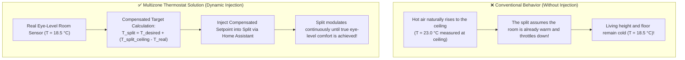

# Room Split Air Conditioners

BETA

Phase 11 allows each thermal zone to bind an individual room split air conditioner (`climate.*`), orchestrating it in harmony with hydronic radiators and zone valves.

---

## 1. The Ceiling Stratification & Sensor Problem

All commercial split air conditioning indoor units (Daikin, Mitsubishi, Gree, Haier, Samsung, Panasonic, etc.) measure room air temperature directly inside the unit mounted high on the wall near the ceiling.

### The Dynamic Injection Formula

When `split_sensor_injection: True` is enabled, Multizone Thermostat intercepts the ceiling probe reading and calculates the real-time offset compared to the room's true thermometer:

$$T_{\text{split\_injected}} = T_{\text{desired}} + \left(T_{\text{split\_sensor}} - T_{\text{real\_sensor}}\right)$$

#### Practical Example
* **Desired Room Temperature**: 20.5 °C
* **Real Measured Temperature at Eye Level**: 19.0 °C (room is still cold)
* **Temperature Measured by Ceiling Split Sensor**: 22.0 °C (heat pooled near ceiling)
* **Calculation**: $T_{\text{split\_injected}} = 20.5 + (22.0 - 19.0) = 23.5\ ^\circ\text{C}$
* **Result**: Multizone Thermostat commands the split unit to target 23.5 °C. The split continues heating until the eye-level sensor reaches 20.5 °C, eliminating cold feet and temperature swings.

---

## 2. Quick Heat Boost (Thermal Shock)

When a room starts cold with a significant temperature gap:

1. **Boost Trigger**: If $\Delta T = (T_{\text{target}} - T_{\text{ambient}}) \ge 1.5\ ^\circ\text{C}$ (configurable via `split_boost_delta`), the system fires both hydronic radiators and the split unit at full capacity (**Dual Heat**).
2. **Rapid Warm-up**: Forced warm air circulates the room volume, reducing warm-up times by 60–70%.
3. **Graceful Exit**: Once the room is within 0.3 °C of the setpoint, the split unit powers down softly.
4. **Silent Maintenance**: Steady-state maintenance is handled exclusively by silent low-temperature radiators, eliminating fan noise and draft currents while occupied.

---

## 3. Automatic Hydronic Decoupling

When a room split is actively heating (via solar surplus, boost, or manual run):
* Multizone Thermostat **suppresses hydronic gas demand for that specific room to `0.0%`**.
* The zone valve or thermostatic radiator valve (TRV) closes.
* The central gas boiler consumes zero fuel for that room.
* Other rooms without split units continue to be heated normally by hydronics without disturbance.

---

## 4. Single-Room Split Manual Button

On the Lovelace **Dial Card**, centered in the header, is a dedicated split button:

* **Smart Visibility**: Appears only in rooms configured with a split unit (`split_climate_entity`).
* **Operation with Central Heating OFF**:
  * Tapping the button when central heating is OFF turns on **only the electric split** for that room.
  * The gas boiler and hydronic circulators remain off (`switch.caldaia: off`).
  * The card immediately displays the **`⚡ ELECTRIC`** badge and cyan glow.
* **Master ON Safety Lockout**:
  * When central heating is ON, the button is disabled to prevent accidental clicks from interfering with whole-house orchestration.
* **Automatic Resync**:
  * Turning ON master heating resets the local override and aligns the room with the global household preset.

---

## 5. Operational Roles

Configured via the `split_role` parameter:
* **`heat_cool` (All Year)**: Operates for winter heating support and primary summer air conditioning.
* **`heating_only` (Winter Only)**: Assists radiators or absorbs solar surplus; idle in summer.
* **`cooling_only` (Summer Only)**: Reserved exclusively for summer cooling (never engages in winter).
