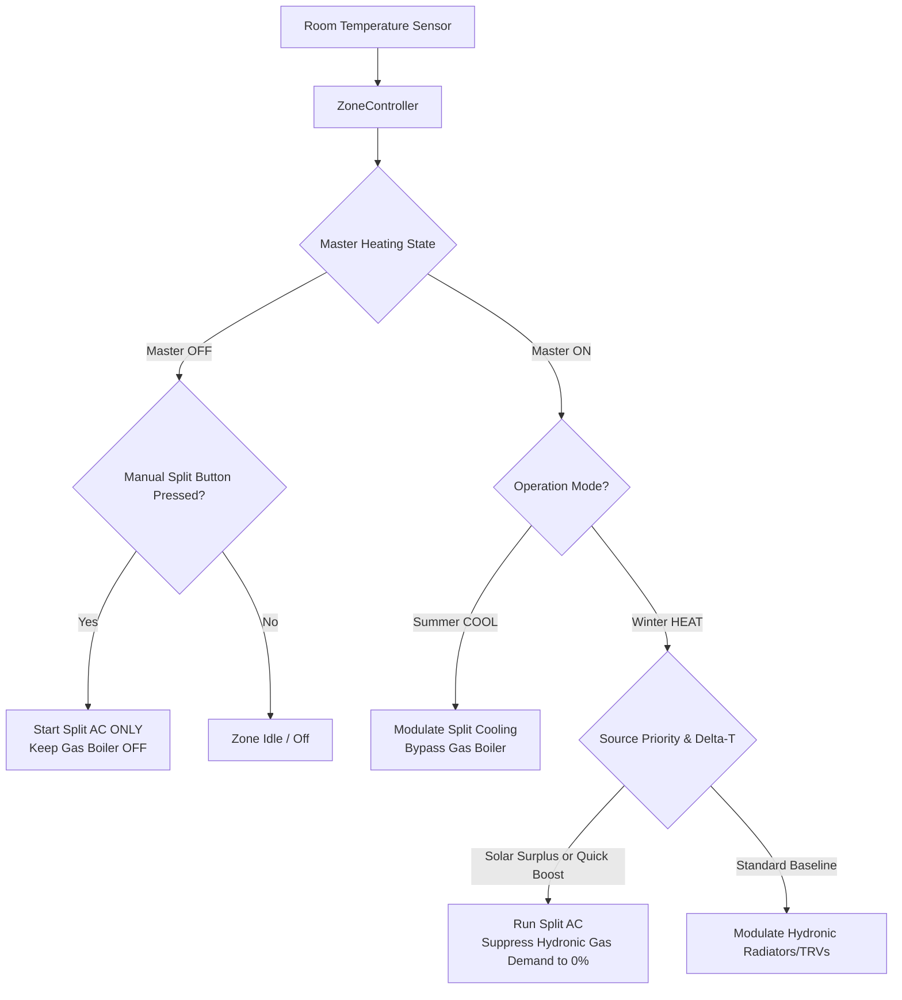

# Hybrid Plant, Room Split AC & Energy Management Guide

[⬅️ Back to Main Readme](README.md) • [⚙️ Configuration Guide](configuration.md) • [🎨 Cards Guide](cards.md)

> [!IMPORTANT]
> **Phase 11 (v6.1.0-beta)** introduces a comprehensive climate and energy architecture supporting bivalent heating plants, per-room air-to-air split integration, off-grid and solar self-consumption optimization, and dual-track seasonal regulation (Heat & Cool).

---

## 1. Bivalent Central Plant (Boiler + Hydronic Heat Pump)

### How It Works
The central plant engine (`PlantOrchestrator`) is no longer restricted to a single fuel boiler. It supports independent or concurrent orchestration of:
1. **Gas / Fuel Boiler**:
   - Controlled via **ON/OFF Relay** (PWM cycles) or **Modulating OpenTherm** (sliding water flow setpoint).
2. **Central Hydronic Heat Pump (PDC)**:
   - Controllable via:
     - `climate.*`: water setpoint modulation + `heat`/`cool`/`off` mode switching.
     - `switch.*`: dry contact or **Smart Grid Ready (SG-Ready)** input.
     - `number.*`: flow setpoint regulation via bus / OpenTherm / Modbus.
   - **Summer Reversibility (`heat_pump_cooling`)**: in Cooling mode, manages chilled water circulation (e.g., radiant floor cooling with dehumidifiers or fancoils), strictly locking the gas boiler to `0%`.

### Orchestration & Heat Source Priorities
Configurable via the Lovelace preset card or through `select.master_control_heat_source_priority`:
- **`auto`**: Gas boiler provides baseline heating; switches to Heat Pump and Room Splits during **Free Solar Surplus**, EMHASS/Predbat schedule, or **Quick Heat Boost**.
- **`hybrid`**: Rooms with Split AC heat via split **only if solar surplus is active**; when solar energy fades, they automatically fall back to hydronic radiator heating to preserve battery reserves.
- **`combined`**: Gas boiler maintains hydronic baseline, while the Heat Pump and Splits kick in during **Solar Surplus** or **Thermal Shock ($\Delta T \ge 1.5^\circ\text{C}$)** for rapid warm-up, turning off once comfort is achieved.
- **`electric_only`**: Zero gas consumption forced (gas boiler locked at 0%). 100% heat demand directed to the Heat Pump and Splits. Suitable for all-electric homes.
- **`gas_only`**: Electric splits and heat pump disabled in heating mode; all heating handled by gas.

---

## 2. Room Split AC Integration

Each thermal zone can bind an individual room air conditioner (`climate.*`) to work in concert with radiators.

### Operational Roles
- `heat_cool`: Year-round support (heating in winter, cooling in summer).
- `heating_only`: Winter heating support only.
- `cooling_only`: Summer air conditioning only.

### Ceiling Sensor Bypass (Real Temperature Injection)
Split AC indoor units measure air temperature at ceiling height, where hot air accumulates prematurely, causing the unit to throttle down before the room is warm.
Multizone Thermostat dynamically injects a mathematically compensated setpoint into the split based on the **real external room sensor** located at eye/living height:
$$T_{\text{split\_target}} = T_{\text{desired}} + (T_{\text{split\_sensor}} - T_{\text{real\_sensor}})$$
This guarantees accurate room comfort without thermostat hunting.

### Quick Heat Boost (Thermal Shock)
When a room starts cold ($\Delta T = T_{\text{target}} - T_{\text{current}} \ge 1.5^\circ\text{C}$):
1. The split starts at maximum heating output alongside radiators (**Dual Heat**).
2. Once the room reaches comfort threshold ($\Delta T \le 0.3^\circ\text{C}$), the split turns off gracefully, leaving steady maintenance to hydronic radiators.

### Automatic Hydronic Decoupling
When a room split is actively heating the room (via solar surplus, boost, or manual run), the room's hydronic demand toward the central boiler is suppressed to `0.0%`, closing the zone valve/TRV and saving gas.

---

## 3. Solar Self-Consumption, Off-Grid & Battery Safeguards

Designed for grid-tied systems, zero-export feed-in limitation, and fully off-grid systems.

### Off-Grid & Inverter Clipping Detection
Does not require a grid export sensor. If no export is detected or configured, the system evaluates:
- **Battery SoC** $\ge 95\%$
- **PV Generation** $\ge 300\text{ W}$
- **Battery State** = idle / absorbing
Surplus is triggered **before** the inverter throttles solar panel generation (curtailment/clipping).

### Battery Anti-Discharge Safeguard (`battery_max_discharge_time`)
If household loads or clouds cause continuous battery discharge ($> 150\text{ W}$) for longer than the configured timeout (default: 5 minutes):
- Solar surplus mode is immediately deactivated.
- Electric heating (splits/heat pump) throttles down.
- The gas boiler automatically resumes baseline heating, safeguarding battery reserve for night-time use.

### Battery Minimum Reserve SoC (`battery_min_reserve_soc`)
Configurable threshold (e.g. 50% - 85%). Electric solar heating is strictly locked out if the battery falls below this level.

### External AI Optimizer Bridge (EMHASS / Predbat)
Integrates seamlessly via `external_solar_override_entity`:
- Accepts boolean inputs (`on`, `true`, `active`, `boost`).
- Accepts numeric deferrable load powers (`sensor.p_deferrable0 > 0 W`).

### Solar Thermal Pre-Storage (`solar_overheat_offset`)
Allows rooms with splits to overheat by a configurable offset ($0.0^\circ\text{C} \dots +3.0^\circ\text{C}$) during peak free solar hours, banking thermal energy directly into building walls and floors.

### Compressor Anti-Chatter Protection (`solar_min_run_time`)
Enforces a minimum continuous run time (default: 10 minutes) on heat pump and split compressors to prevent wear from transient cloud cover.

---

## 4. Dual-Track Seasonal Engine (Heat & Cool)

### Seasonal Commutation
The Master switch bar toggles the entire house between **Winter (Heating)** and **Summer (Cooling)**.

### Dual-Track Presets
Presets (*Comfort, Eco, Sleep, Away, Manual*) are stored on two completely isolated storage tracks:
- `presets_heat`: winter target temperatures and zone modes.
- `presets_cool`: summer target temperatures and zone modes.
Switching seasons instantly restores the correct temperature setpoints without manual readjustment.

### Dual-Track PID & Passive Cooling Autotuner
Hydronic cooling (radiant floor or fancoils) has vastly different thermal inertia and heat transfer dynamics compared to winter heating ($\Delta T_{\text{water}} \approx 7-10^\circ\text{C}$ in summer vs. $30-40^\circ\text{C}$ in winter):
- `ZoneController` maintains separate PID engines: `_pids_heat` and `_pids_cool`.
- The **Passive Autotuner** features an observer dedicated to cooling curves (`mode="cool"`), deriving optimal $Kp, Ki, Kd$ parameters for cooling cycles.

---

## 5. Summary Configuration Reference

| Parameter | Configuration Key | Default | Description |
|---|---|---|---|
| Gas Heater Enable | `enable_gas_heater` | `True` | Enable central gas boiler |
| Heat Pump Enable | `enable_heat_pump` | `False` | Enable central hydronic heat pump |
| Heat Pump Type | `heat_pump_type` | `climate` | Control via `climate`, `switch`, or `opentherm` |
| Heat Pump Entity | `heat_pump_entity` | `None` | Entity ID of the central heat pump |
| Reversible Cooling | `heat_pump_cooling` | `True` | Enable chilled water cooling in summer |
| Split Climate Entity | `split_climate_entity` | `None` | Per-zone Room Split AC entity |
| Split Operational Role | `split_role` | `heat_cool` | `both`, `heating_only`, `cooling_only` |
| Split Sensor Injection | `split_sensor_injection` | `True` | Inject real room sensor target to bypass ceiling probe |
| Split Quick Boost Delta | `split_boost_delta` | `1.5°C` | Delta-T threshold for thermal shock start |
| Solar Management | `energy_management_enabled` | `False` | Enable solar & battery optimization |
| Solar Power Sensor | `solar_power_sensor` | `None` | Real-time PV generation sensor (W) |
| Grid Export Sensor | `grid_export_sensor` | `None` | Grid feed-in sensor (W) |
| Battery SoC Sensor | `battery_soc_sensor` | `None` | Battery charge state sensor (%) |
| Battery Power Sensor | `battery_power_sensor` | `None` | Battery charge/discharge power sensor (W) |
| Solar Export Threshold | `solar_export_threshold` | `500 W` | Minimum export power to trigger surplus |
| Battery Min Reserve SoC | `battery_min_reserve_soc` | `20.0%` | Minimum battery charge to permit electric heating |
| Battery Max Discharge | `battery_max_discharge_time` | `5 min` | Max continuous battery discharge before gas fallback |
| Solar Min Run Time | `solar_min_run_time` | `10 min` | Minimum cycle duration to prevent compressor short cycling |
| Solar Overheat Offset | `solar_overheat_offset` | `0.0°C` | Room target boost during solar surplus |
| External Solar Override | `external_solar_override_entity` | `None` | EMHASS deferrable load or Predbat signal entity |
